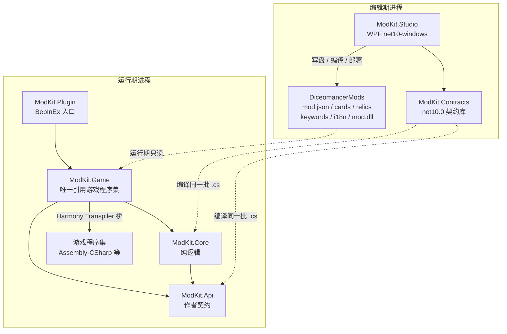
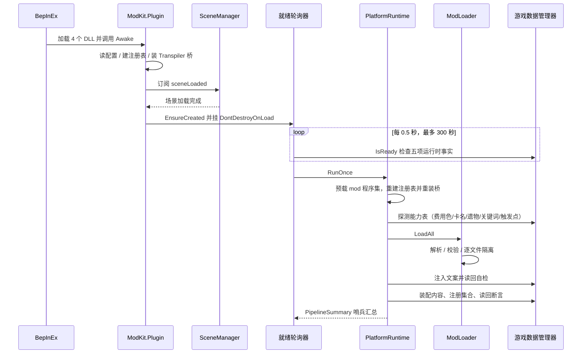

# DICEOMANCER ModKit 实施报告

| 项目 | 值 |
|---|---|
| 报告日期 | 2026-10-20 |
| 报告对象版本 | 0.2.2（`Directory.Build.props:5`） |
| 代码基线 | `4170b0b`（`master`，2026-10-20 01:12:14 +0800） |
| 实机证据截止 | 2026-10-20 00:50:27（`LogOutput.log` 修改时间） |
| 报告范围 | 仓库 `G:\Modkit`、发布产物 `dist/`、实机安装 `G:\deepseek space\DICEOMANCER\BepInEx\`、旧工具链 `G:\deepseek space\diceomancermod\modkit\` |
| 证据口径 | 本文结论均带「文件:行」「命令」或证据编号 `E-xx`（见附录 B）；未验证项显式标为「待验证」，不写成结论。 |
| 用词约定 | **平台**＝平台四件套（Api/Core/Game/Plugin），**插件**只指 `ModKit.Plugin` 这个 BepInEx 入口，**Studio** 指 WPF 编辑器；**mod** 与「模组」同义——正文统一写 mod，仅在引用 Studio 界面文案时保留「模组」（如「模组图鉴」「新建/删除模组」）；**装配**＝把 JSON 变成游戏对象并注册，**注册**＝写入游戏数据库/本地化表，两者不混用。 |

## 目录

- [0. 执行摘要](#0-执行摘要)
- [1. 项目现状](#1-项目现状)
  - [1.1 项目定位](#11-项目定位)
  - [1.2 仓库形态与代码基线](#12-仓库形态与代码基线)
  - [1.3 源码树与已发行 DLL 的对应关系](#13-源码树与已发行-dll-的对应关系)
  - [1.4 版本与发布状态](#14-版本与发布状态)
  - [1.5 验收状态：已实机验证 / 仅编译未实机 / 未验证](#15-验收状态已实机验证--仅编译未实机--未验证)
  - [1.6 文档清点与已知漂移](#16-文档清点与已知漂移)
  - [1.7 本步结论](#17-本步结论)
- [2. 架构](#2-架构)
  - [2.1 分层与依赖方向](#21-分层与依赖方向)
  - [2.2 模块地图](#22-模块地图)
  - [2.3 启动：从 BepInEx 到读回](#23-启动从-bepinex-到读回)
  - [2.4 数据流：从磁盘到游戏对象](#24-数据流从磁盘到游戏对象)
  - [2.5 Studio 与发布链的位置](#25-studio-与发布链的位置)
  - [2.6 边界声明：平台不做什么](#26-边界声明平台不做什么)
  - [2.7 架构结论](#27-架构结论)
- [3. 技术路线](#3-技术路线)
  - [3.1 技术前提：四个约束收窄了可选空间](#31-技术前提四个约束收窄了可选空间)
  - [3.2 五个支点](#32-五个支点)
  - [3.3 关键机制与证据档位](#33-关键机制与证据档位)
  - [3.4 替代方案取舍](#34-替代方案取舍)
  - [3.5 技术路线时间线](#35-技术路线时间线)
  - [3.6 成熟度矩阵](#36-成熟度矩阵)
  - [3.7 技术路线明确不覆盖的范围](#37-技术路线明确不覆盖的范围)
  - [3.8 这条路线的三个不可逆假设](#38-这条路线的三个不可逆假设)
- [4. 已确认缺陷审计](#4-已确认缺陷审计)
  - [4.0 判定口径](#40-判定口径)
  - [4.1 P0 · 阻断构建与发布可追溯性](#41-p0--阻断构建与发布可追溯性)
  - [4.2 P1 · 会在真实使用中造成静默错误、静默降级或不可逆动作](#42-p1--会在真实使用中造成静默错误静默降级或不可逆动作)
  - [4.3 P2 · 工程债：不直接出错，但持续抬高回归成本](#43-p2--工程债不直接出错但持续抬高回归成本)
  - [4.4 已确认不是 bug 的误报](#44-已确认不是-bug-的误报)
  - [4.5 待验证疑点（需要实验，**不计入**缺陷数）](#45-待验证疑点需要实验不计入缺陷数)
  - [4.6 严重度汇总](#46-严重度汇总)
- [5. 风险登记册](#5-风险登记册)
  - [5.0 等级矩阵与判定口径](#50-等级矩阵与判定口径)
  - [5.1 风险总表](#51-风险总表)
  - [5.2 逐条登记](#52-逐条登记)
  - [5.3 三条"最可能先发生"的失效链](#53-三条最可能先发生的失效链)
  - [5.4 监控信号（为第 6 章维护手册提供输入）](#54-监控信号为第-6-章维护手册提供输入)
  - [5.5 必须处理 vs 接受的风险](#55-必须处理-vs-接受的风险)
  - [5.6 与第 4 章的边界（去重说明）](#56-与第-4-章的边界去重说明)
- [6. 维护与演进](#6-维护与演进)
  - [6.0 路径变量与运行壳](#60-路径变量与运行壳)
  - [6.1 环境清单](#61-环境清单)
  - [6.2 构建矩阵](#62-构建矩阵)
  - [6.3 测试与验收](#63-测试与验收)
  - [6.4 发布 SOP](#64-发布-sop)
  - [6.5 回滚 SOP](#65-回滚-sop)
  - [6.6 扩展点指南](#66-扩展点指南)
  - [6.7 故障排查表](#67-故障排查表)
  - [6.8 文档与技术债治理](#68-文档与技术债治理)
- [7. 结论与建议](#7-结论与建议)
  - [7.1 五条按优先级排序的行动](#71-五条按优先级排序的行动)
  - [7.2 不建议现在做的清单](#72-不建议现在做的清单)
  - [7.3 维护者接手第一周的最小闭环](#73-维护者接手第一周的最小闭环)
  - [7.4 本报告的交付说明](#74-本报告的交付说明)
- [附录 A 证据命令清单](#附录-a-证据命令清单)
  - [附录 A.2 第 4 步（缺陷审计）复核命令](#附录-a2-第-4-步缺陷审计复核命令)
  - [附录 A.3 第 7 步（汇总校对）复核命令](#附录-a3-第-7-步汇总校对复核命令)
- [附录 B 证据编号索引](#附录-b-证据编号索引)

## 0. 执行摘要

**一句话定位**：ModKit 0.2.2 是一个已能在实机跑通「加载 → 校验 → 装配 → 读回」全链路的 mod 内容平台，**核心能力可用，发布链不可信**。成熟度判定：**可玩、可用，但不可复现、不宜在现有工程状态下扩容**。

**三个最强项（均有实机证据，不是编译通过）**：

1. **基础内容面已闭环**：卡牌、遗物、能力、文案注入、自定义 C# 效果五项在 2026-10-11 的验收中全部实机通过（`docs/Mod平台设计.md:232-236`），21/21 自定义效果可用（`docs/ModKit-能力缺口与下一步.md:31`）。
2. **最复杂的职业功能能打完一局**：新色球「奶蛙」Stage 1 走完「选球 → 拖球 → 介绍 → 开局牌组 → 战役地图」，由用户在 2026-10-15 深夜至 16 日凌晨完整打完一局（`handoff/PLAN.md` 对应段落），这是整套技术路线里最难的一段接缝（`ColorE` 无 `Black` 成员，只能追加枚举值）。
3. **当前构建的装配与读回是自证的**：一次启动装载 13 卡 / 2 遗物 / 2 关键词，读回 13/13 张卡、2/2 件遗物按名可取，职业装配完成，装配错误 0（`LogOutput.log:373`、`:407`、`:410`、`:416`）；Studio 侧实测 12.03 s、0 警告 0 错误（6.2 C0）；旧工作树测试 135/135 通过（6.3）。

**三个最需要先处理的问题**：

1. **仓库建不出已发行的平台**：`ClassApi.cs` 有引用无定义（B-01）、无任何 `.csproj` 与平台构建脚本（B-02），Plugin/Tests/Tools 三个工程从未进入本仓库版本控制。后果是「改一行平台代码」实际不可行，全部知识压在一台机器上的旧工作树里，旧树一丢即失传（R-13）。
2. **发布物与源码无法对应**：平台包 DLL 取自体机已安装目录且无任何校验（B-03）；同一 0.2.2 下存在四个不同的 `ModKit.Game.dll`（B-04）；`SHA256SUMS.txt` 与平台包不同批（B-16）；Studio 一键部署会用旧 payload 覆盖新安装目录，界面仍显示「更新」（B-04）。
3. **静默失败仍在发生**：卡面导出把 534 张全计为失败而 `error` 全为 `null`（B-13）、装配错误只打数量不打正文（B-14）、清单未声明的卡文件被无声忽略（B-15）；发布脚本默认 `v0.1.0` 且带两处 `git push -f`（B-06），一次误跑即不可逆地覆盖远端历史。

**一句话建议**：**先恢复「可构建、可追溯发布」，再谈新功能**——即 6.8.2 的迭代 1 与迭代 2（约 4–5 周）。在此之前不新增内容特性、不动游戏侧补丁点，因为任何新增都无法验证、也无法安全发出去。

## 1. 项目现状

本章回答"这个仓库现在到底是什么样"。结论按四个维度分节：项目定位与分层约定（1.1）、仓库形态与代码基线（1.2）、**源码树与已发行 DLL 的对应关系（1.3，全报告最重要的一条现状事实）**、版本与发布状态（1.4）。后半部分刻意分开三类陈述：验收档位（1.5，哪些算实机验证）、文档清点与漂移（1.6，D-01…D-12）、本章结论（1.7）。凡"能跑"与"能重建"在本章是两件事，不能互相替代。

### 1.1 项目定位

ModKit 是 Steam 游戏 DICEOMANCER（骰子浪游者）的 mod 内容平台。它把游戏原本「按名字拼字符串 → 查类型 → 造实例」的内容查找接缝接管，替换为一条带解析、校验、装配与读回断言的公开 API；作者用 JSON 声明卡牌、遗物、关键词与文案，需要特殊行为时再写少量 C#（`README.md:7`、`README.md:64-70`）。

面向两类使用者：玩家下载平台包即可运行别人做的 mod；作者使用图形化编辑器 ModKit Studio 制作内容（`README.md:13-18`）。仓库代码为 MIT；发布包不含游戏素材，平台运行时也不落盘游戏素材（`README.md:84-88`）。

分层与仓库目录在 README 中有明确约定：`src/ModKit.Api` 零游戏依赖，`src/ModKit.Core` 负责解析/校验/注册表，`src/ModKit.Game` 是唯一引用游戏程序集的层，`studio/` 为 WPF 编辑器并直接编译 Api+Core 源码，`schemas/` 为内容 JSON 契约（`README.md:62-70`）。该约定与当前 `src/` 的实际目录一致（`src/` 下只有 `ModKit.Api`、`ModKit.Core`、`ModKit.Game` 三个目录，E-03）。

### 1.2 仓库形态与代码基线

当前工作区 `G:\Modkit` 是独立 git 仓库：分支 `master`，HEAD `4170b0b`，共 29 个提交，跟踪文件 135 个（E-01、E-02）。按顶层目录统计：`src/` 63、`examples/` 32、`studio/` 16、`docs/` 14、`schemas/` 3、`lib/` 1、根目录 6（`README.md`、`CHANGELOG.md`、`LICENSE`、`Directory.Build.props`、`.gitignore`、`.gitattributes`）。`dist/`、`studio/bin/`、`studio/obj/`、`nuget-local/`、`voxel-art/` 均被 `.gitignore` 排除（`.gitignore:2-16`），因此发布产物与构建中间物不在版本控制内。

本地 `master` 领先 `origin/main` 18 个提交，落后 0 个（`git rev-list --left-right --count master...origin/main` → `18	0`，E-01）。`origin/main` 停在 `e2caac9`，该提交即 `v0.2.1` 标签；`v0.2.2` 标签指向 `a2807df`（2026-10-19 17:01:29），其后再有 17 个提交未发布（E-01）。`git ls-remote --tags origin` 在 21 秒后以 `Failed to connect to github.com:443` 失败，因此**远端 Release 的实际发布状态待验证**，本报告不把「v0.2.2 已发布」写成结论。

仓库还有一份并存的旧工作树 `G:\deepseek space\diceomancermod`（含独立 `.git`，HEAD `b213196`，工作区存在未提交修改）。该目录下的 `modkit/` 是平台四层（Api/Core/Game/Plugin）与 Tests/Tools 工具链的**唯一完整副本**（E-05）。`G:\Modkit` 的首个提交为 `9a14a44 init: DiceomancerModkit（源码 + Studio + schemas + 文档）`，其历史中从未出现 `ModKit.Plugin`、`ModKit.Tests`、`ModKit.Tools` 或 `ClassApi.cs`（E-03）。因此本报告采用两个基线并分别注明：**代码基线 = `G:\Modkit` HEAD**；**平台构建基线 = 旧工作树 `G:\deepseek space\diceomancermod\modkit`**。

### 1.3 源码树与已发行 DLL 的对应关系

这是本报告最重要的一条现状事实：**当前源码树不能完整重建已发行的平台四件套**。

缺失清单（`G:\Modkit` 内不存在，E-03、E-05）：

- `src/ModKit.Plugin/`：BepInEx 插件入口（旧副本含 `ModKitPlugin.cs`、`ModKitBootstrap.cs`）；
- `src/ModKit.Api/ClassApi.cs`：`ClassSpec` 与 `IModClassProvider` 的定义；
- `src/ModKit.Tests/`：6 个测试源文件与 `TestRunner.exe`（86,528 B，旧副本 `bin/`）；
- `src/ModKit.Tools/`：7 个作者工具源文件（lint/new/pack）；
- 平台构建脚本 `build-api.ps1`、`build-core.ps1`、`build-game.ps1`、`build-plugin.ps1`、`build-tests.ps1`、`build-tools.ps1`、`build-modkit.common.ps1`；
- `capabilities.json`（旧副本 40,817 B，lint 的能力快照）。

契约完整性方面，当前树存在「有引用、无定义」：`src/ModKit.Game/CareerAssembler.cs:35-40` 使用 `ModKit.Api.ClassSpec` 作为列表与字典键，同文件 `:306`、`:354`、`:362-365` 使用 `IModClassProvider`；`CareerPicker.cs:39`、`:67`、`:78`、`:118`、`:413`、`:443` 与 `PlatformRuntime.cs:746` 同样依赖这两个类型（E-04）。定义只存在于旧副本 `ModKit.Api/ClassApi.cs:21`（`public sealed class ClassSpec`）与 `:79`（`public interface IModClassProvider`），以及示例 mod `examples/manual_demo/src/MilkFrogClass.cs:14` 的实现（E-04）。`git log --all -S "class ClassSpec"` 无输出，证明本仓库历史中也没有定义（E-03）。这不是笔误：已安装的 `ModKit.Api.dll` 内含 `ClassSpec` 与 `IModClassProvider` 字符串（E-16），说明**已发行 Api DLL 来自旧工作树，而不是当前 `src/`**。

产物对应关系如下（E-06、E-07、E-08）：

| 产物 | 实际来源/状态 | 与当前源码的关系 |
|---|---|---|
| `ModKit.Api.dll`（27,136 B，md5 `c3b392ba…`） | 与旧工作树 `modkit/bin/ModKit.Api.dll` 哈希相同 | 源码含旧副本 `ClassApi.cs`；当前 `src/ModKit.Api` 与旧副本同名文件均存在内容差异 |
| `ModKit.Core.dll`（92,160 B，md5 `65b85c31…`） | 与旧工作树 `modkit/bin/` 哈希相同 | 当前 `src/ModKit.Core` 有 3 个文件与旧副本存在实质差异 |
| `ModKit.Plugin.dll`（12,288 B，md5 `d9700025…`） | 与旧工作树 `modkit/bin/` 哈希相同 | **当前树没有任何 Plugin 源码，不可重建** |
| `ModKit.Game.dll` | 三份互不相同：实机安装 227,328 B/`188e2410…`（10-19 22:20）、平台包 223,232 B/`48f542bb…`（10-19 21:56）、Studio payload 211,456 B/`85062316…`（10-19 17:01） | 当前 `src/ModKit.Game` 最后提交时间 2026-10-19 22:20:01，与实机安装版时间吻合；但仓库内无 Game 构建脚本，无法复算 |
| `ModKit.Studio.exe`（132,238,436 B） | `dist/` Studio 包内，条目时间 10-19 17:01 | `studio/MainWindow.xaml.cs`、`MainWindow.xaml` 修改于 10-20 01:11–01:12，**包比源码旧**，未包含最新 UI 提交 |

由此可以给出可复核的结论：已发行的 Api/Core/Plugin 三件可追溯到旧工作树 `modkit/bin/`；Game 件在实机、平台包、Studio payload 三处是**三个不同构建**；Studio 包落后于当前源码。当前仓库只能复现 Studio 一侧（`studio/build.sh:1-6` 调 `dotnet build`，`studio/contracts/ModKit.Contracts.csproj:23-26` 把 `src/ModKit.Api/*.cs` 与 `src/ModKit.Core/*.cs` 编成契约库），不能复现平台四件套。

复现命令（与本步实际核对口径一致）：

```bash
# 1) Studio（当前仓库内唯一存在的构建链；本步未执行构建）
cd /g/Modkit && bash studio/build.sh
SELF_CONTAINED=1 WITH_BEPINEX=1 bash studio/pack.sh 0.2.2

# 2) 平台四件套：只能在旧工作树构建（源码不是 G:\Modkit）
cd "/g/deepseek space/diceomancermod/modkit"
powershell -NoProfile -ExecutionPolicy Bypass -File build-api.ps1
powershell -NoProfile -ExecutionPolicy Bypass -File build-core.ps1
powershell -NoProfile -ExecutionPolicy Bypass -File build-game.ps1
powershell -NoProfile -ExecutionPolicy Bypass -File build-plugin.ps1

# 3) 校验发布物
sha256sum /g/Modkit/dist/*.zip
unzip -l /g/Modkit/dist/ModKit-Platform-0.2.2.zip
md5sum "/g/deepseek space/DICEOMANCER/BepInEx/plugins/"*.dll
```

### 1.4 版本与发布状态

仓库统一版本号为 0.2.2（`Directory.Build.props:5`），`CHANGELOG.md:3` 的首节也是 `## v0.2.2`，本地标签 `v0.1.0`、`v0.2.0`、`v0.2.1`、`v0.2.2` 齐全（E-12）。版本一致性只在「包名/项目版本号/CHANGELOG」这一层成立；进入运行期后并不一致：实机日志首行是 BepInEx 5.4.23.5（`LogOutput.log:1`），加载的插件自报 `[DICEOMANCER ModKit (Mod 平台) 0.1.0]`（`LogOutput.log:14-15`），而旧副本 `ModKit.Plugin/ModKitPlugin.cs:37` 把 `PluginVersion` 硬编码为 `"0.1.0"`。即：**发行包标 0.2.2，插件运行时仍标 0.1.0**。

发布产物为 3 个 zip 加 1 个校验文件（E-06）。`dist/SHA256SUMS.txt` 只有 Platform 一项与实际不符：文件记录 `09cec961…`，实际 `8af9929f…`；Example 与 Studio 两项吻合。原因是 Platform 包在 10-19 22:04 被重建，而校验文件停留在 17:01（`ls -la --time-style=long-iso dist/`，E-06）。`README.md:15-18` 给出的是 v0.2.2 的 GitHub 下载链接，但本地 `master` 比 `origin/main` 多 18 个提交、`v0.2.2` 标签尚未推到远端（网络不可达，无法确认远端状态，待验证）。此外 `README.md:15-17` 标注的包体积（150 KB / 55 MB / 553 KB）与实际字节数（158,755 B / 56,912,059 B / 578,469 B）存在出入，属文案量级描述，不影响安装。

### 1.5 验收状态：已实机验证 / 仅编译未实机 / 未验证

三档状态按证据重新归并如下。「实机」只认游戏日志或明确的实机记录，不把编译成功、单测通过或打包成功算作实机。

| 能力/事项 | 档位 | 证据 |
|---|---|---|
| 卡牌：获得、打出、结算、中文名与费用显示 | 已实机验证 | `docs/Mod平台设计.md:232`（2026-10-11 验收） |
| 遗物：出现、描述、触发与效果 | 已实机验证 | `docs/Mod平台设计.md:233` |
| 能力：由卡施加、悬浮提示、效果生效 | 已实机验证 | `docs/Mod平台设计.md:234` |
| 文案注入：卡名/能力描述/遗物名显示 | 已实机验证 | `docs/Mod平台设计.md:235` |
| 自定义 C# 效果（`[ModEffect]`） | 已实机验证 | `docs/Mod平台设计.md:236`；`docs/ModKit-能力缺口与下一步.md:31`（21/21） |
| 职业/新色球「奶蛙」Stage 1 全链路 | 已实机验证 | 记忆白板 `handoff/PLAN.md`「2026-10-15 深夜→16 日凌晨」段（选球→拖球→介绍→开局牌组→战役地图，用户完整打完一局） |
| 平台加载、装配、读回断言、职业装配（当前构建） | 已实机验证（带回读数字） | `LogOutput.log:373`（加载 13 卡/2 遗物/2 关键词）、`:383`（错误 0/警告 7）、`:407`（卡按名可取 13/13）、`:410`（遗物 2/2）、`:416`（职业装配完成） |
| 关键词行为 | 仅编译/未实机 | `docs/Mod平台设计.md:237`、`:314`；日志仅证明类存在（`LogOutput.log:402`） |
| 其余 12 个内置语义 | 仅编译/未实机 | `docs/Mod平台设计.md:239`、`:315`；运行时逐条警告（`LogOutput.log:374-380`） |
| 0.2.x 新增 Studio 功能（新建/删除模组、职业选择面板、皮肤） | 未验证/待验证 | 最新 17 个提交（E-01）无对应实机记录；记忆日志对职业选择面板注明「编译 0 错误、尚未实机验证」 |
| 0.2.2 三个发布包「解压即装即用」 | 未验证 | 三处 Game.dll 不同（E-07）；无发布包安装后的日志或记录 |
| 明确未做：外置美术资源注入、运行期脚本、与其它类型查找 mod 共存 | 未做 | `docs/Mod平台设计.md:305-310` |
| 明确未做：剧情后果 `"Special"` 分支、显式骰子种类 | 未做 | `docs/Mod平台设计.md:316-319` |
| 「重开一局后内容是否仍在池中」 | 未验证 | `docs/Mod平台设计.md:319` |

实机日志同时暴露两类异常，均属已确认事实而非推断：

1. **卡面导出全量失败**：`LogOutput.log:362-370` 记录候选 534 张，进度行显示失败数逐百递增，最终「去重后图 0 张（新写 0，复用 0，失败 534），清单内 error 534」。导出耗时仅 197 ms，符合「每条立即失败」的表现。
2. **1 条装配错误且无明细**：`LogOutput.log:422-423` 汇总「装配[卡 13 / 遗物 2｜错误 1]」「本次运行有 1 条装配错误 —— 相关内容未加载」，但日志没有对应的逐条错误行。示例目录有 14 份 card JSON（E-14），运行期加载 13 张，`frog_song` 未出现在任何日志行；两者是否同一问题**待 Step 04 审计确认**，本报告只记录数量与缺席事实，不写根因。

机械基线方面，`docs/Mod平台设计.md:214-225` 记录「构建 6/6 退出码 0、规则断言 76/76、工具链 11/11、资产闸门 0、示例 lint 通过」，但当前仓库既无测试工程也无平台构建脚本（E-03、E-13），这组数字**无法从 `G:\Modkit` 复现**，只能视为历史记录。旧工作树的 `bin/TestRunner.exe`（86,528 B，2026-10-15 20:50）与 `ModKit.Tests` 6 个源文件是这套断言的现存载体（E-05、E-13）。

### 1.6 文档清点与已知漂移

`docs/` 被 git 跟踪的条目共 14 个：12 份 Markdown 加 `img/` 下 2 张安装截图（E-10）。另有未被跟踪的 `docs/mockups/` 14 个 UI 草图文件（本步开始前即存在，`git status` 显示为 `?? docs/mockups/`，非本步产生）。12 份 Markdown 合计 360,758 B，清单如下：

| 文档 | 字节 | 最后修改 |
|---|---:|---|
| `ModKit-P0-内容契约与API规格.md` | 30,787 | 2026-10-14 22:39 |
| `ModKit-P2-三类探针报告.md` | 11,528 | 2026-10-12 00:32 |
| `ModKit-Studio使用手册.md` | 12,456 | 2026-10-18 12:58 |
| `ModKit-作者手册.md` | 20,771 | 2026-10-18 12:58 |
| `ModKit-原版素材索引.md` | 118,973 | 2026-10-14 21:52 |
| `ModKit-原版遗物版图.md` | 18,533 | 2026-10-14 20:35 |
| `ModKit-效果字典.md` | 21,031 | 2026-10-18 12:58 |
| `ModKit-游戏API表面.md` | 28,375 | 2026-10-14 13:12 |
| `ModKit-能力缺口与下一步.md` | 38,663 | 2026-10-14 20:40 |
| `Mod平台设计.md` | 18,347 | 2026-10-14 22:39 |
| `游戏源码-机制补遗-2026-10-13.md` | 17,756 | 2026-10-13 19:20 |
| `源码研究报告.md` | 23,538 | 2026-10-14 22:39 |

相互引用关系：`README.md:53-55` 指向作者手册、Studio 手册、效果字典；`docs/Mod平台设计.md:340-350` 是文档索引，指向作者手册、P0 规格、P2 探针、源码研究；`docs/ModKit-P0-内容契约与API规格.md:4` 以上位的设计文档为准；`docs/ModKit-能力缺口与下一步.md:122`、`:236` 与 `docs/游戏源码-机制补遗-2026-10-13.md:91`、`:169` 双向引用；`原版素材索引` 自述为自足文档（`:153-156`）。

已确认的文档漂移（均应进入第 4 章缺陷审计或第 6 章维护项）：

| 编号 | 漂移事实 | 证据 |
|---|---|---|
| D-01 | `contracts` 项目注释写「编译成 net8.0」，实际 `TargetFramework` 为 `net10.0`；Studio 项目注释同样写 net8.0 | `studio/contracts/ModKit.Contracts.csproj:4-8` 对 `:12`；`studio/ModKit.Studio.csproj:23` |
| D-02 | 文档要求 BepInEx 5.4.23.2，实机运行的是 5.4.23.5 | `README.md:23` 对 `LogOutput.log:1` |
| D-03 | README 包体积 150 KB / 55 MB / 553 KB，实际 158,755 B / 56,912,059 B / 578,469 B | `README.md:15-17` 对 E-06 |
| D-04 | P0 文档引用 `modkit/ModKit.Game/ApiSurface.md`，两份工作树中均不存在 | `docs/ModKit-P0-内容契约与API规格.md:345`；`find` 无结果（E-17） |
| D-05 | 素材索引声称 493 张卡图已入库 `docs/art/`，实际该目录不存在，且被 `.gitignore` 排除 | `docs/ModKit-原版素材索引.md:27`、`:153-156`；`.gitignore:14` |
| D-06 | 设计文档 §6 的 6/6 构建、76/76 断言、11/11 工具链在当前仓库不可复现（无测试/平台构建脚本） | `docs/Mod平台设计.md:214-225`；E-03、E-13 |
| D-07 | 设计文档称「图形界面的作者工具（只有命令行）」明确不做，但 Studio 已于 2026-10-17 建成并持续提交 | `docs/Mod平台设计.md:308`；`studio/` 16 个跟踪文件（E-02） |
| D-08 | 发布脚本硬编码旧版本：`publish.sh` 固定 `v0.1.0` 与 0.1.0 文件名；`pack.sh` 默认版本 0.1.0 | `studio/publish.sh:16`、`:45-49`；`studio/pack.sh:14` |
| D-09 | 文档称 `docs/` 14 份文档；实际为 14 个跟踪条目 = 12 份 md + 2 张 png | E-10 |
| D-10 | 插件版本常量仍是 0.1.0，与包版本 0.2.2 不一致 | 旧副本 `ModKit.Plugin/ModKitPlugin.cs:37`；`LogOutput.log:14-15` |
| D-11 | 构建脚本硬编码绝对路径与 `dotnet.exe` 位置，换机即失效 | `studio/build.sh:2-3`、`studio/build-mod.sh:16`、`:21-22`、`studio/pack.sh:18-20` |
| D-12 | `dist/` 被忽略，发布物不在版本控制中，只能靠文件系统时间与哈希追溯 | `.gitignore:9`；`git ls-files dist` 为 0（E-02） |

### 1.7 本步结论

1. **代码基线明确但发布链不完整**：`G:\Modkit` HEAD `4170b0b` 是当前代码与文档基线，135 个跟踪文件、29 个提交；`master` 领先 `origin/main` 18 个提交（E-01、E-02）。
2. **平台四件套不能从当前仓库重建**：Plugin/Tests/Tools、`ClassApi.cs`、6 个 `build-*.ps1` 与 `capabilities.json` 全部缺失，且本仓库历史中从未存在；唯一完整副本在旧工作树 `G:\deepseek space\diceomancermod\modkit`（E-03、E-05）。
3. **存在「有引用、无定义」的契约断点**：Game 层多处引用 `ClassSpec`/`IModClassProvider`，定义只在旧副本 `ClassApi.cs`；已发行 `ModKit.Api.dll` 内确实含这两个类型，证明发行二进制来自旧工作树（E-04、E-16）。
4. **产物可追溯性差且彼此不一致**：`dist/` 不在 git 中；Platform 的 SHA256 记录已过期；实机、平台包、Studio payload 三处 `ModKit.Game.dll` 是三个不同构建；Studio 包落后于最新的 Studio 源码（E-06、E-07）。
5. **实机链路成立但带病运行**：2026-10-20 00:50 的日志证明加载、装配、读回、职业装配均跑通，同时存在卡面导出 534/534 全失败与 1 条无明细的装配错误（E-11）。
6. **验收档位必须分开陈述**：卡/遗物/能力/文案/自定义效果/职业 Stage 1 有实机证据；关键词与 12 个内置语义仍属「仅编译未实机」；0.2.x 新增 Studio 功能与三个发布包属「未验证」（见 1.5 表）。
7. **版本号存在三重漂移**：包/项目 0.2.2、插件运行时 0.1.0、文档要求 BepInEx 5.4.23.2 而实机 5.4.23.5（E-12、D-02、D-10）。
8. **文档体系规模可用但已滞后**：12 份 Markdown、360,758 B，核心作者文档与设计文档成形；设计文档 §6 机械基线与 §9「不做图形工具」已与现状冲突（D-06、D-07）。
9. **远端发布状态待验证**：本地 `v0.2.2` 标签存在，但 GitHub 不可达，README 中的 v0.2.2 下载链接是否可用无法在本步确认（E-01）。

## 2. 架构

本章只写**结构**，不评价好坏（评价在 §3、缺陷在 §4）。顺序是：分层与依赖方向（2.1）→ 模块地图（2.2）→ 两条运行时序——启动注入（2.3）与数据流（2.4）→ 发布链在架构里的位置（2.5）→ 平台明确不做什么（2.6）→ 架构层面的结论（2.7）。两张 Mermaid 图分别对应 2.1 的静态依赖与 2.3 的动态时序，节点名与本节用词一一对应。

### 2.1 分层与依赖方向

平台的分层依据不是功能，而是**一条可机械检查的规则**：只有最底层可以引用游戏程序集。运行期是 4 个程序集（Api/Core/Game/Plugin，其中 Plugin 是 BepInEx 入口），编辑期是 1 个 WPF 应用加 1 个契约库，依赖方向单向、无环：`Plugin → Game → Core → Api`，`Studio → Contracts（= Api + Core 的同一批源码）`；运行期不引用 Studio。

| 层 | 目录 | 职责 | 允许依赖 | 禁止依赖 | 当前仓库状态 |
|---|---|---|---|---|---|
| 契约层 | `src/ModKit.Api` | 作者可见契约：JSON 定义模型、效果上下文、`[ModEffect]`、`ModEntry` | 仅 BCL（`System.*`） | 任何游戏类型、`UnityEngine`、Harmony | 6 个 `.cs`，在库 |
| 核心层 | `src/ModKit.Core` | 解析、校验、加载、类注册表、命名表、WAV 解码 | BCL、`Newtonsoft.Json`、`ModKit.Api` | 游戏类型、`UnityEngine`、Harmony | 20 个 `.cs`，在库 |
| 游戏层 | `src/ModKit.Game` | 探测、克隆装配、桥、本地化注入、图鉴、职业、重建守卫、诊断导出 | 游戏程序集、Unity、Harmony、`Api`、`Core` | 无（本层就是边界） | 37 个 `.cs`，在库 |
| 插件层 | `src/ModKit.Plugin` | BepInEx 入口、配置项、`sceneLoaded` 订阅、就绪轮询器 | `Game`、BepInEx、Unity | 直接写内容逻辑 | **源码不在本仓库**（E-03、E-05） |
| 编辑层 | `studio/` | WPF 三栏编辑器、C# 编译、部署、打包脚本 | `Contracts`、WPF、BCL | 游戏程序集 | 16 个跟踪文件，在库 |
| 契约库 | `studio/contracts/` | 把 `src/ModKit.Api/*.cs` 与 `src/ModKit.Core/*.cs` 编成 `ModKit.Contracts` | 同一批源文件 | 自持一份副本 | 在库，`net10.0` |

Api 与 Core 的「零游戏引用」是可复核的，不靠注释自觉：在两层目录执行 `grep -rn "^using UnityEngine\|^using Card;\|^using Relic;\|^using Combat\|^using HarmonyLib" src/ModKit.Api src/ModKit.Core` 无任何命中（本步实际执行，无输出）；`src/ModKit.Api/Contracts.cs:4-9` 写明只允许 BCL、引用游戏即编译失败，`src/ModKit.Core/Capabilities.cs:4-8` 写明本程序集是纯逻辑。Core 把磁盘 IO 抽成 `IModFileSource`、由 `src/ModKit.Game/DiskFileSource.cs:1-14` 实现，因此加载与校验可以在没有游戏的机器上跑回归。Game 层有 26 个文件命中 `UnityEngine`，是唯一与游戏同进程耦合的编译单元。

插件层的源码缺口是架构事实而非细节：当前仓库 `src/` 下只有 Api/Core/Game 三个目录，`ModKit.Plugin` 在本仓库历史中从未出现（E-03）；完整副本只在旧工作树 `G:\deepseek space\diceomancermod\modkit\ModKit.Plugin\`（E-05）。因此 2.3 节的入口时序以旧副本与已发行 DLL 的运行日志为准，并在每处标明来源。当前仓库可复现的只有 Studio 一侧（1.3）。

`studio/contracts/ModKit.Contracts.csproj` 是消除「规则漂移」的机构：`:24-25` 用 `<Compile Include="..\..\src\ModKit.Api\*.cs" />` 与 `..\..\src\ModKit.Core\*.cs` 把同一批源文件编成契约库，Studio 在 `studio/ModKit.Studio.csproj:24` 以 `ProjectReference` 引用它。这样 Studio 的表单枚举、校验规则、效果名表与当前 Api/Core 源码**同源**，不会出现「编辑器放行、游戏拒绝」或反过来的分裂。它不消除另一类不一致：Studio 二进制包与 Studio 源码之间存在版本差（1.3、E-06）。该 csproj 的注释仍写「编译成 net8.0」（`:4-8`），实际 `TargetFramework` 为 `net10.0`（`:12`），属已登记漂移 D-01。



### 2.2 模块地图

按子域列文件组与职责。Game 层 37 个文件、Core 20 个文件，规模最大的是图鉴（`ModCompendium.cs` 1606 行）与能力探测（`GameCapabilitiesProbe.cs` 1623 行）；后者把「探测」和「诊断 dump」合在一处，是排查「作者说没效果」的第一入口。

| 子域 | 文件组 | 职责 |
|---|---|---|
| 编排与运行环境 | `PlatformRuntime.cs`、`DiagnosticSwitches.cs`、`GameLog.cs`、`DiskFileSource.cs` | 六步流水线、哨兵汇总、配置开关、只读文件源 |
| 加载与校验 | `ModLoader.cs`、`ModLoader.Abilities.cs`、`ContentParser*.cs`、`ContentValidator*.cs`、`Capabilities.cs`、`GameFacts.cs` | 清单与五类内容文件的解析、逐字段校验、逐文件失败隔离、mod 内 id 唯一性与跨卡引用检查 |
| 类名与注册表 | `ContentRegistry.cs`、`ConventionNames.cs`、`Names.cs`、`TriggerTypeNames.cs`、`TriggerFieldNames.cs` | 把「原始 id」归一到游戏约定的类名；跨程序集解析 `Type.GetType` 目标；效果/能力/触发点命名表 |
| 内容装配 | `ContentAssembler.cs` 及 6 个 partial（Cards/Relics/Abilities/CardPools/CardRegistration/Effects/RebuildReapply） | 克隆原版 SO、反射写回 `CardInfo`/`RelicInfo`、注册进游戏数据库、读回断言、重建后重放 |
| 游戏接缝 | `TranspilerBridge.cs`、`SummonHook.cs`、`CareerPatch.cs`、`ModCompendiumJump.cs` | 4 个内容工厂的 `Type.GetType` 替换、召唤物命名、第 6 颗色球、图鉴跳转 |
| 效果与能力 | `src/ModKit.Api/Effects.cs`、`EffectContext.cs`、`ContentDefs.cs`；`CustomEffectRuntime.cs`、`EffectSp*.cs` | 作者可见的内置语义与自定义效果上下文；平台自建效果类 |
| 本地化 | `LocalizationPump.cs`、`LocalizedTextDump.cs`、`AbilityNameDump.cs` | 写入本地化表并强制 `IsSmart`；读回自检；整表/能力名导出 |
| 图鉴 | `ModCompendium.cs`、`ModCompendiumJump.cs` | 自建「模组图鉴」UI，只列 mod 内容；悬停解释走后置补丁 |
| 职业与色球 | `CareerAssembler.cs`、`CareerPicker.cs`、`CareerOrbDriver.cs`、`CareerPatch.cs` | 新职业三件事（Class 集合、`StartColorESDecks`、介绍卡）；启用原版未启用的 Black |
| 音效与美术 | `ModAudio.cs`、`ModArt.cs`、`CardArtExporter.cs`、`UiSkin.cs`、`src/ModKit.Core/WavDecoder.cs` | 原版音效名 → FMOD、自带 wav → Unity AudioSource；自带卡面 PNG → Sprite；程序化 UI 皮肤 |
| 诊断与验收 | `CapabilitiesDump.cs`、`RenderProbe.cs`、`VerificationGrant.cs`、`Reflect.cs` | 能力表原子落盘、卡面渲染探针、首战发牌验收、反射工具 |
| Studio | `MainWindow.xaml(.cs)` + `ModCompiler.cs`、`Deployer.cs`、`KeywordClassEditor.cs`、`StudioConfig.cs` | 三栏编辑、JSON 保存、i18n 同步、C# 编译、备份部署 |
| 契约文档 | `schemas/card@1.json`、`relic@1.json`、`i18n@1.json` | 声明期契约：`$schema` 常量的权威定义与字段形状 |

契约文档与代码里的 schema 集合不对称：`ContentValidator.cs:36-40` 定义了 6 个 schema id（card/relic/keyword/ability/i18n/mod），`schemas/` 只有 3 个文件，`keyword@1`、`ability@1`、`mod@1` 没有对应的 JSON Schema。运行期不读这些文件，因此不影响装配与校验；不对称只落在作者侧契约文档的覆盖面上。

三个关键锚点：

1. `src/ModKit.Game/PlatformRuntime.cs:4-29` 是全仓唯一把「六步顺序、文案先于装配、探测等运行时、失败隔离」写在一起的文件头；它既是实现说明，也是本节的结论来源。
2. `src/ModKit.Core/ContentRegistry.cs:1-23` 解释为什么必须有注册表：游戏的 `Type.GetType(string)` 只搜索调用方程序集与核心库，跨程序集找不到且不报错，平台必须用 Transpiler 把该调用整体替换掉。解析入口 `ContentRegistry.cs:317`，按效果 id 解析在 `:470`。
3. `src/ModKit.Game/ContentAssembler.cs:190` 是「克隆原版资产」唯一落点（`UnityEngine.Object.Instantiate(template)`），`:252` 是「反射写回私有 struct 字段」（`Reflect.Set(so, "cardInfo", info)`）；遗物的同构实现在 `:338`。

### 2.3 启动：从 BepInEx 到读回

启动链路分两段。第一段是插件入口（源码见旧副本，E-05）：BepInEx 加载 4 个 DLL 后调用 `Awake`（`ModKit.Plugin/ModKitPlugin.cs:129`），插件读配置、装音效针脚、构建一次注册表并调用 `BridgeInstaller.Install`（`:222`），随后订阅 `SceneManager.sceneLoaded`（`:243`）。桥装不上时直接停用平台、让游戏按原版运行（`:224-229`），不带着残缺的解析器继续装配。第二段是就绪轮询与流水线：场景加载完成后 `EnsureCreated`（`ModKitBootstrap.cs:59`）创建挂 `DontDestroyOnLoad` 的常驻对象（`:78`），由 `Update` 每 0.5 秒、最多 300 秒检查运行时事实（`:50`、`:102`）；`IsReady` 要求五项同时成立——`BattleMultipleWorldsManager.Instance`、当前战斗场地、`ManaManager.Instance`、`DataManager.Instance`、`GetRelicDataManager()`（`:164-191`）。就绪后调用 `PlatformRuntime.RunOnce`（`:193-198`），跑完自毁（`:212-219`）；超时则如实报错并且**不装配任何内容**（`:138-148`）。



流水线本体是 `PlatformRuntime.RunOnce`（`src/ModKit.Game/PlatformRuntime.cs:150`）。六步的顺序与代码证据如下，失败处理按「该文件 / 该 mod / 整平台」三档标注：

| 步 | 动作 | 代码证据 | 失败处理 |
|---|---|---|---|
| ① | 预载各 mod 的 `entryAssembly`，再跨程序集建注册表并重装桥 | `PlatformRuntime.cs:176-212`、`ContentRegistry.cs:143`、`PlatformRuntime.cs:219` | 程序集加载失败只记 Error 继续（`:197-200`）；桥重装失败只警告（`:219-220`） |
| ② | 探测能力表；把注册表扫到的自定义效果回填给校验器 | `PlatformRuntime.cs:244-293`、`GameCapabilitiesProbe.cs:178` | 探测抛异常 → 记录并**直接返回**、不加载任何内容（`:286-293`） |
| ③ | 扫描 mod 根目录，逐 mod 解析、校验、隔离 | `PlatformRuntime.cs:295-319`、`ModLoader.cs:260`、`:492` | 单 mod 异常不影响其他 mod（`ModLoader.cs:299-316`）；无 mod 时提前返回（`:308-312`） |
| ④ | 注入文案：卡/遗物/关键词/能力内联名先灌，再由 i18n 覆盖，最后 Flush 并读回自检 | `PlatformRuntime.cs:321-424`、`LocalizationPump.cs:149`、`:166` | 文案失败不致命（`:420-424`）；读回失败只累积错误、不回滚内容（`:412-417`） |
| ⑤ | 逐条装配卡/遗物/关键词/能力，注册集合，登记图鉴，装重建守卫 | `PlatformRuntime.cs:451-466`、`:562-781`、`ContentAssembler.cs:163` | 每条内容独立 try/catch（`:610-674`）；单条失败只丢该条 |
| ⑥ | 用游戏自己的查询接口读回：卡/遗物是否按名可取、是否在战役池；能力是否可取 | `ContentAssembler.CardRegistration.cs:209`、`ContentAssembler.Relics.cs:53`、`ContentAssembler.Abilities.cs:285` | 读回失败写入 `result.Errors`，内容不卸载但如实报告 |

三条硬约束各有代码依据，且都不是风格偏好：

**（1）文案必须先于装配。** 流水线里 ④ 在 ⑤ 之前（`:321` 对 `:451`），文件头 `:13-18` 记录了原因：卡面文本在**创建卡对象那一刻**由 `CardBase.SetByCardInfo → CardName setter → SetCardNameTMP → GetLocalizedString` 查表，而装配过程会创建卡对象；顺序反了，这一批卡就显示 `No translation found for '…' in CardName`。这也解释了 ④ 内部的两个顺序：先灌 JSON 内联 `name`、再由 `i18n` 覆盖（`:337`、`:399`），因为 i18n 是作者更明确的那一份；平台自建效果的 `EffectDescription` 键必须在 `Flush` 前登记（`:404-406`），否则卡面显示 `Key_CleanMana`。

**（2）能力探测必须等运行时事实就绪。** 探测的两类事实可用时机不同：结构类（卡名/关键词/触发点）数据加载后即有，运行时类（费用色/费用槽组合/遗物名）只在战斗场地存在时才有——`GameCapabilitiesProbe.cs:261-264` 在 `ManaManager.Instance` 为 null 时把原因写成「通常因为当前不在战斗世界内」，`:322-332` 对费用槽组合同理。因此 ② 不能挂在任何「数据加载完成」钩子上，而由轮询器按五项事实把关（`ModKitBootstrap.cs:164-191`）。探测失败时流水线选择**整体不加载**（`PlatformRuntime.cs:286-293`），这是安全失败：能力表为空会让校验器把一切内容判为不可用，宁可不加载也不加载出必崩的内容。

**（3）失败隔离的最小单元是内容文件。** `ModLoader.cs:13-16` 明确定义：一个 mod 里 3 张卡 1 张写错，另外 2 张仍应加载。落地在 `LoadCards` 的逐文件判定——该文件有错误就只丢这一张（`:700-710`）。再往上是单 mod 的 try/catch（`:299-316`），往内是装配期单条内容的 try/catch（`PlatformRuntime.cs:610-625`、`:627-640`、`:644-656`、`:661-674`）。平台级失败只有三种：桥装不上（旧副本 `ModKitPlugin.cs:224-229`）、探测失败（`:286-293`）、等待就绪超时（`ModKitBootstrap.cs:138-148`），三者都收敛为「平台不生效、游戏按原版运行」。

**幂等闸**。`RunOnce` 用静态 `_ran` 与 `LastSummary` 做硬闸，重复调用直接返回上次汇总（`:152-157`）。原因写在 `:86-94`：一局游戏会加载多个场景，`sceneLoaded` 会触发多次，若不设闸就会出现两遍完整流水线（实测第二次探测到 536 张卡、第一次 534 张）、同名内容重复注册、文案重复注入。

**桥的实际命中口径**。代码的哨兵期望是 4 个内容工厂（`TranspilerBridge.cs:276`），但 `BridgeInstaller.Install` 用 `harmony.PatchAll(typeof(BridgeInstaller).Assembly)`（`:303`）对整个 `ModKit.Game` 程序集打补丁，于是同程序集内的职业选择与图鉴跳转补丁也被计入 `GetPatchedMethods()`；实机日志因此是「命中 7 / 期望 4」（`LogOutput.log:29`），哨兵汇总同样是「桥补丁 7」（`:422`）。7 的含义是「本程序集全部 Harmony 补丁数」，不是「4 个工厂里有 7 处替换」；工厂数量是否够仍按 4 判定（`:323-326`）。

### 2.4 数据流：从磁盘到游戏对象

一次运行内，内容只走一条单向管道，不回写磁盘（诊断导出除外，写往 `BepInEx/ModKitDump/`）：

1. **磁盘**：`<游戏>\BepInEx\DiceomancerMods\<modId>\mod.json` 声明 `cards/relics/keywords/abilities/i18n` 五类文件清单与可选 `entryAssembly`（`ContentParser.cs:157-190`）。读取由 `DiskFileSource` 完成，只做目录枚举与文本读取，不含写入路径（`DiskFileSource.cs:1-14`）。
2. **加载**：`ModLoader.LoadAll` 先预扫描全部 mod 声明的关键词，把新关键词并入能力表，避免「卡引用了本 mod 新关键词」被判假错（`ModLoader.cs:280-298`）；再逐 mod 调 `LoadOne`，顺序是清单 → 入口程序集 → 五类内容 → 加 mod 前缀 → 跨卡引用检查（`:492-546`）。
3. **解析**：`ContentParser` 用 `JObject` 手工映射字段，不依赖 JSON Schema 运行库；`schemas/*.json` 是声明期契约，运行期由 `ContentValidator` 用硬编码的 schema 常量校验（`ContentValidator.cs:36-40`、`:677-686`）。这是刻意分工：契约文档给人看，校验器给出字段级中文诊断。
4. **校验**：`ContentValidator.ValidateCard`（`:51`）把能力表当输入，逐项检查费用色、稀有度、结算时机、`artTemplate` 是否在原版卡名清单、效果语义与关键词引用；能力表来自 ②，所以**校验结论的可信度等于探测结论的可信度**。
5. **注册表**：`ContentRegistry.Build`（`:143`）扫描传入的程序集，按完整类型名与平台约定名建两张索引，并由 `EmitFallback` 在解析落空时让 Game 层现生成适配类（`PlatformRuntime.cs:215`、`ContentRegistry.cs:125`）。
6. **装配**：`ContentAssembler` 先取原版模板（`CardDataManager.Instance.GetCardSoByName(artTemplate)`），再 `Instantiate` 克隆（`ContentAssembler.cs:190`），然后改名字、可选替换自带卡面、用 `Reflect.Set` 写回私有 `cardInfo`（`:252`），最后注册进 `GetCardSoByName` 与战役池（`:254-268`）。遗物、能力同构（`:338`、`ContentAssembler.Abilities.cs:92`）。
7. **游戏对象与本地化表**：装配产物进入游戏自己的管理器；文案在 ④ 已进入本地化表并读回（`LocalizationPump.cs:252` 强制 `IsSmart = true`）。
8. **读回自检**：卡/遗物/能力分别调 `VerifyCardsReadBack`、`VerifyRelicsReadBack`、`VerifyAbilitiesReadBack`，用游戏接口取回而不是重算自己写了几次（2.3 节 ⑥）。
9. **重建守卫**：游戏在 `RelicDataManager.LoadAllRelic` 与 `AbilityDataManager.LoadAllAbility` 时会 Clear 再重灌，平台在被清空后重放注册（`PlatformRuntime.cs:765-773`、`RebuildGuard.cs:1-22`）。

| 失败位置 | 影响范围 | 证据 |
|---|---|---|
| 单个内容文件解析/校验失败 | 只丢该文件，同 mod 其他内容照常 | `ModLoader.cs:700-710` |
| 单张卡/遗物/能力装配抛异常 | 只丢该条，其他条目与 mod 继续 | `PlatformRuntime.cs:610-674` |
| 整个 mod 的清单读不出/id 非法 | 该 mod 标记失败，其他 mod 继续 | `ModLoader.cs:87-107`、`:299-316` |
| 文案注入或读回失败 | 内容仍可用，只显示 key 名并累积错误 | `PlatformRuntime.cs:412-424` |
| 能力探测失败 | 平台本次不加载任何内容（安全失败） | `PlatformRuntime.cs:286-293` |
| 桥安装失败 / 就绪超时 | 平台停用，游戏按原版运行 | 旧副本 `ModKitPlugin.cs:224-229`、`ModKitBootstrap.cs:138-148` |

### 2.5 Studio 与发布链的位置

Studio 是**编辑期进程**，与游戏运行期不共享生命周期，也不被运行期引用：当前 `src/` 中没有对 Studio 的代码引用（`grep -rn "Studio" src --include=*.cs` 只命中 4 条注释），Studio 通过写盘与运行期交接。

- **三栏编辑**：`studio/MainWindow.xaml:14-20` 定义左 255、中自适应、右 430 的网格；左栏是模组/内容类型/列表（`:37`），中栏是表单（`:60`），右栏是卡面与遗物/关键词预览（`:281`、`:316`）。
- **保存保留未知字段**：`OnSaveClick` 直接读写 `JsonNode`，只在缺 `$schema` 时重建对象并**深拷贝原有全部键**（`MainWindow.xaml.cs:1139-1160`），因此作者手写的、Studio 表单没有的字段不会被写丢。
- **i18n 同步**：保存后按内容类型选表（卡 → `CardName`、遗物 → `Relic`、关键词 → `KeyWord`），键为 `<modId>.<id>`，中英各写一份，卡牌另有 `FlavorText`（`:1180-1204`）；写表时先读旧文件再合并，不覆盖其他条目（`:1206-1240`）。
- **C# 编译**：`ModCompiler` 在 dotnet 安装目录下找最新 `csc.dll`（`ModCompiler.cs:44-60`），以 `dotnet exec csc.dll -target:library -nostdlib+ -langversion:9` 编译 mod 的 `src/*.cs`（`:86-96`）；命令行等价物是 `studio/build-mod.sh:64-65`，编译前把旧 dll 备份成带时间戳的 `.bak`（`:58-61`），游戏正在运行时覆盖会失败（`:12`）。
- **部署**：`Deployer` 按「BepInEx → 4 个 payload DLL → 配置 → mod 目录」逐项执行并汇总状态（`Deployer.cs:41-96`）；目标文件已存在时先备份到 `.bak` 目录再覆盖（`:121`、`:291-297`），mod 目录整树复制并跳过 `bin/obj/.bak`（`:299-329`）。
- **打包**：`studio/pack.sh` 产三个包——平台包（`:44-79`，只从已安装目录取 4 个 DLL，`:48-55`）、Studio win-x64 自包含包（`:83-157`）、示例 mod 包（`:161-178`），最后生成 `SHA256SUMS.txt`（`:189-194`）。
- **发布**：`studio/publish.sh` 强推 `master → main`、推 tag，再按 `gh` 是否存在自动建 Release 或打印手工步骤（`:30-62`）。

这条链的架构位置决定了两点：第一，Studio 的产物是**磁盘上的 JSON/C#/DLL 目录**，运行期只通过 `DiskFileSource` 只读消费（`DiskFileSource.cs:51`），因此 Studio 崩不影响游戏，游戏也不需要 Studio 在场。第二，发布链的输入是**已安装的 DLL** 而不是源码构建产物（`pack.sh:48-55`），所以「包内容 = 当时机器上装的那份二进制」，这也是三处 `ModKit.Game.dll` 互不一致（E-07）在流程上的成因；`publish.sh:16` 仍硬编码 `v0.1.0`（D-08），`build.sh`/`pack.sh` 硬编码绝对路径（D-11）。

### 2.6 边界声明：平台不做什么

以下边界与 2.1 的分层、2.4 的数据流一致，均有代码或文档依据：

1. **不改游戏资产与数值。** 装配只克隆原版 SO 并改克隆体（`ContentAssembler.cs:183-190`）；平台对游戏目录只读（`DiskFileSource.cs:1-14`）；卡面 PNG 导出默认关闭，因为卡面是游戏版权素材（`DiagnosticSwitches.cs:20-28`）。资产闸门的历史记录见 `docs/Mod平台设计.md:214-225`。
2. **不新增 `ColorE` 枚举成员，也不重建资产。** `ColorE` 编译进 `Assembly-CSharp`，外部无法扩展；平台的做法是启用原版已有但未做成球的 `Black`（`CareerPatch.cs:4-12`），职业本身是数据（Class 集合 + `StartColorESDecks` + 介绍卡，`CareerAssembler.cs:1-20`）。运行期也无法追加 Unity 资产，这是 `Instantiate` 克隆路线的前提（`ContentAssembler.cs:183-186`）。
3. **不接管存档格式。** `src/ModKit.Game` 中不存在 `SaveFile`/`SaveData`/`PlayerPrefs` 的写入路径（本步 grep 无命中）；平台唯一的写盘目标是诊断导出目录 `BepInEx/ModKitDump/`（`CapabilitiesDump.cs:20-27`）。
4. **不提供热重载。** 全仓无 `FileSystemWatcher`/热重载实现（grep 无命中）；流水线是单次幂等执行（`PlatformRuntime.cs:152-157`），内容变更需要重启游戏，编译覆盖 DLL 也要求游戏未运行（`studio/build-mod.sh:12`）。
5. **不做运行期脚本、不做 AssetBundle。** 决策记录见 `docs/Mod平台设计.md:35-40`；表达力不足时走 C# 兜底（`src/ModKit.Api/Mod.cs:1-6`），而不是引入 Lua/JS 或运行期编译。
6. **不与其它改写类型查找的 mod 共存。** 桥按方法签名定位并替换 `Type.GetType` 调用（`TranspilerBridge.cs:2-18`、`:215-261`），与同类补丁互斥；这是已声明风险，不是待修缺陷（`docs/Mod平台设计.md` §8.2）。

### 2.7 架构结论

1. **分层规则在 Api/Core 上是机械成立的**，不是口头约定：两层无任何游戏命名空间引用，Game 是唯一耦合点，插件只是极薄的入口。
2. **Studio 与运行期是两套进程、两条链**：Studio 经 `Contracts`（同一批 `.cs`）复用规则，产出磁盘内容；运行期只读消费，互不依赖。
3. **流水线的正确性依赖三条时序硬约束**：文案先于装配、探测等运行时事实、失败隔离到内容文件；三者都有实机翻车记录与代码注释支撑（`PlatformRuntime.cs:13-28`）。
4. **平台级失败一律收敛为「不生效」**：桥失败、探测失败、就绪超时都不装内容，避免造出必崩的卡。
5. **当前仓库只能复现 Studio 一侧**：Plugin 源码缺失（E-03、E-05），Game 无构建脚本，发布链以已安装二进制为输入；架构描述在运行期入口处依赖旧副本与日志证据，这一点在阅读 2.3 时必须与 1.3 一起看。

## 3. 技术路线

本章回答"为什么这样做"，不是功能清单。行文遵循一条规则：**先给约束，再给支点，最后给档位**。任何"已实机"结论都能追到游戏日志、设计文档或带日期的记忆记录；没有实机证据的一律写"仅编译"或"未验证"。

### 3.1 技术前提：四个约束收窄了可选空间

技术路线不是自由设计的结果，而是被四个已核实的事实逼出来的：

| # | 前提 | 事实与证据 | 对路线的约束 |
|---|---|---|---|
| T1 | 引擎与运行时 | Unity 2022.3.3f1c1、Mono x64、BepInEx 5.4.23.2 x64（`docs/源码研究报告.md:25-34`：`Managed/Assembly-CSharp.dll` 存在、`GameAssembly.dll` 与 `il2cpp_data/` 不存在、PE Machine `0x8664`） | 只能走托管注入 + Harmony，不能走 IL2CPP 注入 |
| T2 | 编译目标 | net472 / `langversion:9` / `nostdlib+`，引用 net472 引用程序集（旧工作树 `build-modkit.common.ps1:7`、`:231-232`；当前仓库已无该脚本，E-03/E-05） | 语言特性锁在 C# 9；不能引用 `netstandard` 门面外的现代 BCL |
| T3 | 枚举不可扩展 | `ColorE` 编译进 `Assembly-CSharp`（`Card/ColorE.cs` = Red/Green/Blue/Purple/Void/Black），外部无法添加成员（`src/ModKit.Game/CareerPatch.cs:4-12`；`docs/Mod平台设计.md:335-336`） | "新增一颗职业球"只能启用原版已有但没做成球的 `Black` |
| T4 | 资产不可追加 | 内容烘焙在 `resources.assets`，`Resources.LoadAll` 读入私有字典；运行期无法追加 Unity 资产（`docs/Mod平台设计.md:50-58`；`ContentAssembler.cs:183-187` 注释"第 1 步不变量 I3"） | 新内容只能在运行时**克隆原版对象**再改字段 |

**为什么不是 IL2CPP 路线。** T1 的排除证据是三条并存的反证：`GameAssembly.dll` 不存在、`il2cpp_data/` 不存在、`Managed/` 下 `mscorlib.dll` 与 `System.*.dll` 完整存在（`docs/源码研究报告.md:27-31`）。若换成 IL2CPP，本章三个支点会同时失效：没有托管方法可供 Harmony 替换 `Type.GetType`；没有 `Activator.CreateInstance` 可造内容；`resources.assets` 的读写要处理 `global-metadata` 与原生偏移。研究报告把这条路的代价定性为"高一个量级"（同文件 `:36`），平台没有必要承担。

**为什么不能新增 `ColorE` 枚举成员。** 枚举类型随 `Assembly-CSharp` 一起编译，mod 程序集里定义同名枚举不会改变游戏侧的类型标识；而游戏的色球候选表、`switch` 分支、`GetClassNameByColorE` 都按**原版枚举值**工作。因此职业路线的正确形态是：**复用原版闲置的 `Black`，把"职业"表达成数据**（`Class` 集合 + `StartColorESDecks` + 介绍卡，`CareerAssembler.cs:1-20`），而不是去扩展枚举。

### 3.2 五个支点

#### 支点一：接管游戏的"名字 → 类型 → 实例"接缝

游戏找内容类的统一做法是"拼字符串 → `Type.GetType` → 造实例"，而 `Type.GetType(string)` 只搜索**调用方程序集 + 核心库**（`docs/ModKit-游戏API表面.md:11-32`）。调用方是 `Assembly-CSharp`，mod 的类不在其中，于是解析返回 `null`，紧接着 `EffectUtils.cs:41` 的 `effectBase.EffectOwner` 抛 NRE（同文件 `:24-32`；`TranspilerBridge.cs:8-11`）。更糟的是关键词一路：找不到时不报错，**静默退化成基类**（`ConventionNames.cs:16-19`）。

平台的解法是一条 Harmony Transpiler：把 4 个内容工厂里的 `Type.GetType(string)` 替换成 `ModKitBridge.Resolve(string)`，后者查平台注册表并跨 AppDomain 搜索（`TranspilerBridge.cs:1-22`、`:79-133`、`:273-333`）。实机日志的哨兵汇总写着"桥补丁 7"（`LogOutput.log:422`），与设计文档"4 个内容工厂、命中 7 处"（`docs/Mod平台设计.md:48`）一致。这里有一条不可让步的工程约束：Transpiler 必须**就地修改** `CodeInstruction` 的 opcode/operand；新建指令对象会丢掉 `labels`/`blocks`，在 Mono 下表现为**无异常、无转储地直接中止进程**（`TranspilerBridge.cs:13-18`；`docs/Mod平台设计.md:264-268`）。

#### 支点二：克隆原版 SO 作为模板

T4 决定了"新增资产"不可行，平台因此把"新内容"表达为"**原版对象的一份克隆 + 字段改写**"：`UnityEngine.Object.Instantiate(template)` 之后只改克隆体的 `cardName`、费用、效果、关键词等字段，卡面、动画、tooltip 结构全部继承模板（`ContentAssembler.cs:170-200`；`docs/Mod平台设计.md:50-58`）。作者只需在 JSON 里写 `artTemplate: "<原版卡名>"`，不必提供任何美术资源。

这条路线有明确的代价，且已被实机照出来：克隆**不止借图标**，模板的 `extraRelicEffectInfos` 与 `requiredChargeCount` 会一并继承，而 `RelicDef` 没有对应字段可以覆盖或清空（`docs/ModKit-能力缺口与下一步.md:48`「新增 H」，实测 `Clock` 克隆件 `effects=1+2 / charge=12/-1`）。平台的缓解手段是"选模板时挑 `effects=N+0`、`charge=0/-1` 的原版遗物"，而不是假装能覆盖。

#### 支点三：JSON 声明式内容 + C# 兜底

决策 Q1 明确"数据化 + C# 兜底"，不引入 Lua/JS、不做运行期编译（`docs/Mod平台设计.md:91`）。JSON 承载卡/遗物/关键词/能力/文案五类内容（`docs/ModKit-作者手册.md:102-470`），C# 只用于 JSON 表达不了的效果：作者继承 `ModKit.Api` 的契约类并标 `[ModEffect]`，不必接触 `Effects.EffectBase`（`src/ModKit.Api/Mod.cs:1-6`；`docs/ModKit-作者手册.md:368-410`）。

这条路线的收益是可校验：JSON 能在加载期被解析、校验、lint，C# 只承担"行为"这一小块。代价是作者门槛——做纯数据内容只需 JSON，做新行为必须能编译一个 DLL（`CHANGELOG.md:56-59` 的已知限制）。

#### 支点四：加载期校验 + 装配后读回，把静默失败变成可诊断错误

游戏侧有四类静默失败：关键词类名写错静默退化成基类；效果类名写错找不到类；触发点写错永不触发；能力取不到直接崩（`docs/Mod平台设计.md:143-152`）。平台的对策分两层：

1. **加载期**：`ContentValidator` 系列按能力表校验类名、触发点、费用组合、文案键、花括号格式，并在报错里**直接告诉作者正确的名字**（`ContentValidator.cs`、`ContentValidator.Effects.cs`、`ContentValidator.Text.cs`；实机日志给出"请提供类 `Keyword.CardKeywordMilkFrog`"这类提示，`LogOutput.log:382-383`）。
2. **装配后**：用**游戏自己的查询接口**把写进去的内容读回来，而不是重算自己的写入次数（`docs/Mod平台设计.md:192-200`）。实机读回数字为卡 13/13、遗物 2/2（`LogOutput.log:407`、`:410`）。

第二层不是形式主义。遗物触发点字段曾因 `TriggerTargetInfo` 是 struct、装配方法按值收参而**全部丢失**，lint 与 120 个单测都抓不到，因为两层门禁只走 JSON→defs→校验器，从不读装配出来的游戏对象；最终是"装配后从最终对象逐字段回读"这道防线把它变成可拒绝装配的错误（`docs/ModKit-能力缺口与下一步.md:49`「新增 I」）。这条缺陷同时解释了为什么本章把"读回"列为支点而不是附加功能。

#### 支点五：同一批 Api/Core 源码编成两套目标框架

Studio 要复用平台的校验规则，但它是 net10 桌面程序，插件侧必须是 net472。平台的解法是 `studio/contracts/ModKit.Contracts.csproj`：用 `<Compile Include="..\..\src\ModKit.Api\*.cs" />` 与 `..\..\src\ModKit.Core\*.cs` 把**同一批源码**编成 net10 程序集（`:24-25`），Studio 直接引用（`studio/ModKit.Studio.csproj:5` 为 `net10.0-windows`）。

这样做的目的不是省代码，而是**让规则不漂移**：枚举、校验器、效果名表只有一份源文件，插件与 Studio 不可能各说各话。代价是两套编译约束要同时满足（C# 9 / net472 与 net10 的交集），且注释已出现漂移——`contracts` 项目注释写"编译成 net8.0"，实际 `TargetFramework` 是 `net10.0`（`studio/contracts/ModKit.Contracts.csproj:4` 对 `:12`；本报告 D-01）。

### 3.3 关键机制与证据档位

下表把"怎么做"和"证据到哪一档"分开写。档位口径与 1.5 一致：实机只认游戏日志或明确的实机记录。

| 机制 | 做法 | 档位 | 证据 |
|---|---|---|---|
| 类名约定归一（四类） | 把 `Keyword.CardKeyword<Id>`、`Relic.RelicEffects.Relic<Id>`、`Effects.Special.CardEffect.EffectSpEffect<Id>`、`Effects.Special.AbilityEffect.EffectSpAbility<Id>` 归一成 PascalCase 类名 | 已实机验证（随奶蛙 Stage 1 全链路） | `ConventionNames.cs:54-68`；缺陷经过见 `:20-25`（"奶蛙"的类从未被实例化）；全链路见记忆白板 `handoff/PLAN.md` |
| 懒建索引 + 落空缓存 | 首次需要时建"名字 → 类型"全量索引，落空的名字进 `_missCache` 不再重扫 | 已实机验证 | `ContentRegistry.cs:87-99`、`:327-334`；症状"鼠标移到卡上卡一下"见 `:91-97` |
| Harmony 桥补丁 | Transpiler 替换 4 个工厂的 7 处 `Type.GetType` | 已实机验证 | `TranspilerBridge.cs:1-22`；`LogOutput.log:422`「桥补丁 7」 |
| `Reflection.Emit` 适配壳 | 运行时生成 `EffectSpEffect<Id> : EffectBase` 薄壳，把 `ApplyEffectForTarget` 转调作者的 `ICardEffect` | 已实机验证（21/21） | `CustomEffectRuntime.cs:38-95`、`:104-133`；`docs/ModKit-能力缺口与下一步.md:31` |
| 模板克隆 | `Instantiate` 原版 SO 后只改克隆体字段 | 已实机验证 | `ContentAssembler.cs:170-200`；`LogOutput.log:385-397` |
| 重建守卫 | 在游戏重建容器的 postfix 里重放注册 | 已实机（挂钩 2 点）；重注册未单独验收 | `RebuildGuard.cs:1-31`；`LogOutput.log:419` |
| 职业球复用 `ColorE.Black` | 6 处 postfix 挂钩把 Black 补进色球候选、状态表、底座与确认流程 | Stage 1 已实机；自建面板未验证 | `CareerPatch.cs:1-23`、`:140-246`；`LogOutput.log:411-416` |
| 自建职业选择界面 | 不调原版 `LeaveSubSmallGame`，直接把三色写进 `mainMenuSmallGameColorEs` | 未验证 | `CareerPicker.cs:1-12`；git 提交 `2026-10-19`（`c5b0909` 等） |
| 程序化 UI 皮肤 | 纸纹/圆角/九宫格边框全部由代码生成，不引用外部素材 | 未验证 | `UiSkin.cs:1-10`；git `2026-10-19`（`53294b4`、`1291ad8`） |
| 卡面 PNG | `new Texture2D + LoadImage` 写进克隆体 `cardArt` | 已实机验证 | `ModArt.cs:1-21`；记忆白板 `handoff/PLAN.md`「均已实机验证」段 |
| 音效桥 | 原版名走 FMOD，自带 wav 走 Unity 音频通路 | 已实机验证 | `ModAudio.cs:1-16`；同上记忆白板段 |
| 运行时导出能力表/本地化表 | 启动期把探测结果原子写入 `BepInEx/ModKitDump/`，供 Studio 读取 | 已实机验证 | `CapabilitiesDump.cs:1-27`；`LocalizedTextDump.cs:1-18`；`LogOutput.log:360-361`（`capabilities.json` 24,660 B，卡 534 / 遗物 205 / 关键词 36 / 触发点 32 / 自定义效果 312） |
| 自建模组图鉴 | 不塞原版图鉴第 7 页，另建常驻画布与四页签 | 仅日志证明画布创建与收录计数 | `ModCompendium.cs:16-25`；`LogOutput.log:406`、`:424`；理由见 `PlatformRuntime.cs:234-237` |

### 3.4 替代方案取舍

| 替代方案 | 为什么不选 | 代价 / 后果 |
|---|---|---|
| **直接改游戏资产或重编译 `Assembly-CSharp`** | 违反"平台全程只读游戏目录"的硬约束（`DiskFileSource.cs:1-14`）与分发红线（`docs/Mod平台设计.md:281-287`） | Steam 校验报错、升级即失效、无法合法分发 |
| **IL2CPP / 原生注入** | 本作是 Mono，三条排除证据见 3.1（`docs/源码研究报告.md:27-31`） | 即使可行，桥、克隆、Harmony 三条全部重写，难度高一个量级 |
| **重写开局状态机 / 自建整套职业系统** | 职业判定、初始牌组、介绍卡、图鉴分页、存档都耦合在原版 `Class` 集合与 `CareerInformationForGameInitialize` 上（`CareerAssembler.cs:1-20`） | 与游戏更新强对抗；故选择"启用 Black + 写数据"的最小侵入形态 |
| **往原版图鉴塞第 7 页** | 原版六个职业页的三色组是硬编码，侧栏书签数量由 prefab 固定 | 每加一页都要和 prefab 较劲，游戏一更新就碎（`PlatformRuntime.cs:234-236`） |
| **只让作者写完整 C#，不做 JSON** | 作者必须理解 `EffectBase`、`EffectInfo`、`rNumbers` 等内部类型，且内容无法 lint 或预览 | 违背 P1「概念暴露，类型不暴露」（`docs/Mod平台设计.md:80`），作者面收窄到会写 mod 的程序员 |
| **引入 Lua/JS 或运行期编译 C#** | 决策 Q1 已否决：这套 Mono 环境下运行期编译风险高、体积大，C# 兜底已足够（`docs/Mod平台设计.md:91`） | 需要自带解释器/编译器，且无法复用 net472 编译约束与现有校验链 |
| **NuGet / CI 自动发布 + 安装器改游戏目录** | 当前发布链以"已安装二进制"为输入，脚本硬编码绝对路径（D-08、D-11），仓库无 CI | 产物不可从当前仓库重建（E-03/E-06）；换机即失效 |

### 3.5 技术路线时间线

时间线只写有提交、文档或日志支撑的阶段，验收方式一列写"当时怎么算通过"。

| 阶段 | 时间 | 产出 | 验收方式 |
|---|---|---|---|
| P0 契约冻结 | 2026-10-14 | `docs/ModKit-P0-内容契约与API规格.md`（30,787 B）、`schemas/` | 文档冻结；Api 零游戏引用的编译期+产物期双检（旧工作树 `build-api.ps1:5-15`） |
| 加载/校验闸门 | 2026-10-13 → 10-14 | P2/P3/P4 三道加载期检查、`ContentValidator` 系列 | `TestRunner` 90 → 120 例全通过，且"0 条"断言配负例控制（`docs/ModKit-能力缺口与下一步.md:26`、`:47`） |
| 实机探测 | 2026-10-10 → 10-11 | 桥接管 4 工厂/7 处；卡 534 / 遗物 205 / 关键词 36 / 触发点 32 | 游戏日志哨兵（`docs/ModKit-P2-三类探针报告.md:1-4`、`:20-36`） |
| 内容装配 | 2026-10-11 起 | 卡/遗物/能力/文案四类端到端 | 2026-10-11 实机验收（`docs/Mod平台设计.md:216`、`:228-239`） |
| 图鉴 / 职业 | 2026-10-15 → 10-19 | 模组图鉴四页签；奶蛙 Stage 1 全链路；自建职业面板 | Stage 1：用户完整打完一局（记忆白板 `handoff/PLAN.md`「2026-10-15 深夜→16 日凌晨」段）；自建面板未验证 |
| Studio | 2026-10-17 → 10-20 | 卡/遗物/关键词编辑、关键词类内嵌编译、新建/删除模组、一键部署 | 编译通过；**无对应实机记录**（1.5 表、E-01） |
| 一键部署 / 发布 | 2026-10-18 → 10-19 | `pack.sh` / `publish.sh`、三包 + SHA256、0.2.0 部署、0.2.1 修复、0.2.2 | 打包成功不等于可用：三处 `Game.dll` 不一致、校验和过期（E-06/E-07），发布包"解压即装即用"未验证 |

这条时间线有两个特征值得写进路线判断：**能力增长是实测驱动的**（职业、桥、读回都来自实机翻车，而不是设计推演），**工程化滞后于能力**（发布链在功能之后才补，且当前仓库无法重建平台四件套）。

### 3.6 成熟度矩阵

| 功能 | 档位 | 证据来源 |
|---|---|---|
| 卡牌：获得 / 打出 / 结算 / 中文名 / 费用 | 已实机验证 | `docs/Mod平台设计.md:232`；`LogOutput.log:385-407` |
| 遗物：出现 / 描述 / 触发 / 效果 | 已实机验证 | `docs/Mod平台设计.md:233`；`LogOutput.log:398-410` |
| 能力：由卡施加 / 悬浮提示 / 效果生效 | 已实机验证 | `docs/Mod平台设计.md:234`；`docs/ModKit-P2-三类探针报告.md:4` |
| 文案注入（写入 31 / 读回 31 / 失败 0） | 已实机验证 | `LogOutput.log:384` |
| 自定义 C# 效果 `[ModEffect]` | 已实机验证（21/21） | `docs/ModKit-能力缺口与下一步.md:31`；`CustomEffectRuntime.cs:38-95` |
| 卡面 PNG（`art` 字段） | 已实机验证 | 记忆白板 `handoff/PLAN.md`；`ModArt.cs:1-21` |
| 音效（原版名 / 自带 wav） | 已实机验证 | 记忆白板 `handoff/PLAN.md`；`ModAudio.cs:1-16` |
| 职业（奶蛙 Stage 1 全链路） | 已实机验证（用户打完一局） | 记忆白板 `handoff/PLAN.md`；`LogOutput.log:411-416` |
| 关键词行为 | 仅编译 / 未实机 | `docs/Mod平台设计.md:237`、`:314`；`LogOutput.log:402` 只证明类存在 |
| 其余 12 个内置语义 | 仅编译 / 未实机 | `docs/Mod平台设计.md:239`、`:315`；`LogOutput.log:374-380` 逐条警告 |
| 图鉴（自建四页签） | 未验证（仅日志证明画布创建与收录计数） | `LogOutput.log:406`、`:424`；`ModCompendium.cs:16-25` |
| 自建职业选择面板 | 未验证 | 1.5 表；git `2026-10-19` 系列提交 |
| Studio 编辑 / 关键词编译 | 未验证 | 1.5 表；`studio/ModKit.Studio.csproj:5` |
| 一键部署 / 三个发布包 | 未验证 | 1.5 表；`CHANGELOG.md:24-33`；E-06/E-07 |

### 3.7 技术路线明确不覆盖的范围

以下各项与 `docs/ModKit-能力缺口与下一步.md` 的现状逐条对齐，不写"计划做"冒充"已做"：

1. **热重载**：源码无 `FileSystemWatcher`（`src`、`studio` 的 `.cs` 无命中），流水线是单次幂等执行（`PlatformRuntime.cs:150-157`），改 JSON 需重启游戏（`docs/ModKit-能力缺口与下一步.md:207-210`）。
2. **特殊遗物行为**：`behaviour` / `IRelicBehaviour` 通路已按裁决整体删除，原版 12 件 `isSpecialRelic=true` 的遗物**不可复刻**（`docs/ModKit-能力缺口与下一步.md:44`「新增 D」）。
3. **指定卡表**：`pool.specific` 已停用（会把 `CardSo` 引用带进存档图，导致存档截断），唯一正路"运行时命名池"未实现（`:40`、`:249`「#20」）。
4. **触发条件 `triggerCondition`**：未做（`:22`「P0-1b」）；效果侧 `cardCoreInfoCheck` 已实机验证，但触发侧尚未复用。
5. **`EffectContext` 17 个成员**：未接通，运行时只记 `WarnOnce`（`:42`「新增 B」）。
6. **能力名清单**：能力中文名已由 `AbilityNameDump` 单独导出为 `abilities-zh.json`（105 条，实机 dump 于 2026-10-20），但它不在 `capabilities.json` 里，lint 的跨类型重名检测因此未实现（`:23`「P0-2」）。
7. **剧情后果 `"Special"` 分支、显式骰子种类**：明确未做（`docs/Mod平台设计.md:316-317`）。
8. **关键词接游戏事件系统**：未做（`:25`「#4」）。
9. **与其它改写类型查找的 mod 共存**：已声明互斥，不是待修缺陷（`docs/Mod平台设计.md:293`）。
10. **发布链可复现**：当前仓库无平台构建脚本与测试工程（E-03、E-13），发布链以已安装二进制为输入。

本章的描述边界因此是：**"平台侧怎么把内容写进游戏"是已建成的技术路线；"作者体验与交付工程"只成立了一部分**。

### 3.8 这条路线的三个不可逆假设

1. **游戏内部符号保持稳定。** 桥按方法签名定位（`docs/Mod平台设计.md:294`），类名解析依赖 `Type.GetType` 的拼接前缀，装配依赖反射字段名。任一处签名或字段改名，轻则桥装不上（平台会报错），重则字段写入静默丢失（这类失败只有"装配后回读"能兜住）。早期预警信号：日志出现"找不到 X 方法"或读回数字低于声明数字。
2. **BepInEx 5 / Mono 后端继续可用。** 整条路线的三个支点都建立在托管注入之上；一旦游戏迁到 IL2CPP，桥、克隆、Harmony 同时失效，平台需要重做而非修补。早期预警信号：游戏目录出现 `GameAssembly.dll` 或 `il2cpp_data/`。
3. **作者接受 JSON + C# 双门槛。** 纯数据内容只需 JSON，但新行为必须编译 DLL（决策 Q1）。若目标作者群要求"零代码图形化"，当前 `EffectContext` 未补齐与 Studio 未实机验证会先成为瓶颈，而不是运行时机制。早期预警信号：作者手册的"五分钟上手"之外，C# 章节成为主要求助来源。

## 4. 已确认缺陷审计

本章只收**有代码行、命令输出或产物指纹**支撑的问题。每条都经过"证实/证伪"两步：先按 4.0 的五组复核命令取原始输出，再判断它是否真是缺陷。证伪的候选集中列在 4.4，不占缺陷编号；需要实验才能定性的放 4.5，也不计入缺陷数。

共 **15 条已确认缺陷**：P0 三条、P1 八条、P2 四条。编号 B-01…固定，供第 6 章直接引用。**B-08 已证伪并作废**，编号不复用——保留空号是为了让"这条曾被怀疑、后被排除"这件事本身可追溯。

### 4.0 判定口径

- **证据档位**：只有三类算数——①源码 `文件:行`；②本步实际执行的命令输出（附录 A 的 E-18…E-22）；③产物指纹（md5/大小/zip 中央目录字节）。**"我觉得"、"一般来说"不写进本章**。
- **严重度依据**：P0 = 仓库当前状态下**无法重建或无法审计**产物；P1 = 会在真实使用中造成**静默错误、静默降级或不可逆动作**；P2 = 不直接出错，但**持续抬高回归成本**。
- **影响对象**只分三类：**作者**（写 mod 的人）、**玩家**（装 mod 的人）、**维护者**（改平台的人）。
- **"静默"是本章的主线**：这套平台的设计原则是"根除静默失败"（`docs/Mod平台设计.md`、`ModLoader.cs:686-694` 的 art 缺文件检查），所以凡是"没报错但结果不对"的问题，严重度一律上调一档。

### 4.1 P0 · 阻断构建与发布可追溯性

#### B-01 平台源码缺 `ClassApi.cs`：`ClassSpec` / `IModClassProvider` 有引用无定义

- **严重度** P0｜**影响谁** 维护者｜**工作量** 0.5 人日
- **证据**
  - `grep -rn "class ClassSpec" src` → 无输出；`git log --all -S "class ClassSpec" -- src` → 无输出（该类型从未进过本仓库历史）。
  - 定义只在旧工作树：`G:\deepseek space\diceomancermod\modkit\ModKit.Api\ClassApi.cs:21`（`public sealed class ClassSpec`）、`:79`（`public interface IModClassProvider`）。
  - 引用在 Game 层：`CareerAssembler.cs:35`、`:39`、`:54`、`:354`（`typeof(IModClassProvider)`）；`CareerPicker.cs:39`、`:67`、`:118`、`:413`、`:443`。
  - 实测编译（E-19）：`CareerAssembler.cs(54,13): error CS0246: 未能找到类型 ClassSpec`；`CareerAssembler.cs(35,77)/(39,83): error CS0234: 命名空间 ModKit.Api 中不存在类型 ClassSpec`；`CareerPicker.cs(39,24)/(67,20)/(118,45)/(413,45)/(443,39): error CS0246`，共 8 条，全部指向同一个缺失类型。
  - 反向对照：单独编译 `src/ModKit.Api/*.cs` **成功**（E-19，退出码 0）——缺的类型恰好是"Game 依赖 Api"的那一层；已发行的 `ModKit.Api.dll` 里**含有**这两个类型（E-16 `grep -ac` 命中）。
  - 示例 mod 也在用：`examples/manual_demo/src/MilkFrogClass.cs:14` 实现 `IModClassProvider`。
- **影响面** 维护者。仓库里改任何 Game 层代码都无法编译验证；职业（奶蛙）这条最复杂的功能成了"只存在于旧工作树和已发行 DLL 里的代码"。
- **复现** `git clone` → 用 E-19 的 csc 命令行编译 `src/ModKit.Api/*.cs src/ModKit.Core/*.cs src/ModKit.Game/*.cs` → 8 条 `CS0246/CS0234`，全部关于 `ClassSpec`。
- **根因** 2026-10-16 12:35 在旧工作树新增 `ModKit.Api/ClassApi.cs`（文件 mtime 与 Api DLL 一致），但只把 `ModKit.Game` 的调用方同步进了本仓库，定义文件没跟过来。
- **修复建议** 把旧工作树 `ModKit.Api/ClassApi.cs` 原样收进 `src/ModKit.Api/` 并 `git add`；同时在 `docs/ModKit-P0-内容契约与API规格.md` 补一节"职业契约"（`ClassSpec` 字段、`IModClassProvider` 方法、`Colors` 必须恰好 3 个的约束，后者已在 `CareerAssembler.cs:69` 强制）。**不要**改成在 Game 层定义——契约必须在 Api。
- **验证方式** E-19 的全量编译 0 错误；再用 `grep -ac ClassSpec` 对比新编译产物与已发行 `ModKit.Api.dll` 的类型存在性一致。

#### B-02 仓库没有平台构建入口：无 `.csproj`、无构建脚本，`Plugin`/`Tests`/`Tools` 三个工程整体缺失

- **严重度** P0｜**影响谁** 维护者｜**工作量** 3 人日
- **证据**
  - `find src -name "*.csproj" -o -name "*.props" -o -name "*.targets"` → 空（E-18）。全仓库 `.csproj` 只有三个：`studio/ModKit.Studio.csproj`、`studio/contracts/ModKit.Contracts.csproj`、`voxel-art/src/VoxelForge/VoxelForge.csproj`。
  - `git ls-files | grep -Ei "plugin|test|tool|build"`（E-18）只回 5 行：`Directory.Build.props`、两个名字里带 `build` 的 Game 源文件、`studio/build.sh`、`studio/build-mod.sh`——**没有任何平台构建脚本，也没有 Plugin/Tests/Tools 目录**。
  - 旧工作树（E-19 `ls`）有完整一套：`build-api.ps1`、`build-core.ps1`、`build-game.ps1`、`build-plugin.ps1`、`build-tests.ps1`、`build-tools.ps1`、`build-mod.ps1`、`build-modkit.common.ps1`（16,786 B），以及 `ModKit.Plugin/`、`ModKit.Tests/`、`ModKit.Tools/`、`tools/`、`tools-tests/`。
  - 平台包里的 `ModKit.Plugin.dll`（12,288 B，md5 `d9700025…`）在所有已知位置都是同一个二进制，但**其源码不在本仓库**——它只存在于旧工作树的另一个 git 仓库（`G:\deepseek space\diceomancermod`，`git ls-files modkit/ModKit.Plugin` 可列出 `ModKitBootstrap.cs`、`ModKitPlugin.cs`）。
- **影响面** 维护者。`git clone` 本仓库之后**没有任何办法产出平台四件套**；0.2.2 的发布物只能从一台特定机器的旧工作树 + 已安装目录拼出来。这与 B-01 叠加后，"改一行平台代码"实际上不可行。
- **复现** `git clone <repo> && find src -name "*.csproj"` → 空；再 `git ls-files | grep -i plugin` → 空。
- **根因** 本仓库是从旧工作树"抽训练教材"式迁移出来的：`src/` 只搬了 Api/Core/Game 三层的**源码**，编译工程文件与 Plugin/Tests/Tools 留在旧树，**从未纳入本仓库的版本控制**（旧树自成另一个仓库，两边的提交历史不可互相追溯）。
- **修复建议** ①新建 `src/ModKit.Api/ModKit.Api.csproj`（net472、零游戏引用）、`src/ModKit.Core/ModKit.Core.csproj`（net472）、`src/ModKit.Game/ModKit.Game.csproj`（net472，引用游戏 Managed 目录 + BepInEx/Harmony）；②迁入旧树的 `ModKit.Plugin/`（入口 `[BepInPlugin]`）与 `ModKit.Tests/`、`ModKit.Tools/`；③把 `build-*.ps1` 改写成 `build/build-platform.sh`（或保留 ps1 但路径参数化，见 B-07）；④加 `Directory.Build.targets` 统一 `OutputPath`。迁移时**逐文件比对**旧工程与 `src/` 现存源码的差异，不要直接覆盖（`ContentDefs.cs` 旧 50,279 B vs 新 48,463 B，已分叉）。
- **验证方式** 在干净目录 `git clone` → 跑一次构建 → 产出四个 DLL → 用 `grep -ac ClassSpec`/`IModClassProvider` 与 E-16 的发行 DLL 对比类型存在性；再实机启动一次确认 `[ModKit]` 流水线跑完。

#### B-03 平台包的 DLL 来自"本机已安装目录"，不是源码构建产物

- **严重度** P0｜**影响谁** 维护者 / 玩家｜**工作量** 1 人日
- **证据**
  - `studio/pack.sh:48-55`：`for f in ModKit.Api.dll ModKit.Core.dll ModKit.Game.dll ModKit.Plugin.dll` → `cp -f "$GAME/BepInEx/plugins/$f"`；`$GAME` 在 `:19` 硬编码为 `/g/deepseek space/DICEOMANCER`。`:50` 的唯一检查是"文件是否存在"，**没有版本、没有 commit、没有哈希校验**。
  - 实测（E-20）：包内 `BepInEx/plugins/ModKit.Game.dll` = 223,232 B / `48f542bb…`；同一时刻安装目录 = 227,328 B / `188e2410…`；旧 `modkit/bin/` = `713a2be4…`。同一版本号 0.2.2 下至少三个不同的 Game.dll。
  - 包内没有任何 `BUILD-INFO`/`git rev`/`SourceRevisionId`（`unzip -l` 8 个条目，全是 dll/cfg/许可证/说明）。
- **影响面** 玩家 + 维护者。玩家拿到的二进制与任何源码状态都无法对应；维护者无法回答"0.2.2 那个包里到底是哪次构建"。更现实的风险是**静默夹带本地改动**：任何人往 `BepInEx/plugins` 丢一个手编 DLL，下一次 `pack.sh` 就会把它当官方产物发出去。
- **复现** 修改 `$GAME/BepInEx/plugins/ModKit.Game.dll`（哪怕只是 touch 后重编一个 debug 版）→ 跑 `bash studio/pack.sh 0.2.2` → 包内即为本地版本，脚本不报任何异常。
- **根因** 发布链的输入选的是"能跑的那份"，不是"能重建的那份"。这是 B-02 的直接后果：既然仓库产不出 DLL，打包只能从安装目录取。
- **修复建议** ①`pack.sh` 增加 `PLATFORM_BIN` 变量，默认指向构建输出目录（如 `artifacts/platform/`），**不允许**默认取 `$GAME/BepInEx/plugins`；②打包时把 `git rev-parse HEAD`、各 DLL 的 sha256、构建时间写进包内 `BUILD-INFO.txt`；③`pack.sh:48` 处加断言：源目录必须含 `BUILD-INFO.txt`，否则直接失败。修复 B-02 后这一条自然收敛。
- **验证方式** 断网环境从 clone 构建 → 打包 → 包内 `BUILD-INFO.txt` 的 commit 等于 `git rev-parse HEAD`；再用 `sha256sum` 比对包内 dll 与构建输出。

### 4.2 P1 · 会在真实使用中造成静默错误、静默降级或不可逆动作

#### B-04 同一版本号下多个不同的 `Game.dll`，且一键部署会静默降级已装平台

- **严重度** P1｜**影响谁** 玩家 / 维护者｜**工作量** 1 人日
- **证据**（E-20，全部实测 md5）
  | 位置 | 大小 | md5 |
  |---|---|---|
  | `dist/ModKit-Platform-0.2.2.zip` 内 `BepInEx/plugins/ModKit.Game.dll` | 223,232 B | `48f542bb225f46b7aaa3109e11d421fa` |
  | `dist/ModKit-Studio-0.2.2-win-x64.zip` 内 `payload/plugins/ModKit.Game.dll` | 211,456 B | `850623163ab49b55b7bd03093f535582` |
  | 本机安装 `BepInEx/plugins/ModKit.Game.dll` | 227,328 B | `188e2410b2e822f1cb4b2d576b305618` |
  | 旧 `modkit/bin/ModKit.Game.dll` | 173,056 B | `713a2be492bd66f5e3227a75a70c2199` |

  `ModKit.Api/Core/Plugin` 三个 DLL 在以上四处**哈希一致**（`c3b392ba…`/`65b85c31…`/`d9700025…`），分歧只在 Game 层——Game 层正是改动最频繁的那一层：`pack.sh` 产出 Studio 包之后，仓库又进了 18 个提交（`git log --since="2026-10-19 17:01"`），其中至少 8 个直接改职业与 UI 代码（`4e5973d`、`0f7d3a6`、`b0f2ee1`、`428184d`、`53294b4`、`91785b1`、`1291ad8`、`143b517`），这些改动**都不在包里**。1.3/E-07 只记了三处，本步补上第四处：**Studio 的 payload**（这一处最危险，因为它会被一键部署写进安装目录）。
  - 覆盖逻辑：`studio/Deployer.cs:106-129`。判定"是否最新"靠 `SameFile(src,dst)`（`:115`）；只要不等就 `Backup` + `File.Copy(src, dst, true)`（`:120-122`），状态写死为 `existed ? "更新" : "安装"`（`:126`）。**没有任何方向性判断**：payload 里的旧 DLL 覆盖安装目录里的新 DLL 时，界面只会显示"更新"。
  - 时间线佐证：Studio 包构建于 2026-10-19 17:01，其后 `143b517`（22:20）改的正是影响 Game.dll 的 UI/皮肤代码。
  - **源码也比发行 DLL 新**：`src/ModKit.Api/*.cs` 的 mtime 全部为 2026-10-17 23:31，而安装的 `ModKit.Api.dll` 是 2026-10-16 12:36——源码晚了约 1.5 天。更硬的证据是语义层面的：已发行 `ModKit.Api.dll` 里**有** `ClassSpec`/`IModClassProvider`（E-16），而仓库源码里**没有**（B-01）。也就是说"发行物 = 源码构建结果"这件事，已经被直接证伪，不依赖时间戳推断。
- **影响面** 玩家。典型路径：先装 0.2.2 平台包（21:56 构建）→ 再用 0.2.2 Studio 点"部署到游戏"→ Game.dll 被换成 17:01 的旧版 → 日志里出现的行为与文档不符，而界面报"更新成功"。备份在 `.modkit-bak` 里，玩家不会知道要回滚。
- **复现** ①装平台包；②启动 Studio（0.2.2 包）点部署；③`md5sum` 安装目录 `ModKit.Game.dll` → 变成 `85062316…`，大小 211,456 B。
- **根因** 三份产物分别在不同时间、从不同输入打出来（平台包取安装目录、Studio 包取当时的安装目录），而版本号只有 `Directory.Build.props:5` 的一个 `0.2.2`，**没有构建号**，所以"同版本不同二进制"这件事在界面上不可见。
- **修复建议** ①给产物加构建戳：`Directory.Build.props` 引入 `SourceRevisionId`，`pack.sh` 写 `BUILD-INFO.txt`（同 B-03）；②`Deployer.cs:115` 的 `SameFile` 改为"比较双方 `BUILD-INFO` 的 commit，若 payload 更旧则状态显示 `降级` 并要求二次确认"；③把 Studio 包与平台包改成**同一次构建的两份切片**——`pack.sh` 先生成 `artifacts/platform/`，平台包和 `payload/plugins` 都从它拷贝，杜绝两条取数路径。
- **验证方式** 重打一次 0.2.2 → 平台包与 Studio payload 的 Game.dll md5 必须相等；装旧版后部署，界面必须显示"降级"且需确认。

#### B-05 `LoadOneDirectory` 缺关键词预扫描：作者工具路径会把"本 mod 声明的新关键词"误判为未注册

- **严重度** P1｜**影响谁** 作者｜**工作量** 0.5 人日
- **证据**
  - `LoadAll` 的两遍制在 `ModLoader.cs:283-296`：`:287` 调 `CollectDeclaredKeywordNames(root, dirs)`，`:290-292` 打日志"预扫描：mod 声明的关键词 N 个"，`:294-297` 用 `ExtendedCapabilities` 把新关键词并入能力表；定义在 `:341`。
  - `LoadOneDirectory`（`ModLoader.cs:400-407`）只做一件事：`return LoadOne(root, directory, caps);`——**原封不动传 `caps`**。
  - `LoadOne`（`ModLoader.cs:492-540`）直接 `LoadCards → LoadRelics → LoadKeywords → LoadAbilities → LoadI18n`（`:535-539`），全程没有预扫描，也没有 `ExtendedCapabilities`。
  - 全仓库 `CollectDeclaredKeywordNames` 只有两个引用（`:287` 调用、`:341` 定义），没有一个走单目录路径。
  - 实机日志（`LogOutput.log:372`）证明 `LoadAll` 路径确实工作："预扫描：mod 声明的关键词 4 个（manual_demo.manual_bulwark, manual_bulwark, …）"。
- **影响面** 作者。`LoadOneDirectory` 的注释自己写明它是"给作者工具用：`modkit lint 我的mod目录` 与 `modkit pack`"（`:403-405`）。作者在 lint 里会看到"关键词未注册"的**假错误**，而同样的 mod 放进游戏又是好的——这类"工具说错、游戏没错"的反馈最消耗信任。
- **复现** 造一个 mod：`keywords/kw.json` 声明 `demo_kw`，`cards/c.json` 的 `keywords` 引用 `demo_kw`，`mod.json` 同时列两者。调 `LoadOneDirectory(modsRoot, "demo", vanillaCaps)` → 卡片报"关键词未注册"；同一目录走 `LoadAll` → 0 错误。
- **根因** 两遍制的第一遍写在 `LoadAll` 的函数体里，而不是抽成"单个 mod 也能用的收集函数"，于是单目录入口天然拿不到它。
- **修复建议** 在 `ModLoader.cs:341` 旁新增 `CollectDeclaredKeywordNames(string modPath)`（单 mod 版，复用现有解析逻辑），在 `LoadOne` 的 `:535` 之前插入预扫描 + `ExtendedCapabilities`，并让 `LoadAll` 改为对每个 `dir` 调用同一个函数（去掉现在的批量版本，避免两份逻辑再次分叉）。
- **验证方式** 上述复现用例在 `LoadOneDirectory` 下 0 错误；再回归 `LoadAll` 的实机日志仍出现"预扫描：mod 声明的关键词 N 个"。

#### B-06 `publish.sh` 版本号写死 `v0.1.0` 且强制推送：误跑会覆盖远端历史并发错版本

- **严重度** P1｜**影响谁** 维护者 / 玩家｜**工作量** 0.5 人日
- **证据**
  - `studio/publish.sh:16`：`VERSION="v0.1.0"`（无参数、无环境变量覆盖）。
  - `:42-49`：只认 `dist/ModKit-Platform-0.1.0.zip`、`ModKit-Studio-0.1.0-win-x64.zip`、`Example-Mod-0.1.0.zip`；标题写死 `"v0.1.0 — 首个可发布版本"`。
  - `:31`：`git push -f origin master:main`；`:36`：`git push -f origin "$VERSION"`。
  - 现状：`git tag --sort=-creatordate` → `v0.2.2 / v0.2.1 / v0.2.0 / v0.1.0`；`git describe` → `v0.2.2-17-g4170b0b`。也就是说脚本默认值落后两个版本、17 个提交。
- **影响面** 维护者 + 玩家。`-f` 到 `master:main` 意味着**一次误跑就不可逆地覆盖远端主线历史**（本地 `master` 与远端 `main` 若已分叉，别人的 PR/提交会从远端消失）；同时会把 0.1.0 的包当"最新 Release"发出去。
- **复现** 只读推演即可：`bash studio/publish.sh` 的第一件事就是 `push -f`（`:31`，在任何校验之前）。
- **根因** 脚本写于 0.1.0 那次"重写历史"之后，把当时的权宜手段（强制推 + 写死版本）固化了下来，之后每次发版靠手工改脚本或绕开它。
- **修复建议** ①`VERSION` 改为 `VERSION="${1:-v$(grep -oP '(?<=<Version>)[^<]+' Directory.Build.props)}"`，与 `Directory.Build.props:5` 的 `0.2.2` 同源；②删除两处 `-f`，改为普通 `git push`，失败即停并提示"远端已分叉，请人工处理"；③`:42-49` 的包名改为 `"$DIST/ModKit-Platform-${VERSION#v}.zip"` 拼接；④推送前加断言：`git status --porcelain` 为空、`dist/` 内三包齐全且 `SHA256SUMS.txt` 与包匹配（防 B-16）。
- **验证方式** `bash studio/publish.sh` 在干净工作区打印将推送的 tag/commit/资产列表并停在确认处；用 `--dry-run`（`git push --dry-run`）验证不会强推。

#### B-07 构建脚本硬编码盘符、SDK 版本与 Python 绝对路径：换机必坏

- **严重度** P1｜**影响谁** 维护者｜**工作量** 1 人日
- **证据**
  - `studio/build.sh:2-3`：`cd "/g/Modkit/studio"`、`DOTNET="/g/deepseek space/dotnet-sdk/dotnet.exe"`。
  - `studio/build-mod.sh:16`：`GAME="/g/deepseek space/DICEOMANCER"`；`:21`：同一个 `DOTNET`；`:22`：`CSC=".../sdk/10.0.401/Roslyn/bincore/csc.dll"`——**SDK 补丁号写死**，装 10.0.402 就找不到。
  - `studio/pack.sh:18-20`：`ROOT`/`GAME`/`DOTNET` 三个绝对路径；`:27`：`PY="/c/Users/admin/.dsh/dsh-runtimes/.../python.exe"`——指向**本机 DSH 运行时**，这不是任何用户会有的路径。
  - 对照：Studio 内部做对了同一件事——`studio/ModCompiler.cs:44-58` 的 `FindCsc(dotnet)` 会枚举 `sdk/*/Roslyn/bincore/csc.dll` 取最新。
- **影响面** 维护者。换一台机器、换一个用户名、升级一次 SDK，四个脚本全废；而 `pack.sh` 是**唯一**能产出发布包的入口（B-02）。
- **复现** 把 `PATH` 里的 dotnet 指向 10.0.402 → `bash studio/build-mod.sh` → 报 `csc.dll` 不存在。
- **根因** 四个脚本是在同一台开发机上迭代出来的（`G:` 盘、固定 SDK、DSH 自带 Python），路径从未被抽象成变量；而 Studio 面向最终用户，`ModCompiler.cs` 才做了探测。两套做法并存，脚本侧一直没被"换机"这件事惩罚过。
- **修复建议** ①四个脚本顶部统一 `ROOT="$(cd "$(dirname "$0")/.." && pwd)"`、`GAME="${DICEOMANCER_ROOT:?请设置 DICEOMANCER_ROOT}"`、`DOTNET="$(command -v dotnet)"`；②`CSC` 改为在脚本内用 shell 找：`ls -d "$(dirname "$DOTNET")"/sdk/*/Roslyn/bincore/csc.dll | sort -V | tail -1`（与 `ModCompiler.cs:45-58` 同策略）；③`PY` 改为 `PY="${PYTHON:-python3}"`，并把 `zip_dir` 的 Python 依赖换成 `zip`（若坚持零依赖，就在 `:27` 前检测变量为空则报错退出）；④抽 `studio/env.sh` 被四个脚本 source，消除复制粘贴。
- **验证方式** 用非默认用户名路径 + 只设 `DICEOMANCER_ROOT` 跑通 `build.sh`、`build-mod.sh`、`pack.sh`；再删掉 `PATH` 里的 dotnet 确认报错信息可读。

#### B-13 关闭卡面 PNG 导出时，534 张卡被全部计为"失败"，且 `cards.json` 里没有任何原因

- **严重度** P1｜**影响谁** 维护者（诊断可信度）｜**工作量** 0.5 人日
- **证据**
  - `src/ModKit.Game/CardArtExporter.cs:446-449`：
    ```csharp
    error = null;
    // 卡面是游戏版权素材：默认不导出 PNG（只写 cards.json 的名字清单）
    if (!DiagnosticSwitches.ExportCardsArtPng) { return null; }
    ```
    这是"**跳过**"，但返回的是 `null`，而 `null` 在调用方语义里就是"失败"。
  - 调用方 `:239-248`：`rel == null` → `node["image"] = null; node["error"] = Merge(..., artError); result.ArtFailed++; result.CardErrors++;`。此时 `artError` 也是 `null`，于是 `Merge` 出来仍是 `null`。
  - 产物实证（E-20）：`BepInEx/ModKitDump/cards.json` 的 `_counts` 为 `{"cards":534,"uniqueArt":0,"artWritten":0,"artReused":0,"artFailed":534,"cardErrors":534}`，而 534 条 `cards[]` 里 `error` **全部为 `null`**（逐条统计：`Counter(空)=534`）。首条 `404Card` 实为 `"image": null, "error": null`。
  - 日志同口径：`LogOutput.log:363-370`——"进度 100/534（…失败 100）"…"导出完成：卡 534 张 / 去重后图 0 张（新写 0，复用 0，失败 534）/ 清单内 error 534"。
  - 反证"这本该能成功"：`BepInEx/ModKitDump/art/` 里有 **492 个 PNG**，mtime 全是 2026-10-15 14:47——10-15 那次导出确实写图了。
- **影响面** 维护者。这是最坏的一类 bug：**统计撒谎**。"失败 534"会让任何看日志的人以为导出功能坏了，而实际上只是功能被关掉；反过来，真出现导出回归时，这个数字也不会再变（永远是 534），于是**回归被永久掩盖**。哨兵汇总里"错误 534"也会污染每一条实机验收记录。
- **复现** 配置 `ExportCardsArtPng=false`（默认值）→ 启动游戏 → 看 `ModKitDump/cards.json` 的 `_counts.artFailed` = `cards` 总数，`error` 全 null。
- **根因** `ExportOneArt` 用"返回 `null`"同时表达**三种**语义（关闭、没有卡面、渲染失败），调用方只能把它统一当失败。
- **修复建议** 在 `CardArtExporter.cs` 引入三态：新增 `public int ArtSkipped;`，`:449` 改为 `{ error = "未启用 PNG 导出（DiagnosticSwitches.ExportCardsArtPng=false）"; result.ArtSkipped++; return Skipped; }`（用哨兵字符串或 `out bool skipped`）；调用方 `:241-248` 先判 `skipped` 再判失败；`ToString()`（`:57-63`）与 `_counts`（`:288-296`）补 `skipped` 字段；日志 `:261-265` 的"失败 N"只在 `ArtFailed>0` 时出现。
- **验证方式** 关开关跑一次：`artFailed=0`、`artSkipped=534`、`cardErrors=0`；开开关跑一次：`artWritten ≈ 图片数`、`artFailed=0`。两次的 `error` 字段都应全 null。

#### B-14 装配错误只打数量、不打明细：日志里的"1 条装配错误"无法定位

- **严重度** P1｜**影响谁** 作者 / 维护者｜**工作量** 0.2 人日
- **证据**
  - 错误被收集：`CareerAssembler.cs:69-294`（十余处 `result.Errors.Add(...)`）、`ContentAssembler.Abilities.cs:52-191`（同样十余处）、`PlatformRuntime.cs:622/637/653/671/683/720/743`。
  - 汇总：`PlatformRuntime.cs:458` `foreach (var e in assembly.Errors) { summary.Errors.Add(e); }`——只搬运，不打日志。
  - 输出：`PlatformRuntime.cs:554-557`
    ```csharp
    if (summary.HasErrors) {
        log.Warn("本次运行有 " + summary.Errors.Count + " 条装配错误 —— 相关内容未加载，其余照常。");
    }
    ```
    **`summary.Errors` 的内容从未被写进日志**。
  - 实机实证（E-11/E-21）：`LogOutput.log:422` 哨兵汇总含「装配[卡 13 / 遗物 2｜错误 1，警告 0]」，`:423` 紧接着"本次运行有 1 条装配错误 —— 相关内容未加载，其余照常。"；对全日志 `grep -an "错误\|失败\|Exception"` **找不到任何一条对应的错误正文**（命中的全是 `[cards-dump]` 的 534 与加载期 0 错误）。
- **影响面** 作者 + 维护者。"有 1 条装配错误，但内容未加载"是作者最需要诊断信息的时刻，而平台恰好在这一刻保持沉默。对维护者，13 张卡里到底哪一张没装配上，只能靠逐条比对"已装配卡"日志（`:385-397`）反推。
- **复现** 拿现成的 0.2.2 安装 + `manual_demo` 启动一次游戏，看 `LogOutput.log:422-423`；`grep -n "Exception\|错误：" LogOutput.log` 无结果。
- **根因** `Errors` 是给哨兵汇总用的计数集合，被误当成了"已经记录过"的日志通道；实际写入点一个都没有。
- **修复建议** `PlatformRuntime.cs:556` 之前插入：
  ```csharp
  for (int i = 0; i < summary.Errors.Count; i++) { log.Error("装配错误[" + (i + 1) + "/" + summary.Errors.Count + "]：" + summary.Errors[i]); }
  ```
  并把 `:556` 的措辞改为"明细见上 N 行"。同时给 `LoadSummary`/`AssemblySummary` 加 `Errors` 的 `ToString()` 折行输出，避免哨兵汇总继续只给数字。
- **验证方式** 复现上述运行 → 日志里出现一条 `[Error]` 明文体，且哨兵汇总的"错误 1"能与它对上；再故意造一个 3 错误的 mod，确认三条都逐条打印。

#### B-15 `mod.json` 未声明的卡文件被静默忽略：示例包里 `frog_song.json` 从未被加载

- **严重度** P1｜**影响谁** 作者｜**工作量** 0.5 人日
- **证据**
  - 文件与清单对不上（E-22）：`examples/manual_demo/cards/` 有 **14** 个 json，`mod.json:7-20` 的 `cards` 数组只列了 **13** 条；差集精确为 `cards/frog_song.json`。
  - 加载只认清单：`ModLoader.cs:644-645` `var files = result.Manifest.Cards;`（为空则直接 return），`:649-654` 逐条 `ResolveContentPath` + `ReadText`，**没有任何目录枚举**。全文件 `grep -n "未声明\|多余\|EnumerateFiles\|ListFiles"` → 无命中。
  - 实机实证：`LogOutput.log:373` "mod 已加载：manual_demo：卡 13"；`:399` "已注册卡集合：ModKit_manual_demo（13 张）"；`:406` 图鉴收录"卡 +13"。全文 `grep "frog_song"` → **0 命中**（E-11 的命令）。
  - 安装目录同样 14 个文件（E-22 `ls | wc -l`），说明不是打包丢文件。
- **影响面** 作者。作者新增一张卡后忘了往 `mod.json` 补一行，游戏照常启动、日志照常"错误 0 条"，**卡就是不出现**。这正好违反平台自己写下的原则（`ModLoader.cs:686-694`：art 声明了却缺文件要立刻报错，"不让它走到运行期"）——同一个目录下多出来的文件却完全无声。
- **复现** 往任意 mod 的 `cards/` 丢一个新的合法卡 JSON、不改 `mod.json` → 启动游戏 → 该卡不存在，日志无任何提示。
- **根因** `LoadCards` 把 `mod.json` 当成**唯一真相**，只实现了"清单里声明了 → 去读文件"这一个方向；反方向（"文件在 → 检查是否声明过"）从未实现。作者少写一行清单，平台就没有任何入口能发现——因为清单本身就是它唯一的输入。
- **修复建议** 在 `ModLoader.cs:642` 的 `LoadCards` 末尾（`:709-710`，方法右括号之前）加一次孤儿扫描：枚举 `modPath/cards/` 下所有 `*.json`，与 `result.Manifest.Cards` 解析后的文件名集合做差，对每个差集项 `result.Report.Warn(modId, "cards", "文件存在但未在 mod.json 的 cards 中声明，已忽略：" + rel)`。遗物/关键词/能力/i18n 四个 `Load*` 同样处理（抽一个 `WarnUndeclared(modPath, subdir, declared, report)` 复用）。**不要**改成"自动加载目录里所有文件"——清单显式化是特性，不是缺陷。
- **验证方式** 上述复现用例应出现一条 `[Warning]` 且卡仍不加载；把 `frog_song.json` 补进 `mod.json` 后卡数变 14、警告消失。

#### B-16 `dist/SHA256SUMS.txt` 与平台包不匹配（包在 22:04 被重建，校验和停留在 17:01）

- **严重度** P1｜**影响谁** 玩家 / 维护者｜**工作量** 0.2 人日
- **证据**
  - `dist/SHA256SUMS.txt:2` 记 `09cec9610abadb50ccd159701e2dadd6077adbac800b04d934328a6c6d2373b8 *ModKit-Platform-0.2.2.zip`。
  - 实测（E-20）`sha256sum dist/ModKit-Platform-0.2.2.zip` → `8af9929fbe7ba209193374e9a52f004b0b9308dbe17ec1b71f1828bf2425051e`。**不匹配**。
  - 另外两个包匹配（Example `d3539ce7…`、Studio `1fe79fa8…`），说明不是整体失效，只坏了 Platform 一行。
  - 时间戳：`SHA256SUMS.txt` 2026-10-19 17:01，`ModKit-Platform-0.2.2.zip` 2026-10-19 22:04。
  - `README.md:18` 把 `SHA256SUMS.txt` 作为发布资产直接链给玩家核对。
- **影响面** 玩家。按 README 提示核对完整性的玩家会得到"校验失败"，第一反应是"包被篡改/下载损坏"，然后重下、报障、或干脆不用。对一个首发的 mod 平台，"官方校验和与你给的包对不上"是信任层面的伤害，不是小瑕疵。
- **复现** `sha256sum -c dist/SHA256SUMS.txt` → 两行 OK、一行 FAILED。
- **根因** 校验和是 `pack.sh:186-194` 的**最后一步**；22:04 那次是手工重打包（只重做平台包），没有走脚本尾部，于是留了旧和。脚本本身没有"校验和与包是否同批"的自检。
- **修复建议** ①把 `pack.sh:186-196` 抽成独立 `studio/sums.sh`，可单独对 `dist/*.zip` 重算；②`pack.sh` 末尾加断言：`sha256sum -c SHA256SUMS.txt` 失败则 `exit 1`；③发布前（`publish.sh` 里，见 B-06 的修复建议④）强制跑 `sums.sh` + 校验；④**不要**把 `SHA256SUMS.txt` 手工编辑。
- **验证方式** `bash studio/sums.sh && sha256sum -c dist/SHA256SUMS.txt` 三行全 OK；删掉一个包后脚本报错退出。

### 4.3 P2 · 工程债：不直接出错，但持续抬高回归成本

#### B-09 仓库无自动化测试、无 CI：质量依赖外部 `TestRunner.exe` 与人工实机

- **严重度** P2｜**影响谁** 维护者｜**工作量** 2 人日（迁移）+ 每次改动的持续收益
- **证据**
  - `grep -rln "xunit\|NUnit\|MSTest\|\[Fact\]\|\[Test\]" src studio --include=*.cs` → 无匹配（退出码 1，E-18）。
  - `.github` 目录不存在；仓库无 `*.yml`/`*.yaml` 流水线。
  - 测试实际存在但不在仓库：`/g/deepseek space/diceomancermod/modkit/bin/TestRunner.exe` 与 `modkit/ModKit.Tests/`（E-19/E-13）。文档记录的"90 → 120 例全通过"（`docs/ModKit-能力缺口与下一步.md:26`）来自那个外部 runner。
- **影响面** 维护者。B-01/B-02 修好之后，仍然没有一条可自动执行的回归线；而 0.2.0→0.2.2 三次修复（`CHANGELOG.md:3-19`）全是实机翻车后补的——说明当前唯一的测试就是"用户帮我打一局"。
- **复现** `git clone` → 找不到任何可运行的测试命令。
- **根因** 与本仓库的定位有关：它一开始是"教材式归档"，验收靠实机日志（1.5 的档位表就是这么来的），工程化没跟上。
- **修复建议** ①把旧树 `ModKit.Tests/` 迁入 `src/ModKit.Tests/`（xunit，`dotnet test` 可跑）；②优先补三类**不需要游戏**的用例：`ContentValidator` 的拒绝路径、`ModLoader` 的清单/孤儿/预扫描（B-05、B-15 的回归）、`CardArtExporter` 的计数三态（B-13，纯逻辑可测）；③每个"0 条断言"必须配负例控制（否则测试可能因过滤条件失效而假通过）；④加 `.github/workflows/ci.yml` 跑 `dotnet test`（不含游戏依赖的那部分）。**不要**把实机测试塞进 CI——那部分继续留在 1.5 的档位表里。
- **验证方式** CI 在 PR 上跑绿；故意改坏 `ContentValidator` 的一条规则，测试必须变红。

#### B-10 三个巨型源文件（90 KB / 83 KB / 76 KB）且无分层测试

- **严重度** P2｜**影响谁** 维护者｜**工作量** 3–5 人日
- **证据**（`find src studio -name "*.cs" -printf "%s\t%p\n" | sort -rn`）
  | 文件 | 字节 |
  |---|---|
  | `studio/MainWindow.xaml.cs` | 90,216 |
  | `src/ModKit.Game/GameCapabilitiesProbe.cs` | 82,743 |
  | `src/ModKit.Game/ModCompendium.cs` | 75,750 |
  | `src/ModKit.Api/ContentDefs.cs` | 48,463 |
  | `src/ModKit.Core/ContentValidator.cs` | 47,037 |
  | `src/ModKit.Game/PlatformRuntime.cs` | 44,080 |
  | `src/ModKit.Core/ModLoader.cs` | 39,999 |

  `ContentValidator` 与 `ContentAssembler` 已按子域拆了 partial（`ContentValidator.Costs.cs`、`.Effects.cs`、`.Semantics.cs`…共 7 个），`MainWindow`/`GameCapabilitiesProbe`/`ModCompendium` **没有任何拆分**。
- **影响面** 维护者。0.2.0→0.2.2 的两次回滚性修复都出在**部署与打包**这条链上（`CHANGELOG.md:11-21` 一键部署把 `core` 装错位置；`:3-9` 示例包缺 `manual_demo.dll`），而这条链的界面入口正是 `MainWindow.xaml.cs`（按钮与进度展示），业务在 `Deployer.cs`。单文件 90 KB 意味着每次定位都是全文搜索，且 WPF 事件处理器与业务逻辑混在一起，无法单测。
- **复现** 不适用（结构性）。
- **根因** 增量开发，功能一直往同一个文件里加；`ModKit.Game` 那三个文件是"探针 → 导出 → 图鉴"三类不同职责，但都写成了单个静态类的若干静态方法。
- **修复建议** ①`MainWindow.xaml.cs` 按子域拆 `partial class MainWindow`：`MainWindow.ModList.cs`（列表/刷新）、`MainWindow.Editor.cs`（表单）、`MainWindow.Deploy.cs`（部署与进度）、`MainWindow.Wizard.cs`（新建/删除），拆分用"按行区间搬移 + 字节级重建校验"的方式做，避免手抄丢行；②`GameCapabilitiesProbe` 拆出 `ProbeCard/ProbeRelic/ProbeKeyword/ProbeTrigger` 四个内聚块；③`ModCompendium` 拆出 `CompendiumPages/CompendiumLayout/CompendiumHooks`；④拆完后把"纯逻辑"（文件名净化、计数、路径解析）抽成可测的静态方法，接入 B-09 的测试。
- **验证方式** 拆分前后 `git diff --stat` 显示为"纯移动"（除 `partial` 关键字与分区注释外无逻辑改动）；编译 0 错误；源文件总和字节数不变；Studio 启动并与拆分前的关键操作路径逐项对照。

#### B-11 注释漂移：`contracts` 项目写"net8.0"、实际 `net10.0`（旧路径说法已证伪，见 4.4）

- **严重度** P2｜**影响谁** 维护者｜**工作量** 0.1 人日
- **证据**
  - `studio/contracts/ModKit.Contracts.csproj:4-8`：注释"把 ModKit.Api + ModKit.Core 的**同一份源码**编译成 **net8.0** 版本…Studio 侧用这个 **net8.0** 编译产物"；`:12`：`<TargetFramework>net10.0</TargetFramework>`。
  - `studio/ModKit.Studio.csproj:23`：注释"（同一批 .cs 编成 **net8.0** 契约库）"；`:5`：`<TargetFramework>net10.0-windows</TargetFramework>`。
  - 这条漂移已在本报告 2.2 与 3.2 被引用两次（D-01），说明它在实际阅读中确实造成过误解。
- **影响面** 维护者。会让人误判目标框架，进而误判可用语法/API（例如以为不能用 `net10` 的 API，或反之）。
- **复现** 打开两个 csproj 对照 `:4-8`/`:23` 与 `:12`/`:5`。
- **根因** 从 net8 升到 net10 时只改了 `<TargetFramework>`，没动注释。
- **修复建议** 直接改注释为 `net10.0`（`contracts:4`、`:7`、`Studio:23`）；顺带在 `Directory.Build.props` 抽 `<TargetFramework>` 变量，避免下次又要改两处。**这条与"文档路径仍指向旧仓库"的候选说法不同**——后者实测不成立，见 4.4。
- **验证方式** `grep -rn "net8" studio --include=*.csproj` 无输出。

#### B-12 模组删除与部署备份只增不减：`.modkit-trash` / `.modkit-bak` 无清理策略

- **严重度** P2｜**影响谁** 玩家 / 维护者（排查时）｜**工作量** 1 人日
- **证据**
  - 删除：`studio/MainWindow.xaml.cs:749-782`。`:759` `trashDir = Path.Combine(_modsRoot, ".modkit-trash")`；`:771` `dst = Path.Combine(trashDir, id + "." + 时间戳)`，`:772` 冲突时再加 `-2`。**没有数量上限、没有到期清理、没有"清空回收站"入口**。
  - 部署备份：`studio/Deployer.cs:19` `BakFolder = ".modkit-bak"`；`:121` 每次覆盖前 `Backup`；`:291-296` 备份文件名 = `原名 + 时间戳 + .bak`，同一文件部署 N 次就有 N 份。`:152` 的整目录备份同理。
  - 扫描会跳过它们（`.modkit-bak`/`.modkit-trash` 以 `.` 开头，`9c63fa6` 之后被跳过），所以问题不会表现为"假 mod"，只会表现为磁盘占用。
- **影响面** 玩家。一次"删了又建、建了又删"的编辑循环会让 `.modkit-trash` 里堆出多份完整模组（含 `art/`、`sfx/`、`src/`、`*.dll`）；反复部署会堆出多份平台 DLL。没有上限，也不会有任何提示。
- **复现** 连续删除同一个模组 3 次 → `.modkit-trash/` 下 3 个目录；反复点部署 → `.modkit-bak/` 下 N 份 `.bak`。
- **根因** "不做不可逆操作"这条原则（`Deployer.cs:15`）落实成了"永不删除"，但没配"回收站保留策略"。
- **修复建议** ①`MainWindow.xaml.cs:753`（`OnDeleteModClick`）旁加"清空回收站"菜单项，并在 `Reload()` 时统计 `.modkit-trash` 占用，超过阈值（如 500 MB）在状态栏提示；②`Deployer.cs:294` 的备份改为"每个目标文件只保留最近 3 份"（按时间戳排序删除更早的）；③删除动作在界面上明确写出"占用 X MB，可在回收站里清空"。
- **验证方式** 连续删 3 次 → 提示占用并可在回收站清空；连续部署 5 次 → `.modkit-bak` 下同一文件只剩 3 份。

### 4.4 已确认不是 bug 的误报

这一节是为了防止后续维护者重复排查。每条都给出**为什么不改**的代码依据。

| 编号 | 候选说法 | 结论 | 依据 |
|---|---|---|---|
| **B-08（作废）** | 平台包/Studio 包内中文文件名在 zip 中乱码，Windows 资源管理器解压显示异常 | **证伪。归档数据是正确的 UTF-8，不是产物缺陷** | 中央目录该条目的名字原始字节为 `e5ae89 e8a385 e8afb4 e6988e 2e747874`（= "安装说明.txt" 的合法 UTF-8），且通用标志位为 `0x0800`（UTF-8 标志）。用 Explorer 自己的 zip 命名空间读取（E-22，`Shell.Application.Namespace(zip).Items()`）返回 `安装说明.txt` / `使用说明.txt`，名字正常；Python `zipfile.extractall` 解出也正常。只有 Info-ZIP `unzip -l` 在控制台显示乱码——它不认 `0x0800` 标志。**这是工具差异，不是包缺陷**；改成 GBK 反而会让非中文系统出错。若要消除所有工具的歧义，可把中文说明文件名改成 `INSTALL-zh.txt` 之类（属取舍，不是修 bug） |
| — | 文档里的路径仍指向旧仓库 `G:\deepseek space\diceomancermod` | **证伪。已跟踪文档中不存在该路径** | `grep -rn "diceomancermod" docs/*.md README.md` 在排除本报告后**无命中**（E-21）。本报告附录 A 里出现的旧树绝对路径是**取证命令**（E-04/E-05/E-12 需要读旧树才能证明"定义只在旧树"），不是文档指向错误 |
| — | 职业球复用 `ColorE.Black` 是"借枚举值 hack" | **设计，不是缺陷** | `CareerPatch.cs:4-23` 写明：`ColorE` 编译进 `Assembly-CSharp`，外部无法添加成员；`GetAllBasicColorEArray()` 硬编码 5 色**不含 Black**、`CalculateColorEAndStates` 也无 `case Black`。所以"追加 Black"是**唯一**在不改游戏资产的前提下新增职业球的路径（详见 3.4 的替代方案取舍） |
| — | 卡池 `pool.specific` "没实现/不解析" | **设计，且明确报错** | `ContentValidator.Semantics.cs:228-246`：注释写"`specific` 路径**已停用**（2026-10-13 实机崩在存档）"，校验器对使用它的 mod 直接 `report.Error` 并给出三选一说明。**报错即正确行为**；真正的缺陷只会在它"静默放行"时出现 |
| — | `.modkit-bak` / `.modkit-trash` 被当成 mod 扫描报错 | **已修复，不再是现状** | 提交 `9c63fa6`（2026-10-19 19:36）"mod 扫描跳过 `.` 开头目录"；`MainWindow.xaml.cs:751-752` 的注释也确认"平台扫描会跳过 `.` 开头的目录" |

### 4.5 待验证疑点（需要实验，**不计入**缺陷数）

这些不是"疑似 bug"，而是"当前证据不足以定性"。每条都写清**要做什么实验**、**看什么指标**才算有结论。

| 编号 | 疑点 | 为什么现在定不了 | 需要的实验 |
|---|---|---|---|
| Q-01 | 存档里有 mod 内容后移除 mod，读档会怎样 | 没有任何实机记录；`CareerAssembler` 与卡池重建在缺内容时会怎样退化，代码里没有显式分支 | 装 `manual_demo` → 开一局打到有 mod 卡进牌组 → 存档退出 → 移走 mod 目录 → 读档。看：是否报错、卡位是否变空/变原版卡、日志有无 `[ModKit]` 警告 |
| Q-02 | 图鉴 534 张卡的渲染成本 | 日志只证明画布创建与收录计数（`LogOutput.log:406`、`:424`），没有帧时间/内存数据 | 打开模组图鉴四个页签，用 Unity Profiler 或外部帧率工具记录：首帧耗时、翻页帧时间、常驻内存增量。阈值：单帧 > 16.7 ms 或增量 > 100 MB 即需优化 |
| Q-03 | 自建职业选择面板（`CareerPicker.cs`）能否走通 | 3.3 表里标"未验证"；最新提交只为滚动/居中/贴图做了修补 | 新档 → 原版选球界面 → 打开自建面板 → 选"奶蛙" → 打完一局。看：能否进入战斗、初始牌组是否 10 张、退出重进是否保留 |
| Q-04 | 一键部署对已装平台的**实际**影响（B-04 的终端表现） | B-04 只证明了二进制会被换成旧版，没证明旧版会怎样失败 | 装 0.2.2 平台包 → 用 0.2.2 Studio 部署 → 比对 `ModKit.Game.dll` md5 → 启动游戏看日志：`[ModKit]` 流水线是否仍完整、是否有缺失的已装配内容 |
| Q-05 | 用 7-Zip / Bandizip 解压平台包后中文名是否正常 | 本机无 7-Zip（E-22 `which 7z` 为空）；Explorer 与 Python 均已确认正常 | 在装有 7-Zip 的机器上解压 `dist/ModKit-Platform-0.2.2.zip`，看 `安装说明.txt` 是否可读 |

### 4.6 严重度汇总

| 严重度 | 数量 | 编号 | 共同特征 |
|---|---|---|---|
| **P0** | 3 | B-01、B-02、B-03 | 仓库无法重建产物、产物无法追溯——修复它们之前，"从源码验证任何东西"都不成立 |
| **P1** | 8 | B-04、B-05、B-06、B-07、B-13、B-14、B-15、B-16 | 全部是**静默**类：不报错、或报了错不给原因、或统计数字骗人；其中 B-06 的 `push -f` 是**不可逆**的，B-04 的覆盖虽留在 `.modkit-bak`，但玩家不会知道要回滚 |
| **P2** | 4 | B-09、B-10、B-11、B-12 | 工程债与文档漂移，抬高回归成本但不直接产出错误结果 |
| 合计 | **15** | B-01…B-07、B-09…B-16 | B-08 已证伪作废，编号不复用（见 4.4） |

**修复顺序建议**（与第 6 章的优先级对齐）：B-01 + B-02 并行（它们互为前提，合起来才让仓库"可建"）→ B-03/B-04（让"建出来的"等于"发出去的"）→ B-13/B-14/B-15（三类静默失败，改动都不大，收益立现）→ B-16/B-06（发布链的护栏）→ B-05/B-07 → P2 整体后置。**B-12 可以随时做**，它与其他条无耦合。

## 5. 风险登记册

本章与第 4 章的分工是硬的：**第 4 章写已经发生的事**（有产物/命令输出/源码行），**本章写尚未发生、但在未来 6–12 个月有现实概率的事**。因此本章不重复任何 B-编号的展开，只引用编号；反过来，本章每条风险都必须给出"**怎么知道它开始了**"（触发信号）与"**现在就能做什么**"（缓解），否则它只是许愿。

口径：**概率**指 12 个月内发生的可能性（高 ≥50%、中 10–50%、低 <10%）；**影响**按"玩家能不能继续玩 / 存档是否受损 / 是否能定位问题"三问取最高档。等级由 5.0 的矩阵机械判定，不逐条拍脑袋。

### 5.0 等级矩阵与判定口径

| 影响 ＼ 概率 | 高 | 中 | 低 |
|---|---|---|---|
| **致命**（游戏崩、存档被删、整套方案作废） | **P0** | **P0** | P1 |
| **高**（核心功能静默失效、发布物不可信） | **P0** | P1 | P2 |
| **中**（部分功能坏、诊断成本陡增） | P1 | P1 | P2 |
| **低**（体验瑕疵、仅影响阅读） | P2 | P2 | P2 |

- **P0 共 5 条**（R-01、R-02、R-05、R-10、R-13），在本章以 🔴 标出，且必须在本季度内动工。
- **责任角色**只分三类，与 4.0 一致：**维护者**（改平台代码）、**发布者**（打包/发 Release/写公告）、**作者**（写 mod 的人）。一条风险可以挂多个角色，但必须有一个"第一责任人"。
- **"现有缓解"只写代码/流程里真实存在的**，不写"应该会""理论上"。凡是现有缓解为空的风险，都是只能靠人盯的风险。

### 5.1 风险总表

| ID | 风险（一句话） | 风险域 | 概率 | 影响 | 等级 | 第一责任 |
|---|---|---|---|---|---|---|
| 🔴 R-01 | 游戏更新挪走 6 个 Harmony 补丁点，职业球静默消失 | 游戏更新 | 高 | 致命 | **P0** | 维护者 |
| 🔴 R-02 | 反射依赖的 4 个私有字段改名，卡/遗物装配全线失配且无正文 | 游戏更新 | 中 | 致命 | **P0** | 维护者 |
| R-03 | `mod.json` 的 `gameVersion` 是死字段，版本不符无任何提示 | 游戏更新 | 高 | 中 | P1 | 维护者 |
| R-04 | BepInEx 5 / Mono / Unity 2022.3 任一换代，托管注入路线作废 | 运行时生命周期 | 低 | 致命 | P1 | 维护者 |
| 🔴 R-05 | 存档含 mod 内容后移除 mod，读档空位甚至触发游戏删档 | 存档兼容 | 中 | 致命 | **P0** | 维护者 |
| R-06 | 克隆 SO 无稳定资产身份，跨存档/跨局往返后变回模板卡 | 存档兼容 | 中 | 高 | P1 | 维护者 |
| R-07 | 两个 mod 同 card id：SO 同名互相覆盖、文案串台，全程不报错 | 多 mod 冲突 | 中 | 高 | P1 | 作者/维护者 |
| R-08 | 与其它改类型查找/同方法的 mod 抢补丁，单个 mod 都正常、一起装就坏 | 多 mod 冲突 | 中 | 高 | P1 | 维护者 |
| R-09 | 534 卡启动期遍历 + 图鉴整页渲染 + 纹理常驻，内存与首帧超标 | 性能内存 | 高 | 中 | P1 | 维护者 |
| 🔴 R-10 | 发布链仍靠手工 + 产物无 provenance/签名，同版本多二进制 | 发布供应链 | 高 | 高 | **P0** | 发布者 |
| R-11 | 分发单点：README 全部下载指向 GitHub Releases | 发布供应链 | 低 | 中 | P2 | 发布者 |
| R-12 | 分发边界越线：游戏素材/反编译产物误入发布包 | 合规 | 低 | 高 | P2 | 发布者 |
| 🔴 R-13 | 维护单点：源码不全 + 知识集中 + 无可复现构建，旧工作树一丢即失传 | 维护 | 中 | 高 | **P0** | 维护者 |
| R-14 | Studio 编译并在本机执行作者 C#；Deployer 按 mod id 删目录 | 安全 | 中 | 高 | P1 | 维护者/作者 |
| R-15 | 仅 Windows x64；`winhttp.dll` 被杀软隔离导致 BepInEx 根本没加载 | 平台兼容 | 低 | 中 | P2 | 发布者 |
| R-16 | 版本号三重漂移（包 0.2.2 / 运行时 0.1.0 / BepInEx 文档 23.2）使报障不可诊断 | 维护 | 高 | 低 | P2 | 维护者 |

### 5.2 逐条登记

每条固定 9 个字段：描述 / 触发信号 / 概率 / 影响 / 等级 / 现有缓解 / 建议缓解 / 残余风险 / 责任角色。

#### 🔴 R-01 补丁点按方法名定位：游戏更新后职业球静默消失

- **描述** 职业接缝靠 `AccessTools.Method(type, "方法名")` 逐点解析 6 个游戏私有/公有方法。方法改名、改签名、改成属性，解析即返回 `null`，平台只打一条 Warn 就继续跑——界面仍能打开，只是第 6 颗球不出现。
- **触发信号** 日志出现 `职业接缝：找不到 DitwUtil.GetAllBasicColorEArray`（`CareerPatch.cs:161`）、`找不到 SubSmallGameChooseColor.CalculateColorEAndStates`（`:174`）、`找不到 ... StartSubSmallGame`（`:189`）；选球界面在装了职业 mod 时仍只有 5 颗球；`[ModKit] 职业接缝：...不会显示第 6 颗球`。
- **概率** 高（Unity 游戏小版本更新改私有方法名是常态，半年内至少一次）。
- **影响** 致命（奶蛙这条最复杂功能直接消失，且玩家会以为是自己装错）。
- **等级** **P0**（高 × 致命）。
- **现有缓解** 每个点单独 try/catch + Warn；`ClassDeclared` 总开关保证"不装职业 mod 时零影响"；`_installed` 幂等。**没有 ERROR，也没有把"缺了几个点"汇总告知玩家**。
- **建议缓解** ①建 `src/ModKit.Game/GameSymbols.cs`，把 6 个方法名与 3 个字段名集中成常量表，启动时一次性生成 `ModKitDump/selfcheck.json`；②任一缺失由 Warn 升为 **Error**，并在选球界面顶部显示"该 mod 需要与当前游戏版本匹配的平台"；③发版前用实机日志 grep 这 6 条字符串（见 M-01/M-02）。
- **残余风险** 即使升为 Error，玩家不看日志仍然只能凭界面症状判断；补丁点恢复后仍需一次实机回归才能确认。
- **责任角色** 维护者（第一）、发布者（发版公告中列出兼容的游戏版本）。

#### 🔴 R-02 反射契约漂移：四个私有字段之一改名，装配全线失配

- **描述** 平台按名字读 4 个私有字段（分布在 3 个游戏类型上）：`CardSo.cardInfo`、`CardDataManager._allInGameCardSoDictionary`、`RelicDataManager._allInGameRelicSo`、`RelicDataManager._allStandPoolRelicSo`（`Reflect.cs:13-15`）。游戏更新改字段名或改容器类型，反射抛异常；而异常被收集进 `AssemblyResult.Errors`，最终只输出"有 N 条装配错误"（B-14），没有正文。
- **触发信号** 日志出现 `契约漂移` / `字段 ... 不存在`（`Reflect.cs:43`、`:54` 的异常文本）；`_allInGameCardSoDictionary 取不到，卡未注册`（`ContentAssembler.CardRegistration.cs:61`）；装配错误计数 > 0 但日志无 `[Error]` 正文；卡池为空但游戏能进。
- **概率** 中（私有字段比方法名更稳定，但 `CardDataManager` 是重构热点）。
- **影响** 致命（所有 mod 卡/遗物同时失效，且症状与"mod 写错了"无法区分）。
- **等级** **P0**（中 × 致命）。
- **现有缓解** 反射**集中在** `Reflect` 一个文件（这是对的设计）；失败抛 `ModKitReflectionException` 而不是返回 null；`FieldCache` 缓存结果。
- **建议缓解** ①启动探针一次校验这 4 个字段并写 `selfcheck.json`（与 R-01 合并实现）；②`FieldCache` 缓存的是**失败结果**——意味着一次失败后整个进程都不再重试，需补 `Reflect.Reset()` 或在 catch 中清缓存，否则"启动瞬间的竞争"会伪装成永久漂移；③修 B-14 让错误正文进日志，否则本条永远不可诊断。
- **残余风险** 字段本身改名时，没有"多路径兜底"可用（游戏只有一个数据源）；只能靠报错质量换修复速度。
- **责任角色** 维护者。

#### R-03 `gameVersion` 是死字段：版本不符不会有任何提示

- **描述** `mod.json` 有 `gameVersion` 字段，`ContentDefs.cs:929-930` 的注释承诺"与当前版本不符时平台给 Warn 并按 FailOpen 决定是否加载"，`ContentParser.cs:171` 也真的解析了它——但全仓库**没有任何消费者**（`grep -rn "GameVersion" src` 只回这两处）。于是平台既不读游戏版本，也不比对。
- **触发信号** 玩家按作者写的"适配 1.0.3"装 mod，实际是 1.0.4，平台日志里没有任何一行提到版本；`selfcheck` 里也没有游戏版本号。
- **概率** 高（每次游戏更新都会有人撞上）。
- **影响** 中（不直接坏，但把所有符号漂移问题都伪装成"mod 作者的错"，诊断成本陡增）。
- **等级** P1（高 × 中）。
- **现有缓解** 无。字段与文档是"承诺了但没实现"，比不承诺更坏。
- **建议缓解** 启动时读 `Application.version` / `Application.unityVersion` 写入哨兵与 `selfcheck.json`；对每个 mod 比对 `GameVersion`，不符时 Warn（不阻断，除非 `--strict`）；把该字段接进 M-01 的四元组。
- **残余风险** 版本号一致不等于符号一致（热修可以不升版本）；它只是"第一道筛子"。
- **责任角色** 维护者。

#### R-04 BepInEx 5 / Mono / Unity 2022.3 的生命周期到头

- **描述** 整套方案建立在三个会过期的前提上：Unity 2022.3.3f1c1（Mono，非 IL2CPP）、BepInEx 5.4.23.x（5.x 分支已进入维护末期）、`net472` 目标框架。任一项换代——尤其是游戏转 IL2CPP（出现 `GameAssembly.dll`）——托管注入 + Harmony 这条路直接作废。
- **触发信号** 游戏目录出现 `GameAssembly.dll` / `il2cpp_data/`；`Managed/Assembly-CSharp.dll` 消失；日志首行 BepInEx 版本跨大版本（5.x → 6.x）；Unity 版本字符串不再是 `2022.3.*`（现记录见 `docs/源码研究报告.md:34`）。
- **概率** 低（12 个月内），但一旦发生是二元的。
- **影响** 致命（平台四件套全部失效）。
- **等级** P1（低 × 致命）。
- **现有缓解** 技术路线的 T1 约束已在 3.1 记录（`docs/源码研究报告.md:25-34` 证明 PE x64 + 有 `Assembly-CSharp.dll`、无 IL2CPP 数据）；平台代码不依赖任何 BepInEx 5 专有 API，只依赖 `BaseUnityPlugin` 与 Harmony。
- **建议缓解** ①README 与启动日志固定打印"Unity/游戏/BepInEx/平台"四元组（与 R-16 同一个动作）；②每次游戏更新先跑一遍探针再发兼容声明，而不是先发版再等报障；③预先写好止损声明：若转 IL2CPP，保留 Studio 的**数据侧**（JSON 校验/lint/打包）作为独立工具，平台运行期部分停止维护。
- **残余风险** 若 BepInEx 5 停止分发，新玩家连前置都装不上；离线包只能缓一时。
- **责任角色** 维护者（第一）、发布者（前置下载链接的可用性）。

#### 🔴 R-05 存档里已有 mod 内容，玩家把 mod 删了再读档

- **描述** 存档由 Odin 序列化（`docs/源码研究报告.md:60`），其中会引用 mod 卡/遗物的 SO。mod 目录被删后，平台启动时只是"没有这个 mod"，不会去检查存档；游戏读档时按名取不到 SO，轻则牌组空位、重则反序列化失败。**更坏的是**：`CampaignSave.xml` 解析失败会触发 `CheckSaveVersionAndRemoveInvalidSave()` **直接删掉存档**（`docs/源码研究报告.md:224`、`:320`）。
- **触发信号** 读档时 Odin 反序列化异常 / 日志出现 `CheckSaveVersionAndRemoveInvalidSave`；牌组或遗物栏出现空格子；图鉴计数与存档内进度不符；玩家反馈"删了个 mod 存档就没了"。
- **概率** 中（玩家换 mod 组合是常态；但需要"存档里真有 mod 卡"这个前置）。
- **影响** 致命（存档丢失不可逆）。
- **等级** **P0**（中 × 致命）。
- **现有缓解** **无显式分支**。平台对"缺内容"的处理是跳过（与 B-15 同一风格：清单是唯一真相），读档路径完全没有 mod 感知。
- **建议缓解** ①读档前扫描存档文件里以 `ModKit_` 开头的名字，与当前已装配集合做差，缺失即 **Error** 并逐条列出，提示"该存档需要 mod X，请装回或接受该内容丢失"；②作者手册加一条硬规则：**卸载 mod 前先把该 mod 的卡从牌组清掉、遗物卸下**；③平台提供"安全移除"（把该 mod 的卡替换为原版占位卡，而不是留空引用）；④把"装 mod 存档 → 移除 → 读档"做成发版前的固定手测（M-06）。
- **残余风险** 游戏自己的删档逻辑在平台之外，只能提前拦；玩家若跳过平台直接删目录，仍然会踩。
- **责任角色** 维护者（第一）、玩家（按手册操作）。

#### R-06 克隆 SO 没有稳定资产身份：跨存档/跨局往返后退化

- **描述** 卡与遗物都是 `UnityEngine.Object.Instantiate(template)` 出来的运行期克隆（`ContentAssembler.cs:190`、`:338`），名字是 `"ModKit_" + def.Id`（`:191`、`:339`）。这类克隆 SO 不在任何 AssetBundle 里，没有 GUID；存档里若存的是对象引用而非名字，读档时只能靠重装配"再克隆一个同名对象"来对齐。另外遗物的 `isSpecialRelic` 被**无条件写成 false**（`:359`），因为游戏 `RelicBase.GetRelicInfo()` 会用 `Type.GetType` 结果**回写**该字段（`docs/ModKit-原版遗物版图.md:82`；`docs/ModKit-能力缺口与下一步.md`「新增 D」），一旦写成 true，行为类找不到就会在存档往返后静默退化。
- **触发信号** 读档或重开一局后 mod 卡显示为模板卡的美术/费用；图鉴进度回退；遗物效果变成模板遗物的效果；日志出现 `isSpecialRelic` 相关 warning（`GameCapabilitiesProbe.cs:984-988`）。
- **概率** 中。
- **影响** 高（内容"看起来还在但行为变了"，比直接缺失更难发现）。
- **等级** P1（中 × 高）。
- **现有缓解** 命名稳定（`ModKit_` + id）；`isSpecialRelic` 强制 false 是经过裁决的规避（避免行为类缺失导致崩溃）；特殊遗物通路已整体删除，不会有人误声明。
- **建议缓解** ①把"重装配必须产出同名 SO"写进不变量，并在装配后做一次 `GetCardSoByName` 自检（同名只有一个）；②`selfcheck.json` 记录每个 mod 的 SO 名清单，便于比对存档；③**不要**重开特殊遗物通路，除非同时补 `RelicBase.cs:574` 的补丁（见「新增 D」的代价）。
- **残余风险** 若存档确实序列化了对象引用（而非名字），Odin 可能在缺类型时整档失败——与 R-05 同源，无法只靠平台解决。
- **责任角色** 维护者。

#### R-07 两个 mod 撞同一个 card id：全程不报错

- **描述** 卡的唯一性只在**单个 mod 内**校验（`ModLoader.cs:675` 的措辞就是"id 在本 mod 内重复"），跨 mod 没有任何检查。两个 mod 各有一张 `strike` 时：SO 都叫 `ModKit_strike`（`ContentAssembler.cs:191`）；`RegisterCardSo` 写进 `_allInGameCardSoDictionary`（`CardRegistration.cs:50-61`）时后者覆盖前者；图鉴按名收录；i18n 同名键在 `LocalizationPump.cs:122` 是 `entries[key] = text`，**后者直接覆盖**。
- **触发信号** 两个 mod 同时装时卡名/描述串台；图鉴里两张卡变成一张；卸载其中一个后另一个的表现发生变化；装配日志里"已注册卡集合"的卡数与两个 mod 之和不等。
- **概率** 中（生态小时低，mod 一多就高；`strike`、`fireball` 这类通用名是重灾区）。
- **影响** 高（静默覆盖，两个作者都会收到莫名其妙的 bug 报告）。
- **等级** P1（中 × 高）。
- **现有缓解** 单 mod 内查重（`:675`）；卡面/文案按 id 取名，至少命名规则是确定的。
- **建议缓解** ①在 `LoadAll` 装配前做**全局** id 唯一性检查，冲突即 Error 并拒绝后装配者（与 B-15 的"不静默"同一原则）；②`mod.json` 增加 `namespace`（或强制 id 带 mod 前缀，如 `manual_demo.strike`），由校验器强制；③i18n 键在注入前加 modId 前缀，或至少检测跨 mod 同键冲突并 Warn。
- **残余风险** 已发版的 mod 用的是无前缀 id，改名会破坏存档——迁移只能靠一次性别名表。
- **责任角色** 作者（第一，用带前缀的 id）、维护者（加检查）。

#### R-08 与其它"改类型查找"的 mod 抢同一个方法

- **描述** 平台挂了 7 个补丁点（`TranspilerBridge.cs:215/226/244/255` 四个工厂/特殊状态，`CareerPicker.cs:504/518` 两个选球方法，`ModCompendiumJump.cs:69` 图鉴判定；另有 `CareerPatch` 自己的 6 个职业接缝补丁），其中 4 个是"按名字造类型"的关键路径。别的 mod 若在同一方法上做 prefix 并返回 false，或做 transpiler 改写，两边的行为会互相抵消。`docs/Mod平台设计.md:289` 已把这条写成"互斥"，但**运行期没有检测**。
- **触发信号** 单装 A 正常、单装 B 正常、A+B 同时装就坏；日志里 `[ModKit] 桥` 相关行缺失或顺序异常；`harmony.GetPatchInfo(method)` 的 owners 里出现非 `ModKit` 的名字。
- **概率** 中（取决于生态里是否有第二套类型工厂 mod）。
- **影响** 高（用户无法自行归因，通常两边作者互推）。
- **等级** P1（中 × 高）。
- **现有缓解** 文档声明互斥（§8.2）；桥本身 FailOpen（`TranspilerBridge.cs:93` 注释"补丁不生效好过让游戏崩"）；补丁失败会 Warn。
- **建议缓解** ①启动后遍历我们触及的方法，打印 `GetPatchInfo().owners`，发现第三方 owner 即 Warn 并点名；②给我们的补丁加 `[HarmonyPriority]` 与 `[HarmonyBefore/After]` 显式声明；③在 README 的"已知冲突"里维护一份名单。
- **残余风险** 无法在运行期强制别人的补丁顺序；只能"发现并告知"。
- **责任角色** 维护者。

#### R-09 启动期 534 卡遍历、图鉴整页渲染与纹理常驻

- **描述** 三个热点：①`CardArtExporter` 启动时遍历全部 534 张卡（`CardArtExporter.cs:690`、`:713` 会为每张图 `new Texture2D`）；②`ModArt.Cache` 是**无淘汰**的静态字典，单图上限 4096×4096 / 16 MB（`ModArt.cs:35-43`），N 张卡面即 N 份显存常驻；③图鉴按页建格子（`ModCompendium.cs:1322` 的 `_page * PerPage() + slot`），整页刷新时会有一批 `Destroy`（`:867`、`:1250`）与重建。另有 `CareerOrbTicker` 每帧驱动（`CareerPatch.cs:53-66`），仅在声明职业时存在。
- **触发信号** 图鉴首帧 > 16.7 ms；从启动到可玩比基线慢 > 3 s；常驻内存增量 > 100 MB；翻页时明显掉帧；GC 峰值随时间抬升（泄漏特征）。
- **概率** 高（534 张卡是规模事实，`art/` 目录里已有 492 个 PNG 的实机记录，见 B-13 证据）。
- **影响** 中（能玩，但低配机体验差、也是崩溃的常见诱因）。
- **等级** P1（高 × 中）。
- **现有缓解** 图鉴分页（不一次渲染 534 格）；`ModArt` 按路径去重（同一张图只解码一次）；单图尺寸/体积上限。
- **建议缓解** ①把 Q-02 的测量固化成发版基线（首帧/翻页/常驻内存三项），每次发版记录；②`ModArt.Cache` 加上限 + 按需释放（切页时 `Resources.UnloadUnusedAssets` 或手动 `Destroy` 不可见页的贴图）；③图鉴页签改为惰性构建（进入页签才建格子）；④卡面导出默认关闭（现状），不要因为"导出好看"而默认打开。
- **残余风险** 显存峰值由玩家装了多少 mod 决定，平台无法给出硬保证。
- **责任角色** 维护者。

#### 🔴 R-10 发布链仍是手工的：产物无 provenance、无签名、同版本多二进制

- **描述** 这条风险的**事实基础已在第 4 章**：产物取自安装目录（B-03）、同版本四个不同的 `Game.dll`（B-04）、校验和与包不同批（B-16）、无 CI 无测试（B-09）、两个 `push -f`（B-06）。本章只加一句"未来会怎样"：只要这条链还是"某台机器上手工跑脚本"，下一次发版**必然**再次出现"包里的二进制对应不上任何 commit"，而玩家没有任何手段自证。
- **触发信号** `sha256sum -c` 出现 FAILED；同版本号的包在不同渠道 md5 不同；Release 页的 tag 与包内 `BUILD-INFO`（目前不存在）无法对齐；玩家报障时给不出"我装的是哪次构建"。
- **概率** 高（已经发生过一次，没有机制阻止第二次）。
- **影响** 高（信任 + 不可复现排障：维护者无法在本地重放玩家的环境）。
- **等级** **P0**（高 × 高）。
- **现有缓解** `SHA256SUMS.txt`（已失配）、`pack.sh` 末尾算校验和、`.modkit-bak` 备份。
- **建议缓解** 依赖 B-02/B-03/B-04/B-16/B-06 的修复，顺序是：**先让仓库能构建 → 产物带 `BUILD-INFO.txt`（commit + sha256 + 构建时间）→ 平台包与 Studio payload 从同一次构建切片 → 发布脚本去掉 `-f` 并强制校验 → 接 CI 出产物**。签名（代码证书）可后置，provenance 不能后置。
- **残余风险** 没有代码签名证书时 Windows SmartScreen 仍会警告首次运行；这是发布者无法单方面消除的。
- **责任角色** 发布者（第一）、维护者（提供可复现构建）。

#### R-11 分发单点：所有下载都指向 GitHub Releases

- **描述** `README.md:15-18` 的四个链接全部指向 `github.com/Kirisor/DiceomancerModkit/releases`。仓库改名/转移、Release 资产被删、国内网络不可达，都会让"安装说明"变成一堆 404；而 BepInEx 前置也依赖 GitHub。
- **触发信号** 玩家反馈链接打不开；Release 下载计数异常低；GitHub 状态页异常。
- **概率** 低。
- **影响** 中（新玩家装不上，老玩家不受影响）。
- **等级** P2（低 × 中）。
- **现有缓解** 无镜像、无离线包。
- **建议缓解** 每次发版同步一份到国内可用的镜像（Gitee Release / 网盘），README 写"主渠道 + 备用渠道"；离线包内附 `SHA256SUMS.txt` 与一页"无网安装"说明。
- **残余风险** 镜像本身也可能失效；不做自动同步就只能靠人记得。
- **责任角色** 发布者。

#### R-12 分发边界越线：游戏素材/反编译产物误入发布包

- **描述** `docs/Mod平台设计.md:281-287` 的三条红线是：反编译产物仅供本地学习、不得再分发游戏本体资源、发布物只含自己的代码。现实里最容易被"顺手"打进去的是 `BepInEx/ModKitDump/art/` 下的 492 个 PNG——它们**是游戏版权素材**（B-13 证据里明确写了这批文件的存在）；其次是 `Assembly-CSharp.dll` 或反编译出的 `.cs`。
- **触发信号** `unzip -l` 里出现 `art/*.png`、`Assembly-CSharp*`、`Managed/`、`*.cs`（非示例）；包内缺 `LICENSE` / BepInEx 的 `NOTICE`（`README.md:86` 承诺随包分发）。
- **概率** 低（目前 `pack.sh` 只拷四个 dll，但脚本是手工维护的）。
- **影响** 高（一旦越线是法律层面的，不是技术债）。
- **等级** P2（低 × 高）。
- **现有缓解** 卡面 PNG 导出**默认关闭**（`CardArtExporter.cs:446-449`，即 B-13 那个"跳过"）；发布包按白名单只拷 `ModKit.*.dll` + `BepInEx` 许可文件（`pack.sh:48-55`）；文档写明红线。
- **建议缓解** ①`pack.sh` 加"禁入清单"断言（命中 `art/`、`Assembly-CSharp`、`Managed/` 即 `exit 1`）；②发布前跑一次 `unzip -l` 人工核对（10 秒的事）；③示例 mod 里若含卡图，确认是作者原创而非游戏截图。
- **残余风险** 作者自行分发的 mod 不受平台控制；平台只能管自己的包。
- **责任角色** 发布者。

#### 🔴 R-13 维护单点：源码不全 + 知识集中 + 无可复现构建

- **描述** 这条风险的**现状**已由 B-01（缺 `ClassApi.cs`）、B-02（无构建入口、Plugin/Tests/Tools 缺失）、B-10（三个巨型文件）、B-09（无测试无 CI）共同刻画。本章只补"未来 6–12 个月的形态"：仓库产不出平台四件套 ⇒ 任何平台修复都只能在**一台特定机器的旧工作树**里做 ⇒ 旧工作树（`G:\deepseek space\diceomancermod`，另一个 git 仓库）一旦不可用，平台即失传；且"改一行平台代码"需要同时理解两个仓库，实际只有一个人能做。
- **触发信号** 旧工作树不可访问（换机/磁盘故障/对方删库）；`git clone` 后找不到任何构建命令（`find src -name "*.csproj"` 为空）；文档与代码的漂移条目持续增加（§1.6 已列 D-01…D-12，其中 D-02/D-10 是版本类、每发一版就多一条）。
- **概率** 中（取决于旧工作树的寿命，非技术因素）。
- **影响** 高（不是"某功能坏"，而是"整个项目停在 0.2.2 不能前进"）。
- **等级** **P0**（中 × 高）。
- **现有缓解** 本报告本身就是缓解（把知识落成可审计的文字）；`CHANGELOG.md` 有版本记录；`dist/` 有历史包。
- **建议缓解** ①优先做 B-01 + B-02 的迁移（`git clone` 能构建是唯一的硬指标）；②把 §6 维护手册写成"可执行清单"而不是散文（发版 7 步、文档对齐 3 项、回归 4 项）；③每次发版把旧工作树的对应源码 diff 回本仓库，避免再次分叉；④B-09 的 CI 是最便宜的保险。
- **残余风险** 即使源码补齐，游戏侧知识（私有字段、补丁点、存档格式）仍集中在少数文档里；文档本身也会漂移。
- **责任角色** 维护者。

#### R-14 Studio 在本机编译并执行作者 C#；Deployer 按 id 删目录

- **描述** 三条攻击面：①Studio 用 `dotnet exec csc.dll` 编译作者的 `src/*.cs` 并在本机产出 DLL（`ModCompiler.cs:95`、`:120`），编译期即可执行 MSBuild 任务/分析器（虽然这里直接调 csc，风险较低，但作者源码本身可以诱导用户编译）；②游戏侧 `Assembly.LoadFrom` 无条件加载 mod 的 `entryAssembly`（`PlatformRuntime.cs:190`），这是所有 BepInEx mod 的固有前提（`docs/Mod平台设计.md:290` 已声明）；③Deployer 的 `Directory.Delete(target, true)`（`Deployer.cs:154`）与 `File.Delete`（`:219`、`:227`）以 `_mod.Id` 拼路径，`_mod.Id` 来自 mod.json，**未做字符集/路径穿越校验**。
- **触发信号** mod.json 的 `id` 含 `..`、`/`、绝对路径；Studio 编译日志里出现非常规 csc 参数；mod 目录里的 `src/` 与声明的 entryAssembly 不一致；用户报告"点部署后别处的文件夹没了"。
- **概率** 中（恶意 mod 少，但误操作会撞上含特殊字符的 id）。
- **影响** 高（可删任意目录 / 本机执行任意代码）。
- **等级** P1（中 × 高）。
- **现有缓解** 覆盖前备份到 `.modkit-bak`（`Deployer.cs:121`、`:293-296`）；部署前检查游戏是否在运行；编译前用户须自己点按钮。
- **建议缓解** ①`_mod.Id` 强制 `^[a-z0-9][a-z0-9._-]*$` 且不含 `..`，并对所有目标路径做 `Path.GetFullPath(...).StartsWith(modsRoot)` 前缀断言；②编译前把完整 csc 参数显示给用户确认一次；③README 明确"只装你信任的 mod，平台不扫描 DLL 内容"。
- **残余风险** BepInEx 生态的固有风险，平台无法根除；只能把"误删"这一半关掉。
- **责任角色** 维护者（第一）、作者。

#### R-15 平台兼容性：只支持 Windows x64，且 doorstop 易被杀软误伤

- **描述** 平台侧 `net472`（`README.md:80`）、Studio 侧 `net10.0-windows` 自包含（`README.md:16`，55 MB）、注入靠 BepInEx 的 `winhttp.dll` doorstop。这意味着：不支持 ARM64 设备、不支持 Linux/Steam Deck（除非另做方案）；`winhttp.dll` 被 Defender/国产杀软隔离时，**BepInEx 根本不加载**，玩家看到的是"游戏正常但 mod 全没有"，且日志里连 `[ModKit]` 都不会出现。
- **触发信号** 玩家日志里没有 `[ModKit]` 但游戏能启动；`BepInEx/LogOutput.log` 不存在；杀软隔离记录；Studio 启动报缺少 Windows 组件。
- **概率** 低（但每有一批新玩家就会撞一次）。
- **影响** 中（不坏游戏，但"装了没反应"是最难自证的故障）。
- **等级** P2（低 × 中）。
- **现有缓解** Studio 自包含（无需用户装 .NET 10）；README 写明 BepInEx 5.4.23.2 x64；平台不写游戏目录（只读资产）。
- **建议缓解** ①README 加"杀软误报/隔离"FAQ（含 `winhttp.dll` 的哈希供用户核对）；②发布前在干净的 Win10 与 Win11 各跑一次安装-启动；③在 `README` 明确"仅 Windows x64"。
- **残余风险** 杀软策略随厂商更新变化，无法承诺"永不误报"。
- **责任角色** 发布者。

#### R-16 版本号三重漂移：报障时无法定位玩家装的是什么

- **描述** 现状（§1.7、D-02、D-10）：包/项目版本 `0.2.2`（`Directory.Build.props:5`），插件运行时自报 `0.1.0`（旧副本 `ModKit.Plugin/ModKitPlugin.cs:37` 硬编码），文档要求 BepInEx `5.4.23.2` 而实机跑 `5.4.23.5`（`README.md:23` 对 `LogOutput.log:1`）。三者不一致时，玩家复述的"我是 0.2.2"无法定位到任何一次构建。
- **触发信号** 日志首行的 BepInEx 版本与 README 不一致；`[DICEOMANCER ModKit ... 0.1.0]` 出现在 0.2.2 的安装里；玩家报障附带的信息只有"最新版"。
- **概率** 高（现状已成立）。
- **影响** 低（不影响运行，只抬高诊断成本——但它会放大 R-01/R-02 的排查时间）。
- **等级** P2（高 × 低）。
- **现有缓解** `Directory.Build.props` 统一了项目版本；`CHANGELOG.md` 有版本节；`git tag` 齐全。
- **建议缓解** 迁移 B-02 时把插件版本改为从 `Directory.Build.props` 注入；启动日志第一行打印"平台/插件/Unity/BepInEx"四元组（与 R-04 的缓解共用一次改动）；README 的版本号改为发版时统一替换（或由脚本生成）。
- **残余风险** 已发出去的 0.2.0–0.2.2 包里的插件仍标 0.1.0，历史无法回溯修正，只能在新版修正并在公告里说明。
- **责任角色** 维护者（第一）、发布者。

### 5.3 三条"最可能先发生"的失效链

只写三条，标准是：**触发条件在日常里就会出现**、**每一步都能指到文件与方法**、**玩家看到的现象与真实原因相差很远**。

#### 5.3.1 游戏小更新改了选球私有方法名 → 界面正常、第 6 颗球消失

1. 游戏更新，`SmallGames.WorldBetween.SubSmallGameChooseColor.CalculateColorEAndStates` 被改名或改成无返回值属性。
2. `CareerPatch` 安装时 `AccessTools.Method(..., "CalculateColorEAndStates")` 返回 `null`（`CareerPatch.cs:165`）。
3. 只走 `log.Warn("职业接缝：找不到 ... 选球界面不会显示第 6 颗球")`（`:174`），安装流程继续，其余 5 个补丁点照常挂上。
4. 玩家进入选球界面：原版 5 颗球正常显示、可点、可开局——**一切看起来都是好的**，只是没有第 6 颗。
5. 若同一更新也改了 `GetPickedColorES`，`CareerPicker.cs:518` 的 postfix 静默不生效，玩家即便通过别的入口选中奶蛙，读回的也是空数组。
6. 玩家结论："职业 mod 没装好/作者骗人"；作者结论："我这边好的"；日志里只有 1 条 Warning，而 B-14 让这条 Warning 附近没有任何上下文。
7. **断链点**：M-01 的自检（6 个点任一缺失即 Error）+ 选球界面的显式提示。这两件事都不依赖游戏侧修复。

#### 5.3.2 玩家删掉 mod 后读档 → 牌组空位，甚至存档被游戏删除

1. 玩家装 `manual_demo`，开一局，拿到 `manual_demo.bulwark` 并进入牌组，存档（Odin 序列化，`docs/源码研究报告.md:60`）。
2. 玩家想换个 mod 组合，直接删掉 `BepInEx/DiceomancerMods/manual_demo`。
3. 启动游戏：`LoadAll` 只看到剩下的 mod，**没有任何一步去检查存档**（`ModLoader.cs:644` 起只读清单）。
4. 平台照常跑完，卡池里没有 `ModKit_manual_demo.bulwark`；`_allInGameCardSoDictionary` 里也没有它（`ContentAssembler.CardRegistration.cs:50-61`）。
5. 读档：按名取 SO 返回 `null` ⇒ 牌组出现空位 / 触发 `NullReferenceException`。
6. 更坏的分支：`CampaignSave.xml` 反序列化失败 ⇒ `CheckSaveVersionAndRemoveInvalidSave()` **直接删掉 `CampaignSave.xml` 与 `WorldSave.xml`**（`docs/源码研究报告.md:224`、`:320`）。玩家失去整局进度，且**没有任何日志指向"是因为删了 mod"**。
7. **断链点**：R-05 的读档前引用扫描 + 作者手册的"卸载前清卡"硬规则。这是唯一能在游戏删档之前介入的位置。

#### 5.3.3 两个 mod 都叫 `strike` → 图鉴合并、文案串台、卸载一个另一个也变

1. modA 与 modB 各自在 `cards/` 下声明 id 为 `strike` 的卡；两个 mod 各自通过校验（`ModLoader.cs:675` 只查"本 mod 内"重复）。
2. `LoadAll` 依次装配，各自 `Instantiate(template)` 后 `so.name = "ModKit_strike"`（`ContentAssembler.cs:190-191`）——两个 SO **同名**。
3. `RegisterCardSo` 写 `_allInGameCardSoDictionary`（`CardRegistration.cs:57`），键相同 ⇒ 后者覆盖前者，`GetCardSoByName("ModKit_strike")` 只返回一个。
4. 图鉴按名字收录，两个 mod 的卡在玩家眼里合并成一张；i18n 的 `entries[key] = text`（`LocalizationPump.cs:122`）让描述也只剩一份，卡名与效果可能来自不同 mod。
5. 玩家卸载 modA：`manual_demo` 的卡消失，但"strike"这张卡的行为/文案随之变化——症状看起来像"modB 坏了"。
6. **断链点**：R-07 的跨 mod id 唯一性检查（装配前 Error 并拒绝后者）。这是唯一能在"两个 SO 同名"之前拦住的地方。

### 5.4 监控信号（为第 6 章维护手册提供输入）

前三条是**代码里要加的**，后五条是**发版流程里要跑的**。每条都能落到命令或文件，不写"持续关注"。

| 编号 | 信号 | 落地位置 | 判据（何时算告警） | 对应风险 |
|---|---|---|---|---|
| M-01 | 启动符号自检：6 个补丁点 + 4 个反射字段 + 版本四元组，写 `BepInEx/ModKitDump/selfcheck.json` | `CareerPatch.cs` 安装段、`Reflect.cs` 初始化段、`PlatformRuntime.RunOnce` | 任一项 `missing=true` 即 **Error**（不再只是 Warn） | R-01、R-02、R-03、R-04、R-16 |
| M-02 | 日志关键字扫描（发版前对实机 `LogOutput.log` 跑一次 grep） | `studio/` 下加 `smoke.sh` | 命中 `找不到`、`契约漂移`、`未注册`、`已忽略`、`装配错误` 任一即人工复核 | R-01、R-02、R-07 |
| M-03 | 装配错误正文必须与计数对上 | `PlatformRuntime.cs:554-557`（B-14 修复点） | 出现"有 N 条装配错误"但上文没有 N 行 `[Error]` 即视为日志缺陷 | R-02、R-05 |
| M-04 | 发布前冒烟 7 步：clean clone → 构建 → 打两包 → 校验和 → 装包启动 → grep `[ModKit]` 六行 → 图鉴可开 | `README` 或 `docs/ModKit-发布清单.md`（待建） | 任一步失败即停发 | R-10、R-13 |
| M-05 | 校验和与包同批：`sha256sum -c dist/SHA256SUMS.txt` 三行全 OK，且包内 `BUILD-INFO.txt` 的 commit = `git rev-parse HEAD` | `pack.sh` 末尾 + `publish.sh` 前置 | 出现 FAILED 或缺 `BUILD-INFO.txt` 即停发 | R-10 |
| M-06 | 存档往返手测：装 mod → 存档 → 移除 mod → 读档 | 发版前手测（不塞 CI） | 出现空位/异常/存档被删即阻断发版 | R-05、R-06 |
| M-07 | 性能基线：图鉴首帧、翻页帧时间、常驻内存增量 | Q-02 的测量方法，结果记入 `CHANGELOG` 或发版说明 | 首帧 > 16.7 ms 或增量 > 100 MB 即开优化项 | R-09 |
| M-08 | 双 mod 采样装配：至少两个 mod 同时装，装配错误 0 条、无同名 SO | 发版前手测 | 出现同名 SO 或跨 mod id 冲突未报错即阻断（需先做 R-07 的检查） | R-07、R-08 |

### 5.5 必须处理 vs 接受的风险

避免风险表变成许愿池：**P0 全部必须处理**；P1 里只挑"现在不做会放大 P0 排查成本"的；其余明确写成"接受"，并写清接受的条件与代价。

| 分类 | 风险 | 理由 / 触发条件 | 本季度动作 |
|---|---|---|---|
| **必须处理** | R-01、R-02 | 二者共同决定"游戏一更新，平台是安静地废掉还是明确报错"；且自检是同一个改动 | 建 `GameSymbols` + `selfcheck.json`，Warn→Error |
| **必须处理** | R-05 | 唯一会**不可逆损坏玩家数据**的风险（游戏自己删档） | 读档前引用扫描 + 手册硬规则 + M-06 |
| **必须处理** | R-10 | 已发生过一次（B-03/B-04/B-16），没有机制阻止第二次 | 先做 B-02/B-03/B-04，再修 B-06/B-16，最后接 CI |
| **必须处理** | R-13 | 它是所有其他缓解的**前置**：仓库不能构建，什么监控都加不进去 | B-01 + B-02 迁移 |
| **必须处理（低成本）** | R-03、R-07 | 都是几十行代码 + 一次校验，收益立现；R-07 还会顺带修掉"生态长大后的必然冲突" | 版本四元组进日志；跨 mod id 唯一性检查 |
| **条件接受** | R-04 | 12 个月内概率低，且没有可提前做的技术动作（只能准备止损声明） | 触发信号（IL2CPP / BepInEx 6 / Unity 6）出现时启动路线评估 |
| **条件接受** | R-06 | 目前靠"强制 isSpecialRelic=false + 稳定命名"压住了；只有在 M-06 出现异常时才需要动手 | 保持现状，M-06 覆盖 |
| **条件接受** | R-08 | 生态里暂时没有第二套类型工厂 mod；检测成本高于当前收益 | 先加 `GetPatchInfo` 日志（M-02/M-08 顺带覆盖） |
| **条件接受** | R-09 | 534 张卡是规模事实，但玩家侧尚未出现明确的性能投诉 | 先建基线（M-07），超标再优化 |
| **条件接受** | R-14 | `_mod.Id` 的路径断言是 10 行代码，值得顺手做；"执行任意 DLL"本身接受 | 加 id 字符集校验 + 路径前缀断言 + README 声明 |
| **接受** | R-11 | 单点分发靠"每次发版同步一份离线包"缓释即可，不值得建镜像站 | 发版时手动同步 |
| **接受** | R-12 | 已有白名单 + 默认关闭导出；真正的法律判断不在工程范围内 | `pack.sh` 禁入清单 + 发布前 `unzip -l` 人工核对 |
| **接受** | R-15 | 只支持 Windows x64 是产品决策；杀软误报只能靠 FAQ 缓释 | README 加 FAQ（含 `winhttp.dll` 哈希） |
| **接受** | R-16 | 已发出去的包无法回溯修正；新版修正即可 | 随 B-02 迁移顺手改插件版本注入 |

**接受的风险不是"不管"**：每条都写明了接受的代价（R-11 断链时新玩家装不上、R-12 越线时是法律问题、R-15 用户需要看 FAQ、R-16 老报障无法定位）。一旦触发信号出现，它们自动升级为"必须处理"。

### 5.6 与第 4 章的边界（去重说明）

| 本章风险 | 引用第 4 章的既有事实 | 本章只新增什么 |
|---|---|---|
| R-10 | B-03（产物取自安装目录）、B-04（同版本四个 Game.dll）、B-16（校验和失配）、B-06（`push -f`）、B-09（无 CI） | 把"已经发生"升级为"没有机制阻止再次发生"，并给出 provenance 的修复顺序 |
| R-13 | B-01（缺 `ClassApi.cs`）、B-02（无构建入口）、B-09、B-10 | 加上"旧工作树一丢即失传"这一人力/资产维度的时间判断 |
| R-02 | B-14（装配错误无正文） | 不重复 B-14 的代码定位，只说明它如何让契约漂移**不可诊断** |
| R-16 | §1.7 的版本三重漂移、D-02、D-10 | 从"文档缺陷"视角转为"报障不可定位"的风险视角，并给出四元组日志的缓解 |
| R-05 | 4.5 的 Q-01（存档移除是待验证疑点） | 把 Q-01 的**实验**升级为**风险条目**：给出游戏侧删档逻辑的后果（`docs/源码研究报告.md:224`） |
| R-09 | 4.5 的 Q-02（图鉴渲染成本未测）、B-13 的 `art/` 492 PNG | 把"待测"转为"高概率中影响"，并给出三项基线指标 |

**没有重复的部分**：§4 的 15 条缺陷在本章只以编号出现，没有一条被重新展开成"风险描述"；反过来，本章的 R-01/R-03/R-05/R-06/R-07/R-08/R-09/R-11/R-12/R-14/R-15 都**不在** §4 的缺陷清单里——它们是"还没发生的"，不是"已经坏的"。

## 6. 维护与演进

本章写给**接下来接手这个仓库的人**：环境怎么装、哪条链现在能跑、哪条链要先去别处借、发布与回滚按什么顺序做、改代码时哪些文件必须一起动、日志里出现什么字样对应什么病。命令分两类：标「实测」的给出本次真实执行结果（2026-10-20），其余是脚本既有用法与文件事实，执行前按该小节的前提条件确认；路径一律用 6.0 的变量或 `G:\Modkit` 形式。没有依据的命令不写。

先给三条贯穿全章的纪律，后面不再重复：

1. **不动游戏目录里除 `BepInEx\plugins\` 与 `BepInEx\DiceomancerMods\` 之外的任何文件**。平台只读游戏资产，维护动作也不该越线（R-12 的分发边界同源）。
2. **任何覆盖先备份**。Studio 部署会写 `.modkit-bak`，手工操作也必须先 `cp` 一份；`pack.sh` 会 `rm -rf dist`（`studio/pack.sh:24`），跑它之前先备份 `dist/`。
3. **发布包只能从 `dist/` 出，且必须与同批 `SHA256SUMS.txt` 一起发**。包里 DLL 与校验和不同批，就是 B-16 的复发。

### 6.0 路径变量与运行壳

全部命令假定 **Git Bash for Windows**（`bash --version` 实测 5.3.15），工作目录 `G:\Modkit`。先在一个终端里定义变量，后续命令直接复用：

```bash
export MK="/g/Modkit"
export GAME="/g/deepseek space/DICEOMANCER"
export DOTNET="/g/deepseek space/dotnet-sdk/dotnet.exe"
export PY="/c/Users/admin/.dsh/dsh-runtimes/dsh-primary-runtime/dependencies/python/python.exe"
export OLDTREE="/g/deepseek space/diceomancermod/modkit"   # 旧工作树：平台源码/脚本/测试的唯一现存放处
export TOOLS="/g/deepseek space/diceomancermod/tools"      # net472 引用程序集、net472 csc、BepInEx 包
```

| 变量 | 本机实际值 | 用途 | 换机时要改吗 |
|---|---|---|---|
| `$MK` | `G:\Modkit` | 仓库根 | 是 |
| `$GAME` | `G:\deepseek space\DICEOMANCER` | 游戏根（含 `Diceomancer.exe`） | 是 |
| `$DOTNET` | `G:\deepseek space\dotnet-sdk\dotnet.exe` | Studio / 契约库 / csc | 是 |
| `$PY` | `C:\Users\admin\.dsh\...\python\python.exe` | **只**给 `pack.sh` 打 zip 用 | 是 |
| `$OLDTREE` | `G:\deepseek space\diceomancermod\modkit` | 平台构建脚本与测试载体 | 是 |
| `$TOOLS` | `G:\deepseek space\diceomancermod\tools` | net472 引用集 + csc + BepInEx 安装包 | 是 |

这六个绝对路径就是 **B-07/D-11 的实体**：仓库里的脚本把它们写死了，换一台机器全断。迭代 1 的验收之一就是把这张表变成「脚本自动探测 + 可用环境变量覆盖」。

### 6.1 环境清单

| 组件 | 要求 | 本机实测（2026-10-20） | 检测命令 | 缺了会怎样 |
|---|---|---|---|---|
| Windows | 10/11 x64（唯一支持平台，R-15） | Windows 11 `MINGW64_NT-10.0-26200`，`AMD64` | `echo "$PROCESSOR_ARCHITECTURE"; uname -srm` | 平台不承诺支持其它系统 |
| 游戏根 | 含 `Diceomancer.exe` 与 `Diceomancer_Data\Managed\Assembly-CSharp.dll` | `G:\deepseek space\DICEOMANCER` ✅ | `test -f "$GAME/Diceomancer.exe" && test -f "$GAME/Diceomancer_Data/Managed/Assembly-CSharp.dll" && echo OK` | 平台编译（引用游戏程序集）与实机验证都做不了 |
| BepInEx | README 要求 5.4.23.2 x64；**本机实际 5.4.23.5**（D-02） | 5.4.23.5，`BepInEx\core\BepInEx.dll` 存在 | `grep -m1 "BepInEx" "$GAME/BepInEx/LogOutput.log"` | 游戏不加载任何插件 |
| .NET 10 SDK | Studio / 契约库 / mod C# 编译 | **10.0.401** | `"$DOTNET" --version` | `build.sh`、`build-mod.sh`、Studio「编译本 mod」全失败 |
| .NET 10 运行时 | 仅框架依赖模式的 Studio 需要 | `Microsoft.WindowsDesktop.App 10.0.12` 已装 | `"$DOTNET" --list-runtimes` | 框架依赖版 Studio 双击无反应 |
| .NET Framework 4.7.2 引用程序集 | 平台四件套按 net472 编译 | `$TOOLS/refasm/build/.NETFramework/v4.7.2/` ✅ | `test -f "$TOOLS/refasm/build/.NETFramework/v4.7.2/mscorlib.dll" && echo OK` | 平台侧一条都编不了（**该目录不在仓库里**） |
| net472 csc（Roslyn） | 旧树构建脚本专用 | `$TOOLS/roslyn/tasks/net472/csc.exe` ✅ | `test -f "$TOOLS/roslyn/tasks/net472/csc.exe" && echo OK` | 旧树 `build-*.ps1` 直接抛错 |
| Python | 3.x，仅 `pack.sh` 的 zip 函数用 | 3.12.14 | `"$PY" --version` | `pack.sh` 打不出 zip |
| PowerShell | 旧树平台脚本要求 5.1，且 `.ps1` 必须带 UTF-8 BOM | Windows 自带 | `powershell -NoProfile -Command '$PSVersionTable.PSVersion'` | 脚本按 GBK 读中文会语法炸（项目已踩过两次） |
| Git | 任意近版 | 2.56.0 | `git --version` | 发布 SOP 的 tag/commit 记录做不了 |
| `gh` CLI | 可选，用于自动建 Release | **未安装** | `command -v gh` | 只能网页手工建 Release（6.4 已给替代步骤） |
| `unzip` | 校验包内容 / 回滚取 DLL | `/usr/bin/unzip` 可用 | `command -v unzip` | 用资源管理器解压亦可 |

一键核对（复制即跑，全绿说明环境齐全）：

```bash
for p in "$GAME/Diceomancer.exe" "$GAME/Diceomancer_Data/Managed/Assembly-CSharp.dll" \
         "$GAME/BepInEx/core/BepInEx.dll" "$DOTNET" \
         "$TOOLS/refasm/build/.NETFramework/v4.7.2/mscorlib.dll" \
         "$TOOLS/roslyn/tasks/net472/csc.exe" "$PY"; do
  [ -e "$p" ] && echo "OK   $p" || echo "MISS $p"
done
"$DOTNET" --version
grep -m1 "BepInEx" "$GAME/BepInEx/LogOutput.log"
```

### 6.2 构建矩阵

**这张表是本仓库现状的核心**：只有 Studio 一侧是「当前仓库能独立重建」的，平台四件套必须去旧工作树借。不要把它读成「差不多都能编」。

| # | 目标 | 产物 | 命令 | 现状 | 备注 |
|---|---|---|---|---|---|
| C0 | 契约库 + Studio | `ModKit.Contracts.dll`、`ModKit.Studio.dll` | `cd "$MK" && bash studio/build.sh` | ✅ **现在能做** | 实测 0 警告 0 错误，12.03 s |
| C1 | 打包（框架依赖 Studio） | `dist/` 三个 zip | `SELF_CONTAINED=0 bash studio/pack.sh 0.2.2` | ✅ 现在能做 | 平台包取自已安装目录；Studio 需玩家装 .NET 10 Desktop Runtime |
| C2 | 打包（自包含 Studio） | `ModKit-Studio-<ver>-win-x64.zip` 等三包 | `SELF_CONTAINED=1 WITH_BEPINEX=1 bash studio/pack.sh <ver>` | ✅ 现在能做 | 自包含走 `pack-sc-offline.sh`；首次需联网取运行时包 |
| C3 | mod 的 C# | `<modsRoot>/<modId>/<modId>.dll` | `bash studio/build-mod.sh <modId> [modsRoot]` | ✅ 现在能做 | 脚本硬编码 SDK `10.0.401` 与游戏路径（B-07）；旧 dll 自动备份 |
| C4 | 平台 Game | `ModKit.Game.dll` | `bash "/g/deepseek space/_toolchain-tmp/build-game.sh"` | ⚠ **仓库缺失**，只有树外临时脚本 | 脚本直接覆盖 `BepInEx\plugins\`，无版本戳、无产物记录 |
| C5 | 平台 Api | `ModKit.Api.dll` | 旧树 `build-api.ps1` | ❌ **仓库缺 `ClassApi.cs` 与脚本**（B-01/B-02） | 只能从旧树源码产出，不等于当前 `src/` |
| C6 | 平台 Core | `ModKit.Core.dll` | 旧树 `build-core.ps1` | ❌ 仓库缺脚本 | 产自旧树源码 |
| C7 | 平台 Plugin | `ModKit.Plugin.dll` | 旧树 `build-plugin.ps1` | ❌ **仓库无任何 Plugin 源码** | 现有 DLL 是 10-15 的历史产物 |
| C8 | 单元/回归 | `TestRunner.exe` | `cd "$OLDTREE/bin" && ./TestRunner.exe` | ⚠ 仅旧树；仓库无测试工程（B-09） | 实测 **通过 135 / 失败 0**，exit 0 |
| C9 | 作者工具 | `ModKit.Tools.exe` | 旧树 `build-tools.ps1` | ⚠ 仅旧树 | `lint` 实测 exit 1（B-05，见 6.3.2） |
| C10 | 示例 mod | `Example-Mod-<ver>.zip` | 由 `pack.sh` 第 3 段从游戏里的 `manual_demo` 打包 | ⚠ 依赖本机 mod 目录 | 缺 `manual_demo.dll` 时只打警告，包仍会生成 |

#### 6.2.1 今天就能跑的两条链

Studio（C0，实测）：

```bash
cd "$MK" && bash studio/build.sh
# 期望结尾：
#   ModKit.Contracts -> G:\Modkit\studio\contracts\bin\Release\net10.0\ModKit.Contracts.dll
#   ModKit.Studio    -> G:\Modkit\studio\bin\Release\net10.0-windows\ModKit.Studio.dll
#   已成功生成。0 个警告 0 个错误
echo $?   # 0
```

mod 的 C#（C3）：

```bash
cd "$MK" && bash studio/build-mod.sh manual_demo
# 期望结尾：✓ 编译成功：...\manual_demo.dll
# 失败时会保留旧的 <modid>.dll.<时间戳>.bak，tmp 文件自动清理
```

#### 6.2.2 平台四件套：缺什么、临时怎么补

**Game（C4）**：树外脚本 `G:\deepseek space\_toolchain-tmp\build-game.sh` 是当前唯一能编译 Game 层的东西。它做四件事：用 net472 csc 把 `$MK/src/ModKit.Game/*.cs` 编到 `_toolchain-tmp/out/`、把旧的 `ModKit.Game.dll` 备份进 `_toolchain-tmp/backup/`、覆盖安装到 `BepInEx\plugins\`、打印大小与 md5。

```bash
# 先确认脚本里的四个路径与 6.0 变量一致（它是写死的）
sed -n '1,5p' "/g/deepseek space/_toolchain-tmp/build-game.sh"
bash "/g/deepseek space/_toolchain-tmp/build-game.sh"
# 期望：compile exit=0 + 一行 "installed <bytes> bytes  md5=..."
```

用它的三条前提与三条风险：

- 前提：`ModKit.Api.dll` / `ModKit.Core.dll` 已安装在 `BepInEx\plugins\`（脚本把它们当引用，不自己编）；
- 前提：`$TOOLS` 下的 Roslyn 与游戏 `Managed/` 都存在；
- 前提：游戏没在运行（否则覆盖 dll 失败）；
- 风险：它**直接把产物装进游戏目录**，不产出带版本/commit 的可归档产物；
- 风险：没有「构建前自检」（旧树脚本的 `Assert-ModKitFrameworkOnly` 等断言它没有）；
- 风险：它不更新 `dist/` 里的包，也不更新任何校验和 —— 用它之后必须重跑 6.4 的打包步骤才能发布。

**Api/Core/Plugin（C5–C7）**：仓库里没有脚本，也没有 Plugin 源码，只能从旧树编。旧树源码与当前 `src/` 不是同一份（§1.3），所以「编出来了」不等于「发出去的就是它」。

```bash
cd "$OLDTREE"
powershell -NoProfile -ExecutionPolicy Bypass -File build-api.ps1
powershell -NoProfile -ExecutionPolicy Bypass -File build-core.ps1
powershell -NoProfile -ExecutionPolicy Bypass -File build-game.ps1
powershell -NoProfile -ExecutionPolicy Bypass -File build-plugin.ps1
# 产物在 $OLDTREE/bin/；脚本自带断言：
#   build-api.ps1    断言产物只引用框架程序集（Api 不依赖游戏）
#   build-plugin.ps1 断言产物引用了 Assembly-CSharp 与 BepInEx，且 Game 层带 0Harmony
```

**结论必须写清**：在 B-01/B-02 修好之前，「当前仓库可复现的产物」只有 Studio 与 mod DLL；平台四件套是「旧树源码 + 旧树脚本 + 本机工具链」拼出来的，任何一个环节丢失（旧树被删、换机、工具升级）就永久失去重建能力（R-13）。所以下一节不是建议，是验收条件。

#### 6.2.3 应补进仓库的构建入口（迭代 1 的出口形状）

目标形态（文件名可调，能力不可减）：

```text
build/
  build-platform.sh        # 一条命令：Api → Core → Game → Plugin，按依赖顺序
  build-platform.ps1       # Windows 原生等价物（可选，但 .ps1 必须带 UTF-8 BOM）
src/ModKit.Plugin/         # 从旧树恢复（ModKitPlugin.cs、ModKitBootstrap.cs）
src/ModKit.Api/ClassApi.cs # 从旧树恢复（ClassSpec / IModClassProvider 的定义）
src/ModKit.Tests/          # 6 个测试源 + TestRunner
src/ModKit.Tools/          # lint / new / pack
```

`build/build-platform.sh` 必须满足：

1. 通过 `DOTNET` / `TOOLS` 环境变量或自动探测定位 dotnet、refasm、csc，**不写死盘符**（B-07）；
2. 编译前断言源文件集合完整（缺 `ClassApi.cs` 直接报错，而不是编出一个缺类型的 DLL）；
3. 产物落到 `artifacts/<version>/`，并在 `BUILD-INFO.txt` 写入 `commit=$(git rev-parse HEAD)`、构建时间、四个 DLL 的 SHA256；
4. 不在构建过程中写游戏目录；部署是独立动作（Studio 部署或显式 install 子命令）；
5. 结束后跑 `TestRunner.exe`，非 0 退出即视为构建失败。

验收（迭代 1 出口）：**干净 clone 上一条命令产出四个 DLL 且测试全绿**，在第二台没装过本项目的 Windows 上同样通过，`artifacts/*/BUILD-INFO.txt` 的 commit 与 `git rev-parse HEAD` 一致。

### 6.3 测试与验收

四层，缺一层都不算「验过」：**回归 → 内容 lint → Studio 冒烟 → 游戏内冒烟**。

#### 6.3.1 回归测试（TestRunner）

```bash
cd "$OLDTREE/bin" && ./TestRunner.exe; echo "exit=$?"
# 实测结尾：
# ===== 结果 =====
# 通过 135 / 失败 0
# 全部通过。
# exit=0
```

口径与陷阱：

- 退出码 **0 = 全通过，1 = 有失败**（`ModKit.Tests/Program.cs:10`），CI 只认退出码；
- 它必须**在 `bin/` 目录里跑**：`TestRunner.exe` 用 `Assembly.LoadFrom` 加载同目录的 `ModKit.Tests.TestMod.dll`；
- 它引用的是 `$OLDTREE/bin/ModKit.Api.dll` 与 `ModKit.Core.dll`（10-16 构建），**不是**当前 `src/` 现编的产物。所以它证明的是「旧树这套源 + 这版编译产物通过 135 条断言」，不能直接当成「当前仓库通过」。改 `src/ModKit.Core` 后要重跑 `build-api.ps1` + `build-core.ps1` 再跑它，否则测的是旧 DLL。

#### 6.3.2 内容 lint（作者工具）

```bash
cd "$OLDTREE/bin" && ./ModKit.Tools.exe lint "$GAME/BepInEx/DiceomancerMods/manual_demo"; echo "exit=$?"
# 实测：错误 9 条 / 警告 7 条，exit=1
```

当前**不能**把它当发版门禁，原因已定位（B-05）：参考 mod 自己声明了关键词 `milk_frog`，而 `lint` 走的是「只查能力表里的已知关键词」的旧路径，于是把本 mod 自己声明的关键词判成「未注册」，一次报 9 条。游戏内同一份内容却能正常加载（`LogOutput.log:373` 显示关键词 2 个）。

- 修 B-05 之前：lint 的**错误**只用于看「与本 mod 声明无关的字段错误」，**警告**仍然可信（内置语义未实机验证的提示就是它给的）；
- 修 B-05 之后：`exit=0` 才能作为发布门禁；
- 另有能力表双份问题：`lint` 读 `DiceomancerMods\capabilities.json`（10-14，40 KB），游戏运行期写 `BepInEx\ModKitDump\capabilities.json`（10-20，24 KB）。两份不同步会让 lint 与游戏结论相反，属于 6.8 的核对项。

#### 6.3.3 Studio 冒烟清单（每版必过）

在**新解压**的发布包上做（不要在开发目录里点），8 项全过才算 Studio 可用：

| # | 动作 | 通过判据 | 失败先看 |
|---|---|---|---|
| S1 | 双击 `ModKit.Studio.exe` | 窗口出现，无「缺少 DLL」弹窗 | 是否用了框架依赖包却没装 .NET 10 Desktop Runtime |
| S2 | 选游戏根目录 → 重新加载 | 左侧出现 `manual_demo` 等 mod；状态栏显示目录 | 选的层级是否含 `Diceomancer_Data` |
| S3 | 新建模组 `smoke_test` | `DiceomancerMods\smoke_test\` 下出现 `mod.json` + 目录骨架 | 写权限；游戏是否在运行 |
| S4 | 新建一张卡并保存 | `cards\*.json` 与 `i18n\*.json` 同时更新，键带 `smoke_test.` 前缀 | 文案同步报错会在底部状态栏显示 |
| S5 | 关键词页「生成行为类」+ 编译 | 底部显示 `✓ 编译成功`，生成 `<modid>.dll` | 未装 .NET SDK；`src` 下无 .cs |
| S6 | 顶栏「部署到游戏」 | 逐项显示「安装 / 更新 / 跳过」，无「失败」 | 游戏在运行；payload 缺失；写权限 |
| S7 | 删除 `smoke_test` | 目录被移到 `DiceomancerMods\.modkit-trash\smoke_test.<时间戳>` | 文件被占用 |
| S8 | 把 S7 的目录移回 | 重新加载后 mod 回来，内容完整 | —— |

#### 6.3.4 游戏内冒烟（发布前必须真跑）

顺序固定，前一步不过不进入下一步：

1. **备份并清空旧日志**（BepInEx 每次启动会重写，但先留证据）：
   ```bash
   cp "$GAME/BepInEx/LogOutput.log" "/tmp/LogOutput.$(date +%Y%m%d-%H%M%S).log" 2>/dev/null || true
   rm -f "$GAME/BepInEx/LogOutput.log"
   ```
2. 启动游戏，进入主菜单（等 30 秒，让装配与图鉴宿主跑完）。
3. 加载判定：
   ```bash
   L="$GAME/BepInEx/LogOutput.log"
   grep -q "mod 已加载：" "$L" && echo "PASS load" || echo "FAIL load"
   grep "mod 已加载：" "$L"
   # 期望形如：mod 已加载：manual_demo：卡 13 / 遗物 2 / 关键词 2 / 文案 1，诊断 9 条（错误 0）
   ```
4. 汇总判定（一行看全：补丁、加载、装配、读回、文案）：
   ```bash
   grep "哨兵汇总" "$L"
   # 必须包含：错误 0
   # 若出现「错误 1」或「本次运行有 N 条装配错误」，先按 6.7 排查，不得发版
   ```
5. 图鉴：桌面界面打开「模组图鉴」→ 四个页签能翻 → 右键 mod 卡能定位。
6. 职业球：新档 → 选球界面出现第 6 颗（Black）→ 选「奶蛙」→ 进入战斗、初始牌组 10 张。
7. 出牌：拿到一张 mod 卡 → 打出 → 结算与描述一致（卡面正确不等于逻辑正确）。
8. 存档往返：存档退出 → 重新进入 → 内容仍在；再按 §4.5 的 Q-01 实验做一次「移除 mod 后读档」的破坏性验证（只在**专用测试档**上做，R-05）。

失败判定的机器命令（任一命中即视为冒烟失败，输出到 stderr，便于脚本 `set -e`）：

```bash
L="$GAME/BepInEx/LogOutput.log"
grep -n -e "契约漂移" -e "未注册" -e "找不到 DitwUtil" -e "找不到 SubSmallGameChooseColor" \
        -e "本次运行有 .* 条装配错误" -e "Exception" "$L" && echo "SMOKE FAIL" >&2 || echo "SMOKE OK"
```

**当前基线要如实说明**：本机最新一份日志（10-20 11:35）里 `装配[卡 13 / 遗物 2｜错误 1]`、`错误 1`，来自 B-15（示例 `frog_song.json` 未被清单收录）。也就是说，用上述严格判据，**今天这套示例是不过的**。发布前必须先修 B-15，或者换一个干净示例包；否则门禁形同虚设。

#### 6.3.5 发版门禁（把 6.3.1–6.3.4 串成一次检查）

```bash
set -e
cd "$OLDTREE/bin" && ./TestRunner.exe
cd "$MK" && bash studio/build.sh
# 平台四件套：B-02 修好前，手工按 6.2.2 执行并记录四个 md5
cd "$MK/dist" && sha256sum -c SHA256SUMS.txt     # 必须三行 OK
L="$GAME/BepInEx/LogOutput.log"
grep -q "错误 0" "$L"                            # 加载/汇总行要出现「错误 0」
if grep -q -e "错误 [1-9]" -e "条装配错误" "$L"; then echo "SMOKE FAIL" >&2; exit 1; fi
```

### 6.4 发布 SOP

每一步都给出「命令或检查项」；**顺序不能换**，尤其是先备份 `dist/` 再跑 `pack.sh`。

**Step 0 · 冻结并备份 dist（必做）**

```bash
DEST="/tmp/mk-dist-$(date +%Y%m%d-%H%M%S)"
mkdir -p "$DEST"
cp -a "$MK/dist/." "$DEST/"
ls -la "$MK/dist" "$DEST"
```

原因：`studio/pack.sh:24` 第一件事是 `rm -rf "$DIST"`。没有备份，上一次的发布包和 `SHA256SUMS.txt` 会被直接删掉（它们不在 git 里，`dist/` 被 `.gitignore` 忽略）。

**Step 1 · 版本号三处对齐**

| 位置 | 当前值 | 改法 | 检查命令 |
|---|---|---|---|
| `Directory.Build.props:5` | `0.2.2` | `<Version>` 改成新版本 | `grep -n "<Version>" "$MK/Directory.Build.props"` |
| `README.md:15-18` | 下载区链接全为 `v0.2.2` | 四个链接与包名同步替换 | `grep -n "releases/download" "$MK/README.md"` |
| `CHANGELOG.md:3` | `## v0.2.2` | 顶部新增 `## vX.Y.Z` 段，写清修复/新增 | `grep -n "^## v" "$MK/CHANGELOG.md" \| head -3` |

第四处是插件运行时版本（旧树 `ModKit.Plugin/ModKitPlugin.cs:37` 硬编码 `"0.1.0"`）。**当前在仓库里改不了**：源码不在 `$MK/src`。这就是 D-10/R-16，只能随迭代 1 一并解决；在那之前，发版说明里要写明「运行时日志显示的插件版本仍是 0.1.0，这是已知漂移」。

**Step 2 · 构建**

```bash
cd "$MK" && bash studio/build.sh
# 平台四件套：当前只能按 6.2.2 从旧树/树外脚本构建，逐个记录：
md5sum "$GAME/BepInEx/plugins/ModKit."*.dll | tee "/tmp/platform-md5-$(date +%Y%m%d).txt"
```

**Step 3 · 部署并自测（6.3.4 全过）**

```bash
# 用新构建的 Studio 打开 → 顶栏「部署到游戏」；或手工覆盖四个 dll（先备份）
ls -la "$GAME/BepInEx/plugins/" | grep ModKit
grep "哨兵汇总" "$GAME/BepInEx/LogOutput.log"
```

**Step 4 · 打包（显式传版本，绝不依赖默认值）**

```bash
cd "$MK" && SELF_CONTAINED=1 WITH_BEPINEX=1 bash studio/pack.sh 0.2.3
# 期望结尾：三个 zip 的 sha256 + dist 列表
```

注意：`pack.sh` 默认版本是 `0.1.0`（`:14`）；平台包的内容取自**已安装的** `BepInEx\plugins\`（`:48-55`），不是取自 `artifacts/`。所以在 B-03 修好前，「包里的 DLL = 本机装的那四个」，构建记录必须和 Step 2 的 md5 对上。

**Step 5 · 校验和同批核对**

```bash
cd "$MK/dist" && sha256sum -c SHA256SUMS.txt
# 期望：三个 zip 全部 OK
unzip -l ModKit-Platform-0.2.3.zip | sed -n '1,12p'
```

现有 `dist/SHA256SUMS.txt` 是反例：Platform 一行 `FAILED`（包在 22:04 被重建，校验和停在 17:01，B-16）。发版时必须三行 OK。另外 M-05 要求的 `BUILD-INFO.txt` **目前不存在**，属于「暂缺项」，迭代 2 补上。

**Step 6 · 打 tag 并推代码（禁止 force）**

```bash
cd "$MK"
git add -A && git commit -m "release: v0.2.3"
git tag -a v0.2.3 -m "v0.2.3"
git push origin master
git push origin v0.2.3
git rev-parse HEAD    # 记进发布说明，作为 provenance
```

**Step 7 · 建 Release（本机没有 gh，走网页）**

- 打开 `https://github.com/Kirisor/DiceomancerModkit/releases/new`；
- tag 选 `v0.2.3`，标题 `v0.2.3 — <一句话>`，描述粘贴 `CHANGELOG.md` 对应段落；
- 上传**四个附件**：`ModKit-Platform-0.2.3.zip`、`ModKit-Studio-0.2.3-win-x64.zip`、`Example-Mod-0.2.3.zip`、`SHA256SUMS.txt`；
- 若装了 `gh`，等价命令（不删旧 Release、不 force）：
  ```bash
  gh release create v0.2.3 "$MK/dist/ModKit-Platform-0.2.3.zip" \
    "$MK/dist/ModKit-Studio-0.2.3-win-x64.zip" "$MK/dist/Example-Mod-0.2.3.zip" \
    "$MK/dist/SHA256SUMS.txt" --title "v0.2.3" --notes-file "$MK/CHANGELOG.md"
  ```

**Step 8 · 回写 README 的体积**

```bash
stat -c "%n %s" "$MK/dist/"*.zip
# 把字节数换算成 KB/MB 填回 README:15-17（现有 150 KB/55 MB/553 KB 与实际 158,755/56,912,059/578,469 不符，D-03）
```

**Step 9 · 发布后自检**

- 从 Release 页面重新下载 `SHA256SUMS.txt`，对本地产物跑一次 `sha256sum -c`；
- 记录 `commit + 三个包 SHA256 + 平台四个 DLL 的 md5` 到发版说明或 `CHANGELOG`；
- 更新本地 `dist/` 备份（Step 0 的目录）。

**`studio/publish.sh` 当前不可直接用**，三条硬伤（B-06）：

1. 版本写死 `VERSION="v0.1.0"`（`:16`），附件名也写死 `0.1.0`（`:45-49`）——发 0.2.3 会推错 tag、传错包；
2. `git push -f origin master:main`（`:31`）与 `git push -f origin "$VERSION"`（`:36`）会**覆盖远端历史**，不可逆；
3. `gh release delete --yes`（`:43`）会先删已有 Release，失败时留下「tag 有、Release 没」的中间态。

替代做法就是上面 Step 6–7 的显式命令。修好 `publish.sh` 是迭代 2 的条目：版本必须从参数取、去掉全部 `-f`、删除动作要二次确认并支持 `--dry-run`。

### 6.5 回滚 SOP

回滚的前提是**知道备份在哪、以及当时有没有备份**。Studio 的两处备份命名规则（`Deployer.cs:291-294`、`MainWindow.xaml.cs:759-773`）：

| 备份 | 位置 | 命名 | 何时产生 |
|---|---|---|---|
| 平台 DLL | `<游戏根>\BepInEx\plugins\.modkit-bak\` | `ModKit.Game.dll.<yyyyMMdd-HHmmss>.bak` | 仅当部署**覆盖已有文件**时 |
| 被替换的 mod | `<modsRoot>\.modkit-bak\` | `<modid>.<yyyyMMdd-HHmmss>\` | 部署同名 mod 时整目录备份 |
| 删除的 mod | `<modsRoot>\.modkit-trash\` | `<modid>.<yyyyMMdd-HHmmss>\` | Studio「删除模组」时移入 |

**现状提醒**：本机 `plugins\.modkit-bak` 当前**不存在**（现有四个 DLL 不是通过 Studio 部署覆盖的），`mods\.modkit-bak\manual_demo.20261019-162746` 存在，`.modkit-trash` 为空。所以下面第一条回滚路径在本机目前走不通，必须用「从发布包/旧树取 DLL」的兜底路径。

#### 6.5.1 插件四件套回退

```bash
# 路径 A：有 .modkit-bak
B="$(ls -1t "$GAME/BepInEx/plugins/.modkit-bak/ModKit.Game.dll."*.bak 2>/dev/null | head -1)"
echo "$B"
cp -f "$B" "$GAME/BepInEx/plugins/ModKit.Game.dll"
md5sum "$GAME/BepInEx/plugins/ModKit."*.dll

# 路径 B：没有备份 —— 从当前发布包取
rm -rf /tmp/mkplat && mkdir -p /tmp/mkplat
unzip -oq "$MK/dist/ModKit-Platform-0.2.2.zip" -d /tmp/mkplat
cp -f /tmp/mkplat/BepInEx/plugins/ModKit.*.dll "$GAME/BepInEx/plugins/"

# 路径 C：包也没有 —— 旧树 bin（10-16 的产物，最后手段）
cp -f "$OLDTREE/bin/ModKit."*.dll "$GAME/BepInEx/plugins/"
```

回退后**必须重启游戏**并跑 6.3.4 的加载判定；只换 DLL 不看日志等于没回滚。

#### 6.5.2 mod 回退

```bash
MODS="$GAME/BepInEx/DiceomancerMods"
# 从 .modkit-bak 恢复（注意先确认备份完整）
M="$(ls -1dt "$MODS"/.modkit-bak/manual_demo.*/ 2>/dev/null | head -1)"
echo "$M"
mv "$MODS/manual_demo" "$MODS/manual_demo.broken.$(date +%Y%m%d-%H%M%S)"
cp -a "$M" "$MODS/manual_demo"

# 从 .modkit-trash 恢复（Studio 删除的 mod）
T="$(ls -1dt "$MODS"/.modkit-trash/smoke_test.*/ 2>/dev/null | head -1)"
cp -a "$T" "$MODS/smoke_test"
```

把旧目录改名而不是直接删，是给第二次回滚留后路；确认新版本可用后再清理（B-12 的「只增不减」要靠这条约定定期收拾）。

#### 6.5.3 发布回滚（已发出去的版本）

| 场景 | 动作 | 命令/检查项 | 可逆性 |
|---|---|---|---|
| 包内容错、tag 对 | 删 Release 附件 → 重传修好的同版本包 | 网页：Edit release → 删附件 → 上传；先 `sha256sum -c` | 可逆（但已下载的旧包收不回） |
| tag 打错（指向错 commit） | 删本地/远端 tag，重打 | `git tag -d v0.2.3 && git push origin :refs/tags/v0.2.3` | **有条件**：别人已拉取就会分叉 |
| 代码本身错 | 用新提交 revert，再发新版本 | `git revert <sha> && git tag -a v0.2.4 ...` | 可逆（历史保留） |
| 远端历史被 force 覆盖（误跑 `publish.sh`） | 从本地 reflog 找回：`git reflog` → 重建分支 → 非 force 推送 | `git reflog --date=iso` | **高危**：需要远端管理员/他人未拉取的前提 |
| 平台 DLL 坏了但包是好的 | 按 6.5.1 路径 B 回退 | `md5sum` 与发布包比对 | 可逆 |

**不可逆清单**（动手前想清楚）：

1. **玩家存档**：mod 内容进了存档后移除 mod 再读档，游戏可能直接删档（R-05、Q-01）。所有破坏性验证只在专用测试档做，并先复制整个存档目录（存档路径本报告未取证，先整目录备份最稳）。
2. **`git push -f`**：覆盖远端历史后，别人基于旧历史的工作全部作废。
3. **`pack.sh` 的 `rm -rf dist`**：删掉的是发布物本体，不在 git 里。
4. **清空 `.modkit-trash` / `.modkit-bak`**：等于放弃 Studio 提供的唯一恢复路径。
5. **同版本号覆盖 Release 附件**：GitHub 必须先删再传，删除瞬间下载链接全部 404；玩家手里已下载的旧包无法追溯。
6. **改 tag 指向**：已发布的校验和与包名会对不上。

### 6.6 扩展点指南

四条常见改动，每条给出「改哪些文件 → 跑哪些验证 → 是否必须实机」。判断「是否实机」的标准是：**改动是否只在编译期/数据层生效**。只要碰了游戏对象（SO、补丁、本地化表、UI），就必须实机。

#### 6.6.1 新增一个内置效果（`builtin`）

| 步骤 | 文件 | 要点 |
|---|---|---|
| 1 | `src/ModKit.Api/Effects.cs:28` `enum BuiltinEffect` | 新枚举成员 + XML 注释写清语义与参数个数 |
| 2 | `src/ModKit.Core/Names.cs:51` 的 `BuiltinEffectNames` 字典 | 加 `"snake_case" → 枚举` 映射；作者写的就是这个字符串 |
| 3 | `src/ModKit.Core/ContentValidator.Semantics.cs:19` `CheckSemanticFields` | 加 `case`，校验必填字段/数字个数；漏了会变成「静默接受坏参数」 |
| 4 | `src/ModKit.Game/ContentAssembler.Effects.cs:80` 的 `switch` | 真正装配成游戏需要的结构；`default` 分支会报「尚无装配实现」 |
| 5 | `src/ModKit.Game/PlatformRuntime.cs:126` `AddBuiltinEffectDescriptions` | 补卡面/tooltip 的文案键，否则玩家看到 `No translation found` |
| 6 | `docs/ModKit-效果字典.md` §2.2 | 名单与参数说明；作者手册 §4 同步 |
| 7 | `TestRunner`（旧树 `ModKit.Tests`） | 至少加「非法参数报错 + 合法参数零错误」两条 |

验证：`bash studio/build.sh`（契约层是否通过）→ 旧树重编 Api/Core/Game（6.2.2）→ `TestRunner.exe` → 一张卡实际打出去。
**必须实机**：效果的执行发生在游戏战斗流程里，编译通过只证明结构对。

#### 6.6.2 新增触发点附加字段

| 步骤 | 文件 | 要点 |
|---|---|---|
| 1 | `docs/源码研究报告.md` / 反编译 `Trigger/TriggerManager.cs:70-185` | 先确认游戏在哪个 `triggerType` 下读哪个字段、字段名是什么 |
| 2 | `src/ModKit.Api/ContentDefs.cs:696-752` | 给 `RelicDef` 加属性（按需包成 `BattlePhaseSpec` 这样的结构体） |
| 3 | `src/ModKit.Core/TriggerFieldNames.cs` | 三张表要同源：JSON 名↔游戏字段、`Consumes(trigger, field)`、`MissingCrashes` |
| 4 | `src/ModKit.Core/ContentValidator.cs:157/225/256` | 校验「哪些触发类型必须/禁止带这个字段」，写错时点名 |
| 5 | `src/ModKit.Game/ContentAssembler.Relics.cs:267-330` | 按同一份 `Consumes` 判据写入 `TriggerTargetInfo`；不要另写一套条件 |
| 6 | `docs/ModKit-作者手册.md` §5.2、`docs/ModKit-效果字典.md` §四 | 字段表与示例 |
| 7 | 回归测试 | 加「该字段配错触发类型 → 报错」的负例 |

验证顺序同 6.6.1。**必须实机**：触发点是否真的触发只能用遗物在战斗里验证，而且要覆盖「该触发」与「不该触发」两种情况。

#### 6.6.3 新增一类内容（如新的 JSON 内容类型）

| 层 | 文件 | 要点 |
|---|---|---|
| 契约 | `src/ModKit.Api/ContentDefs.cs`、`Effects.cs` | 新内容的 DTO 与 `$schema` 常量 |
| 解析 | `src/ModKit.Core/ContentParser.cs` | 认新 schema、解析字段 |
| 校验 | `src/ModKit.Core/ContentValidator*.cs` | 独立分部文件，别塞进已有校验器 |
| 装载 | `src/ModKit.Core/ModLoader.cs` | 清单里的文件类型分发；注意 `:285` 的「先收关键词再校验卡」顺序 |
| 装配 | `src/ModKit.Game/ContentAssembler*.cs` + `ContentRegistry.cs` | 游戏对象创建与注册 |
| Schema | `schemas/<type>@1.json` | 必须与校验器规则一致 |
| Studio | `studio/MainWindow.xaml` + `.xaml.cs`（`Kind` 枚举 `:210`、`DirOf/SchemaOf` `:586-593`、表单与保存分支） | 不加就是「只能手写 JSON」，不算完成 |
| 文档 | 作者手册新增字段表；README 的仓库结构 | —— |
| 验证 | 旧树 lint + TestRunner + Studio 新建/保存 + 游戏内出现 | —— |

**必须实机**，且需要一个新的「空内容→有内容→读回」的完整日志证据。

#### 6.6.4 新增 Studio 页面/编辑形态

先说明现状：Studio **没有页签**，是「卡牌 / 遗物 / 关键词」三选一的表单切换（`MainWindow.xaml.cs:210` 的 `enum Kind`，`:840-848` 切 `Visibility`）。所以「新增页签」实际是「新增一个 `Kind` 分支」。

| 步骤 | 文件 | 要点 |
|---|---|---|
| 1 | `studio/MainWindow.xaml` | 加表单容器与字段控件，复用 `FieldLabel` 等样式 |
| 2 | `studio/MainWindow.xaml.cs` | `Kind` 枚举、`DirOf/SchemaOf`、`ApplyKind`、保存/载入分支、生成默认 JSON |
| 3 | 复杂编辑器可拆新文件 | 参考 `studio/KeywordClassEditor.cs` 的独立窗口写法 |
| 4 | `docs/ModKit-Studio使用手册.md` | 操作说明 + 失败提示表 |
| 5 | 验证 | `bash studio/build.sh` → 6.3.3 的 S3–S5 手工走一遍 |

**不强制实机**：只要新页面只读写 `mods` 目录下的 JSON（不调用游戏数据），Studio 冒烟即可；一旦展示游戏内预览/调用平台 DLL，就要按 6.3.4 实机验证。

#### 6.6.5 新增职业 / 色球

职业与色球不是"加一个 JSON 文件"能解决的：球的身份被 `ColorE` 枚举锁死（6 值、5 已用），而职业的身份是三色组合。**四条路线的机制、改动清单、风险与验收写在《[ModKit-职业球扩展方案](ModKit-职业球扩展方案.md)》，该文档是真源**；本节只保留导航与三条前置纪律。

| 要做什么 | 先读哪一节 | 关键约束 |
|---|---|---|
| 只想加 1 个职业、接受原版选球界面 | 该文档 §4（方案 A） | 三色必须恰为 `{Black, Purple, Void}`（Purple/Void 被 `MustUse` 锁槽） |
| 要多职业、且每个职业有自己的球 | §6（方案 C，推荐）与 §5（方案 B，暂缓） | 面板接管界面后**必须**补调 `AscensionBox.Initialize(classKey)` |
| 只想多几个职业、不要新球美术 | §7（方案 D） | 需放开 Purple/Void 的 `MustUse`，属产品取舍，需拍板 |
| 想把原版颜色"套皮"成新颜色（如绿球换黄皮） | §8.1（近亲反例） | **不可行**：一色一球，套皮是改名不是复制，原色消失且组合数不增 |
| 两个 mod 都想用同一组三色（如都做 `{Black,Green,Purple}`） | §6.8（三元组冲突与 C+） | 抢注只能报错（全局仅 10 组）；要真正共存必须把身份移到面板选择上（4 个数据层补丁） |
| 想扩 `ColorE` 枚举或改游戏资产 | §8（排除项 E） | 不可行，不要重复尝试 |

三条前置纪律：① 仓库当前编不了平台层（B-01/B-02），动手前先在旧工作树或先完成迁回；② 任何"加球"改动都要配**三元组唯一性**校验，否则第二个职业静默输给第一个；③ 作者手册目前**没有职业章节**，落地前必须补。

### 6.7 故障排查表

顺序按「先确认平台在不在，再看内容对不对」。表中关键字都是**日志/界面原话**，可直接 `grep`。

| 症状（日志/界面原文） | 最可能原因 | 检查命令 | 处理 |
|---|---|---|---|
| 日志里完全没有 `[ModKit]` | 四件套缺一，或 BepInEx 没装/被杀软拦 | `grep -c "\[ModKit\]" "$GAME/BepInEx/LogOutput.log"`；`ls "$GAME/BepInEx/plugins/ModKit."*.dll` | 补齐四个 DLL（缺一不可）；确认 `winhttp.dll` 在游戏根 |
| `Loading [DICEOMANCER ModKit ...]` 之后无下文 | 插件构造抛异常 | `tail -60 "$GAME/BepInEx/LogOutput.log"` | 看紧随其后的异常栈；多为 DLL 版本不匹配 |
| `字段 xxx 不存在（已缓存失败结果）。可能是游戏更新导致契约漂移` | 游戏更新改了私有字段（R-02） | `grep -n "契约漂移" "$GAME/BepInEx/LogOutput.log"` | 停发版；按报错点名重跑反编译核对 `Reflect.cs` 的字段表 |
| `找不到 DitwUtil.GetAllBasicColorEArray —— 第 6 颗球不会出现。` | 选球方法名变了（R-01） | `grep -n "找不到 DitwUtil" "$GAME/BepInEx/LogOutput.log"` | 与 `CareerPatch.cs:152` 的方法名对照；这是 P0，修前不发版 |
| `找不到 SubSmallGameChooseColor.CalculateColorEAndStates` | 同上，选球界面不显示新球 | `grep -n "找不到 SubSmallGameChooseColor" "$GAME/BepInEx/LogOutput.log"` | 同上 |
| `关键词 'milk_frog' 未注册`（且该关键词就在本 mod 里） | lint 路径缺关键词预扫描（B-05） | `cd "$OLDTREE/bin" && ./ModKit.Tools.exe lint "$GAME/BepInEx/DiceomancerMods/manual_demo"` | 修 B-05；临时以游戏内加载结果为准 |
| `清单声明了 entryAssembly=xxx，但文件不存在。` | mod 的 C# 没编，或 dll 没进包 | `ls "$GAME/BepInEx/DiceomancerMods/<modid>/"` | 跑 `bash studio/build-mod.sh <modid>`；确认打包时没删 dll（0.2.2 已修） |
| `本次运行有 N 条装配错误 —— 相关内容未加载，其余照常。` 但上文没有 N 行明细 | 装配错误只打数量（B-14） | `grep -B2 -A2 "条装配错误" "$GAME/BepInEx/LogOutput.log"` | 修 B-14 或开诊断开关复现；发版前必须 0 条 |
| 游戏里卡面/描述显示 `No translation found for ...` | i18n 表名/键名错，或平台未注入该文案键 | 查 `BepInEx\ModKitDump\localization-zh.json` 是否有该键 | 用《作者手册》§8.2 的 27 个表名；键必须带 `<modid>.` 前缀 |
| `图鉴 ... NullReferenceException`（或打开图鉴崩） | mod 内容缺字段，图鉴宿主渲染空引用 | `grep -n -e "NullReferenceException" -e "ModCompendium" "$GAME/BepInEx/LogOutput.log"` | 先看该 mod 的 lint 错误；`ModCompendium.cs` 侧加空值防护 |
| 职业球不出现，但日志有「职业装配完成」 | 界面挂钩没生效（R-01 的另一半） | `grep -n "职业接缝" "$GAME/BepInEx/LogOutput.log"` | 看 `找不到 ... InitializeOrb/StartSubSmallGame` 警告；新档再试（旧档不刷新） |
| 部署后游戏起不来（双击无反应/闪退） | BepInEx 注入文件缺失，或 DLL 是半截文件 | `tail -40 "$GAME/BepInEx/LogOutput.log"`；`md5sum "$GAME/BepInEx/plugins/ModKit."*.dll` | 按 6.5.1 回退；核对四个 DLL 与发布包哈希一致 |
| Studio 提示「先选游戏根目录」或左侧没有 mod | 游戏根选错层级，或 mods 根不是 `DiceomancerMods` | 打开 `%APPDATA%\ModKitStudio\config.json` 看 `gameRoot`/`modsRoot` | 选含 `Diceomancer_Data` 的那层；重新加载 |
| Studio 提示「找不到 .NET SDK」 | 没装 SDK 或 PATH 里没有 dotnet | `"$DOTNET" --version` | 纯 JSON mod 可忽略；写 C# 必须装 .NET 10 SDK |
| 编译报 `CS0246 未能找到类型 HarmonyLib/UniTask` | 手工拼 csc 参数，漏了引用 | 看 `studio/build-mod.sh:42-56` 的引用列表 | 用脚本或 Studio 按钮编译，不要手拼 |
| 游戏行为没变，但日志显示新内容已加载 | 没重启游戏（内容只在启动装配一次） | 看日志时间戳与游戏进程启动时间 | 完全退出游戏再进 |
| 包内 DLL 比插件目录旧（或反之） | 打包取的是「已安装目录」而非构建产物（B-03） | `unzip -o -q "$MK/dist/ModKit-Platform-0.2.2.zip" -d /tmp/p && md5sum /tmp/p/BepInEx/plugins/*.dll` | 以发布包为准回退/覆盖，并记录两者哈希；修 B-03 |
| `sha256sum -c` 报 `FAILED` | 包被重建但校验和没重生成（B-16） | `cd "$MK/dist" && sha256sum -c SHA256SUMS.txt` | 重跑 `pack.sh`（同批生成）或手工重算并提交新校验文件 |
| `dist/` 里的包突然全没了 | 跑过 `pack.sh`（它先 `rm -rf dist`） | `ls "$MK/dist"` | 从 Step 0 的备份恢复，或从 Release 重新下载 |

### 6.8 文档与技术债治理

#### 6.8.1 文档真源与核对周期

同一件事只允许有一个真源，其余文档引用它，不复制结论：

| 文档 | 它回答什么 | 真源地位 | 更新触发 |
|---|---|---|---|
| `README.md` | 玩家怎么装、下哪个包 | **下载区与前置条件的真源** | 每次发版（版本号、体积、链接） |
| `docs/ModKit-作者手册.md` | JSON 字段、报错怎么说 | **作者写法的真源** | 新增字段/报错文案变化 |
| `docs/ModKit-Studio使用手册.md` | 界面怎么点 | **UI 操作的真源** | Studio 交互变化 |
| `docs/ModKit-效果字典.md` | builtin / 触发点 / 能力名单 | **名字表的真源** | 效果表、触发表变化 |
| `docs/ModKit-实施报告.md` §1/§4/§5 | 现状、缺陷、风险 | **工程现状的真源** | 每次缺陷修复/审计 |
| `docs/ModKit-P0-内容契约与API规格.md`、`P2-三类探针报告.md`、`源码研究报告.md` | 设计与探针证据 | 历史证据，**不作操作指南** | 仅在结论被推翻时加批注 |
| `CHANGELOG.md` | 每个版本改了什么 | **版本事实的真源** | 每次发版 |

周期与动作：

- **每次发版**：README 下载区、CHANGELOG、`Directory.Build.props` 三处版本必须一致（6.4 Step 1）；README 体积用 `stat` 实测填回（D-03）。
- **每季度**（或换机后）跑一次漂移自查：
  ```bash
  cd "$MK"
  grep -n "net8.0" studio/contracts/ModKit.Contracts.csproj studio/ModKit.Studio.csproj   # D-01
  grep -n "5\.4\.23" README.md                                                            # D-02
  grep -n "0\.1\.0" studio/publish.sh studio/pack.sh                                      # D-08
  stat -c "%n %s" dist/*.zip                                                              # D-03
  grep -rn --exclude=ModKit-实施报告.md "diceomancermod" docs README.md      # 文档是否又指向旧树
  ```
- **文档与代码同批改**：改字段表/报错文案时，作者手册与效果字典必须在同一个 PR 里改；只改代码不改文档，等于制造下一条 D-xx。

#### 6.8.2 三个迭代（引用 §4 编号，出口标准可验收）

排序原则来自 §4.6：**先让仓库可构建（否则任何监控都装不进去），再让发布可追溯，最后清静默失败与工程债**。预算按「一个人、每周 1–2 天」估算，只用于排序，不是承诺。

| 迭代 | 范围（§4 编号） | 对应风险 | 为什么必须在这一批 | 验收标准（全部满足才算完） |
|---|---|---|---|---|
| **迭代 1 · 恢复可构建**<br>约 2–3 周 | B-01、B-02、B-03、B-07（+D-10 的插件版本） | R-13、R-16 | 仓库不能重建产物时，后面所有修复都无法验证；这是所有缓解的前置 | ① 干净 clone 上 `bash build/build-platform.sh` 一条命令产出四个 DLL；② `TestRunner.exe` 135/135 通过且由该脚本自动触发；③ 产物带 `BUILD-INFO.txt`（commit/时间/四哈希）；④ 换机（无 `G:` 盘假设）构建通过；⑤ `pack.sh` 改为从 `artifacts/` 取 DLL 而非已安装目录 |
| **迭代 2 · 可追溯发布**<br>约 2 周 | B-04、B-06、B-16（+M-05 的 `BUILD-INFO.txt` 入包） | R-10、R-13 | 已经发生过一次「同版本多二进制 + 校验和失配」，没有机制阻止第二次 | ① 平台包内 DLL 与 `artifacts/` 哈希一致；② `sha256sum -c` 三行全 OK 且与包同批；③ `publish.sh` 版本从参数取、全部 `-f` 移除、支持 `--dry-run`；④ 发布说明含 commit 与四哈希；⑤ 新旧版本安装后日志版本号一致（不再 0.1.0 vs 0.2.2） |
| **迭代 3 · 静默失败与工程债**<br>约 3–4 周 | B-05、B-13、B-14、B-15、B-09、B-10、B-11、B-12（可顺手做 R-03/R-07 的低成本项） | R-01、R-02、R-05、R-07 | 这批不会让仓库「不可用」，但每一条都在抬高排障成本；放在可构建、可追溯之后才有意义 | ① lint 对自带关键词的 mod 不再误报（B-05），`exit=0` 可作门禁；② 图鉴导出失败时 `cards.json` 有原因、不再把 534 全记失败（B-13）；③ 装配错误逐条打明细，数量与明细行数一致（B-14）；④ 清单未声明的卡文件会告警（B-15）；⑤ 测试工程入仓、CI 跑 `build + TestRunner`（B-09）；⑥ 三个巨型文件按子域拆分且每域有测试（B-10）；⑦ 注释/文档漂移清零（B-11）；⑧ `.modkit-bak/.modkit-trash` 有保留策略（B-12） |

**排期与责任（角色，不是人名）**：迭代 1 需要「能碰构建与旧树的人」全程在场，因为它是从旧树迁回仓库，只有旧树知识的持有者能做；迭代 2 是发布链，任何人都能按 6.4 执行；迭代 3 可以分给写业务代码的人，每人领 2–3 条，按「一条一 PR + 一条测试」交付。

**不做的事也要写下来**：R-04（BepInEx 5 / Unity 2022.3 生命周期）、R-11（单点分发）、R-12（法律边界）、R-15（仅 Windows x64）在本路线图里保持「接受」，理由见 §5.5；只有当触发信号出现（IL2CPP/BepInEx 6/Unity 6、下载断链、素材越线投诉、非 Windows 需求）才重新评估。**接受不等于忘记**：§5.4 的 M-01～M-08 就是触发信号的采集点，其中 M-01/M-02/M-03 需要代码改动，应在迭代 1/3 中落地。

## 7. 结论与建议

本章只做三件事：把第 4–6 章收敛成**按优先级排序的行动**（每条可验收）、明确写出**现在不要做什么**、给出**接手第一周就能跑完的最小闭环**。工作量按「一个人、每周 1–2 天」估算，只用于排序，不是承诺。

### 7.1 五条按优先级排序的行动

排序原则与 §4.6、6.8.2 一致：**先让仓库可构建 → 再让发布可追溯 → 最后清静默失败**。前两条是前置，理由很硬：仓库建不出产物时，任何修复都无法验证；发布链不可信时，验证通过的结论也传不到玩家手上。

| # | 行动 | 覆盖编号 | 验收标准（全部满足才算完） | 预估 |
|---|---|---|---|---|
| **1** | **把平台源码与构建迁回仓库**：收 `ClassApi.cs`、补三个 `.csproj`、迁入 Plugin/Tests/Tools、路径参数化 | B-01、B-02、B-07、D-10、R-13 | ① 干净 clone 上一条命令产出四个 DLL 且 `TestRunner.exe` 135/135 自动跑通；② 产物带 `BUILD-INFO.txt`（commit/时间/四哈希）；③ 无 `G:` 盘与固定 SDK 假设，换机可构建；④ 契约类型存在性与已发行 `ModKit.Api.dll` 一致（`grep -ac ClassSpec`） | 2–3 周 |
| **2** | **让发布物可追溯**：`pack.sh` 只从 `artifacts/` 取 DLL、两包同源切片、校验和与包同批 | B-03、B-04、B-16、R-10 | ① 平台包与 Studio payload 的 `ModKit.Game.dll` md5 相等；② `sha256sum -c dist/SHA256SUMS.txt` 三行全 OK；③ 包内 `BUILD-INFO.txt` 的 commit = `git rev-parse HEAD`；④ 旧包 + 新 Studio 部署时界面显示「降级」并要求二次确认 | 2 周 |
| **3** | **发布脚本护栏**：版本参数化、去掉两处 `-f`、支持 `--dry-run`、推送前断言 | B-06 | `bash studio/publish.sh` 在干净工作区打印待推送 tag/commit/资产并停在确认；`git push --dry-run` 通过；工作区脏或 `dist/` 缺包时直接退出 1 | 0.5 天 |
| **4** | **消灭三处静默失败**（改动小、收益立现，可并行） | B-13、B-14、B-15 | ① 关导出时 `artFailed=0`/`artSkipped=534`、`error` 全 null；② 日志「有 N 条装配错误」上方有 N 行 `[Error]` 正文；③ 未声明的卡文件出现 `[Warning]` 且仍不加载 | 1–2 天 |
| **5** | **存档安全 + 符号自检**（唯一会不可逆损坏玩家数据的风险） | R-05、R-01、R-02、M-01、M-06 | ① 读档前扫描存档内 `ModKit_` 引用，缺失即 Error 并逐条列出；② `selfcheck.json` 覆盖 6 个补丁点 + 4 个反射字段 + 版本四元组，任一缺失由 Warn 升 Error；③ M-06「装 mod → 存档 → 移除 → 读档」手测纳入发版前置 | 1 周 |

**只做得到前三条时的止损结论**：仓库可构建 + 包可追溯 + 脚本不误伤，就已经把 R-10、R-13 两个 P0 从「随时爆」压到「可管理」；第 4、5 条可以在下一次发版窗口里补。

**残余的三条 P0 风险**（R-01、R-02、R-05）与行动 5 同源，**不随前四条自动消失**：它们取决于游戏更新与玩家操作，而不是仓库卫生。这三条一旦触发，玩家看到的现象与真实原因相差很远（5.3 给了三条完整失效链），所以 M-01/M-02/M-06 三个监控点必须在下一版落地。

### 7.2 不建议现在做的清单

写下来是为了避免"顺手做"把有限的维护带宽切碎。每条都给出**为什么现在不做**与**什么时候才值得做**。

| 不做的事 | 为什么现在不做 | 什么时候重新评估 |
|---|---|---|
| **热重载 / 运行期脚本** | 平台是**启动期一次装配**（`PlatformRuntime.RunOnce` 跑完自毁，`ModKitBootstrap.cs:212-219`），热重载要求重入全部补丁点与注册表，等于重写生命周期；且当前连"重开一局内容是否仍在池中"都未验证（1.5） | 迭代 1–3 全部完成后，且有作者明确提出该需求 |
| **重开特殊遗物通路** | `isSpecialRelic` 被无条件写成 `false` 是**裁决过的规避**（`ContentAssembler.cs:359`）：写成 `true` 时 `RelicBase.GetRelicInfo()` 用 `Type.GetType` **回写**该字段，行为类找不到就在存档往返后静默退化（R-06）。重开需同时补 `RelicBase.cs:574` 的补丁 | 能对游戏侧打补丁并有存档往返测试之后 |
| **跨平台（Linux / Steam Deck / ARM64）** | 注入靠 BepInEx 的 `winhttp.dll` doorstop，平台侧 `net472`、Studio 侧 `net10.0-windows` 自包含；换平台不是移植而是换技术路线（R-04、R-15） | 出现真实的非 Windows 玩家需求，或游戏转 IL2CPP 需要重新评估路线时 |
| **代码签名证书** | SmartScreen 首次运行警告是可缓释的体验问题；**provenance 不能后置、签名可以**（R-10 残余风险）。先把 `BUILD-INFO.txt` 做出来 | 行动 2 完成、有稳定发版节奏之后 |
| **把实机测试塞进 CI** | 实机需要游戏与一局完整对局，CI 跑不了；能进 CI 的只有不依赖游戏的那部分（B-09 的三类用例） | 永不做；实机部分继续留在 1.5 档位表与 6.3 冒烟 7 步里 |
| **拆分三个巨型文件**（B-10） | 90 KB 的 `MainWindow.xaml.cs` 确实抬高回归成本，但它是**纯结构改造**、不修任何 bug；在仓库不可构建时拆分的风险（丢行、难验证）大于收益 | 迭代 3，且必须等测试工程入仓（B-09）之后 |
| **图鉴性能优化** | 534 张卡的渲染成本目前**没有测量数据**（Q-02），先优化等于凭感觉改；R-09 的判据是首帧 > 16.7 ms 或常驻增量 > 100 MB | M-07 基线建起来、且实测超标之后 |
| **新增内容特性（新触发点、新效果类型）** | 每加一个都在扩大"无法验证"的面积；B-13/B-14/B-15 说明现有特性的**报错质量**都还没达标 | 行动 1–4 完成、CI 与冒烟能兜住回归之后 |

### 7.3 维护者接手第一周的最小闭环

目标：一周结束时能独立回答三个问题——**0.2.2 的包从哪来、它坏在哪、下一版怎么发**。不要求改代码，只要求跑通与复现。

| 天 | 做什么 | 具体动作 | 通过标准 |
|---|---|---|---|
| **D1** | 读（半天，只读四段） | README 的下载区与前置；§1.3（源码与 DLL 的对应关系）；§4.6（15 条缺陷的严重度汇总）；§5.1（风险总表）。其余章节当索引查 | 能口述"为什么当前仓库编不出平台包" |
| **D1–D2** | 跑环境 | 6.1 的一键核对全绿；`bash studio/build.sh`（C0，实测 12 s / 0 错）；`bash studio/build-mod.sh manual_demo`（C3，产出 dll 并自动备份旧 dll） | 两条构建链都跑通，且知道自己机器上缺哪个变量（6.0 的六行 export） |
| **D3** | 亲手复现三个缺陷 | ① `sha256sum -c dist/SHA256SUMS.txt` → Platform 行 FAILED（B-16）；② 装 0.2.2 平台包启动一次，看 `LogOutput.log:422-423` 的「1 条装配错误」上文无正文（B-14）；③ 看 `BepInEx/ModKitDump/cards.json` 的 `_counts`：`artFailed=cardErrors=534` 且 `error` 全 null（B-13） | 三处都亲眼见到，且能说出各自根因一句话 |
| **D4** | 做一件最小的事 | B-15 的孤儿扫描警告（`ModLoader.cs` 的 `LoadCards` 末尾加目录枚举差集 + `report.Warn`），或用 B-12 的备份保留策略练手（两者都与其他条无耦合） | 一条 `[Warning]` 出现且卡仍不加载；改动 < 50 行、可回滚 |
| **D5** | 铺迭代 1 的路 | 把旧工作树 8 个 `build-*.ps1` 的依赖列成清单（输入路径、产物路径、断言），写出 `build/build-platform.sh` 的第一版骨架（哪怕还不能跑） | 清单能与 6.2 的 C4–C10 对上；骨架能说明"缺哪几个文件就能跑" |

**这周不要做的事**：不要试图一次补齐 B-01+B-02（那是 2–3 周的事，D5 只铺路）；不要动 `publish.sh` 的 `-f`（行动 3 之前先只读）；不要在没有备份的情况下跑 `pack.sh`（它会 `rm -rf dist`，`studio/pack.sh:24`）。

### 7.4 本报告的交付说明

- **位置与篇幅**：`docs/ModKit-实施报告.md`，2,093 行、37,291 个中文字符、43 张表、2 张 Mermaid 图（2.1 分层图、2.3 启动时序图）。
- **证据体系**：17 组基线证据 E-01…E-17（第 1–3 步采集）+ 5 组复核证据 E-18…E-22（第 4 步采集）+ 1 组汇总校对证据 E-23（本步采集），命令全文见附录 A，编号索引见附录 B。
- **编号约定**：缺陷 B-01…B-16（**B-08 已证伪作废、编号不复用**，理由见 4.4）；风险 R-01…R-16（连续）；待验证疑点 Q-01…Q-05（**不计入缺陷数**）；文档漂移 D-01…D-12；监控信号 M-01…M-08。
- **三档口径**：任何"已验证"都必须能指到游戏日志或实机记录；编译通过、单测通过、打包成功**不算实机**（1.5）。凡证据不足的，本文降级为「仅编译/未验证」或列入 4.5 的 Q-xx，不写成结论。
- **复查方式**：附录 A 的命令可逐条重跑；本步对 12 处 `文件:行` 引用做了抽查（结果见附录 A.3），行号与内容仍然匹配。

## 附录 A 证据命令清单

以下命令均在本步实际执行（工作目录 `/g/Modkit`，除注明外）：

```bash
# E-01 仓库基线
git log --oneline -20
git status --short
git ls-files | wc -l
git branch -vv
git rev-parse HEAD
git rev-parse origin/main
git rev-list --left-right --count master...origin/main
git tag --sort=-creatordate
for t in $(git tag); do echo -n "$t "; git rev-list -n1 "$t"; done
git ls-remote --tags origin

# E-02 文件构成
git ls-files | awk -F/ '{print $1}' | sort | uniq -c | sort -rn
git ls-files docs | wc -l
git ls-files studio
git ls-files dist

# E-03 源码树与历史
find src -type f | sort
git ls-tree --name-only HEAD src/
git log --all --oneline -- src/ModKit.Plugin src/ModKit.Tests src/ModKit.Tools src/ModKit.Api/ClassApi.cs
git log --all --oneline -S "class ClassSpec"

# E-04 契约引用
grep -rn "ClassSpec\|IModClassProvider" src studio examples
grep -rn "ClassSpec\|IModClassProvider" "G:/deepseek space/diceomancermod/modkit/ModKit.Api"

# E-05 旧工作树
ls -la "/g/deepseek space/diceomancermod/modkit/"
find "/g/deepseek space/diceomancermod/modkit/ModKit.Tests" -type f -name "*.cs"
find "/g/deepseek space/diceomancermod/modkit/ModKit.Tools" -type f -name "*.cs"
ls -la "/g/deepseek space/diceomancermod/modkit/bin"
git -C "/g/deepseek space/diceomancermod" log --oneline -3

# E-06 产物清单与校验
ls -la --time-style=long-iso dist/
sha256sum dist/*.zip
cat dist/SHA256SUMS.txt
unzip -l dist/ModKit-Platform-0.2.2.zip
unzip -l dist/ModKit-Studio-0.2.2-win-x64.zip
unzip -l dist/Example-Mod-0.2.2.zip

# E-07/E-08 DLL 指纹
md5sum "/g/deepseek space/DICEOMANCER/BepInEx/plugins/"*.dll
md5sum "/g/deepseek space/diceomancermod/modkit/bin/"*.dll
mkdir -p /tmp/mkzip && cd /tmp/mkzip && unzip -o -q "/g/Modkit/dist/ModKit-Platform-0.2.2.zip"
find . -name "*.dll" -exec md5sum {} \;
mkdir -p /tmp/mkstudio && cd /tmp/mkstudio && unzip -o -q "/g/Modkit/dist/ModKit-Studio-0.2.2-win-x64.zip" "payload/plugins/*"
md5sum payload/plugins/*.dll

# E-09/E-12 构建脚本与版本
cat -n studio/build.sh
cat -n studio/build-mod.sh
cat -n studio/pack.sh
cat -n studio/publish.sh
cat -n studio/ModKit.Studio.csproj
cat -n studio/contracts/ModKit.Contracts.csproj
cat -n Directory.Build.props
git show -s --format='%h %ci %s' v0.2.2
grep -rn "0\.1\.0\|Version" "G:/deepseek space/diceomancermod/modkit/ModKit.Plugin/" --include=*.cs

# E-10 文档清点
wc -c docs/*.md
ls -la --time-style=long-iso docs/*.md
git ls-files docs
grep -rn "docs/" README.md docs/*.md

# E-11 实机日志
L="/g/deepseek space/DICEOMANCER/BepInEx/LogOutput.log"
head -30 "$L"
grep -an "\[ModKit\]" "$L" | tail -30
sed -n '360,425p' "$L"
grep -an "错误\|失败\|Exception\|error" "$L"
grep -an "frog_song" "$L"
stat -c '%y %s %n' "$L"

# E-13 测试现状
grep -rln "xunit\|NUnit\|MSTest\|\[Fact\]\|\[Test\]" src studio --include=*.cs
find "/g/deepseek space/diceomancermod" -name "TestRunner.exe" -o -name "ModKit.Tools.exe"

# E-14 示例与卡牌
for f in examples/manual_demo/cards/*.json; do grep -o '"id"[^,]*' "$f" | head -1; done
ls "/g/deepseek space/DICEOMANCER/BepInEx/DiceomancerMods/manual_demo/cards" | wc -l
diff <(ls examples/manual_demo/cards) <(ls "/g/deepseek space/DICEOMANCER/BepInEx/DiceomancerMods/manual_demo/cards")

# E-15 工作区改动基线
git status --short

# E-16 发行 DLL 内的契约类型
grep -ac "ClassSpec" "/g/deepseek space/DICEOMANCER/BepInEx/plugins/ModKit.Api.dll"
grep -ac "IModClassProvider" "/g/deepseek space/DICEOMANCER/BepInEx/plugins/ModKit.Api.dll"

# E-17 缺失文档与素材目录
find . -name "ApiSurface.md" -o -name "capabilities.json"
ls -d docs/art
```

### 附录 A.2 第 4 步（缺陷审计）复核命令

以下 5 组命令在 `2026-10-20 12:50` 前后实际执行，工作目录 `/g/Modkit`。每组对应第 4 章的一类断言。

```bash
# E-18 复核①：源码完整性
git ls-files src | wc -l
git ls-files src
git ls-files | grep -Ei "plugin|test|tool|build"
grep -rn "ClassSpec" src
git log --all --oneline -S "class ClassSpec" -- src
find src -name "*.csproj" -o -name "*.props" -o -name "*.targets"
grep -rln "xunit\|NUnit\|MSTest\|\[Fact\]\|\[Test\]" src studio --include=*.cs
ls -la .github

# E-19 复核②：构建可复现性（含"源码到底能不能编"的直接实验）
find . -path ./.git -prune -o -type f \( -name "*.ps1" -o -name "*.bat" -o -name "*.cmd" \) -print
ls -la "/g/deepseek space/diceomancermod/modkit/"
ls -la "/g/deepseek space/diceomancermod/modkit/"*.ps1
grep -rn "class ClassSpec\|interface IModClassProvider" "/g/deepseek space/diceomancermod/modkit/ModKit.Api/"
cd /g/Modkit
DOTNET="/g/deepseek space/dotnet-sdk/dotnet.exe"
CSC="/g/deepseek space/dotnet-sdk/sdk/10.0.401/Roslyn/bincore/csc.dll"
MG="/g/deepseek space/DICEOMANCER/Diceomancer_Data/Managed"
GAME="/g/deepseek space/DICEOMANCER"
# ① Api 单独编译（应为 0 错误——证明缺的类型是 Game 依赖的那一层）
"$DOTNET" exec "$CSC" -nologo -target:library -nostdlib+ -langversion:9 \
  -out:/tmp/mkapi.dll -r:"$MG/mscorlib.dll" -r:"$MG/System.dll" -r:"$MG/System.Core.dll" \
  -r:"$MG/Newtonsoft.Json.dll" -r:"$MG/UnityEngine.dll" -r:"$MG/UnityEngine.CoreModule.dll" \
  src/ModKit.Api/*.cs
# ② 三层一起编（应出现 ClassSpec 的 CS0246/CS0234）
"$DOTNET" exec "$CSC" -nologo -target:library -nostdlib+ -langversion:9 \
  -out:/tmp/mkall.dll -r:"$MG/mscorlib.dll" -r:"$MG/System.dll" -r:"$MG/System.Core.dll" \
  -r:"$MG/Newtonsoft.Json.dll" -r:"$MG/UnityEngine.dll" -r:"$MG/UnityEngine.CoreModule.dll" \
  -r:"$MG/UnityEngine.UI.dll" -r:"$MG/Assembly-CSharp.dll" \
  -r:"$GAME/BepInEx/core/BepInEx.dll" -r:"$GAME/BepInEx/core/0Harmony.dll" \
  src/ModKit.Api/*.cs src/ModKit.Core/*.cs src/ModKit.Game/*.cs 2>&1 | grep -E "ClassSpec|IModClassProvider"

# E-20 复核③：版本一致性（产物 ↔ 源码 ↔ 安装 ↔ 包内）
ls -la --time-style=long-iso dist/
ls -la --time-style=long-iso src/ModKit.Api/ src/ModKit.Core/ src/ModKit.Game/
ls -la --time-style=long-iso "/g/deepseek space/DICEOMANCER/BepInEx/plugins/"
md5sum "/g/deepseek space/DICEOMANCER/BepInEx/plugins/"ModKit.*.dll \
       "/g/deepseek space/diceomancermod/modkit/bin/"*.dll
cat dist/SHA256SUMS.txt
sha256sum dist/*.zip
# 包内 dll 指纹：平台包
cd /tmp && rm -rf mkph && mkdir mkph && cd mkph \
  && unzip -o -q "/g/Modkit/dist/ModKit-Platform-0.2.2.zip" && md5sum BepInEx/plugins/*.dll
# 包内 dll 指纹：Studio 的 payload（中文名用 python 解，避免 unzip 的控制台编码干扰）
cd /tmp && rm -rf mks2 && mkdir mks2 && cd mks2 \
  && "$PY" -c "import zipfile;z=zipfile.ZipFile(r'G:\Modkit\dist\ModKit-Studio-0.2.2-win-x64.zip');[z.extract(n,'.') for n in z.namelist() if 'payload/plugins' in n]" \
  && md5sum payload/plugins/*.dll
# 卡面导出的真实计数（不是日志，是产物）
"$PY" -c "import json;d=json.load(open(r'G:\deepseek space\DICEOMANCER\BepInEx\ModKitDump\cards.json',encoding='utf-8'));print(d['_counts'])"
"$PY" -c "import json,collections;d=json.load(open(r'G:\deepseek space\DICEOMANCER\BepInEx\ModKitDump\cards.json',encoding='utf-8'));print(collections.Counter((c.get('error') or '') for c in d['cards']).most_common(3))"
ls "/g/deepseek space/DICEOMANCER/BepInEx/ModKitDump/art" | wc -l
stat -c '%y %s %n' "/g/deepseek space/DICEOMANCER/BepInEx/LogOutput.log"

# E-21 复核④：脚本安全性、文档路径、改装错误明细
cat -n studio/build.sh
cat -n studio/build-mod.sh
cat -n studio/pack.sh
cat -n studio/publish.sh
cat -n studio/contracts/ModKit.Contracts.csproj
cat -n studio/ModKit.Studio.csproj
grep -rn "net8\.0" studio --include=*.csproj
grep -rn "diceomancermod" docs/*.md README.md | grep -v "实施报告"
git tag --sort=-creatordate
git describe --tags --always
git log --format="%h %ci %s" --since="2026-10-19 17:00"
# 装配错误是否逐条落日志
grep -an "\[Error\|\[Warning" "/g/deepseek space/DICEOMANCER/BepInEx/LogOutput.log"
sed -n '396,425p' "/g/deepseek space/DICEOMANCER/BepInEx/LogOutput.log"

# E-22 复核⑤：归档编码、示例清单、解压工具差异
unzip -l dist/ModKit-Platform-0.2.2.zip
unzip -l dist/ModKit-Studio-0.2.2-win-x64.zip
# 中央目录原始字节（判断到底是不是真乱码）
"$PY" - <<'PY'
import struct
raw = open(r"G:\Modkit\dist\ModKit-Platform-0.2.2.zip", "rb").read()
off = 0
while True:
    i = raw.find(b"PK\x01\x02", off)
    if i < 0: break
    nlen = struct.unpack("<H", raw[i+28:i+30])[0]
    flag = struct.unpack("<H", raw[i+8:i+10])[0]
    print("flag=0x%04x hex=%s" % (flag, raw[i+46:i+46+nlen].hex()))
    off = i + 4
PY
# Explorer 自己的 zip 命名空间怎么读（比 unzip 更贴近玩家体验）
pwsh -Command '$sh = New-Object -ComObject Shell.Application; $sh.Namespace("G:\Modkit\dist\ModKit-Platform-0.2.2.zip").Items() | % { $_.Name }'
which 7z 7za
# 示例：清单 vs 目录
"$PY" -c "import json,os;m=json.load(open(r'G:\Modkit\examples\manual_demo\mod.json',encoding='utf-8'));f=sorted(os.listdir(r'G:\Modkit\examples\manual_demo\cards'));print('declared',len(m['cards']),'files',len(f));print('undeclared',sorted(set('cards/'+x for x in f)-set(m['cards'])))"
grep -an "frog_song" "/g/deepseek space/DICEOMANCER/BepInEx/LogOutput.log"
```

> 变量约定：`$PY` 指本步使用的 Python（`/c/Users/admin/.dsh/dsh-runtimes/dsh-primary-runtime/dependencies/python/python.exe`）；`$DOTNET`/`$CSC` 同 E-19。E-20 的第二段 `unzip` 仅用于平台包（全 ASCII 路径安全），Studio 包用 Python 解压，因为 Info-ZIP 会按控制台代码页显示中文名（见 E-22 与 4.4 的 B-08 结论）。

### 附录 A.3 第 7 步（汇总校对）复核命令

本步不新增调查，只做**事实回归**：把前六章依赖的关键断言重跑一遍，并抽查 12 处 `文件:行` 引用。命令于 `2026-10-20` 在 `/g/Modkit` 执行，输出列在注释里。

```bash
# E-23 基线回归
git rev-parse --short HEAD                              # 4170b0b（与报告首页「代码基线」一致）
grep -n '<Version>' Directory.Build.props               # 5:    <Version>0.2.2</Version>
find src -maxdepth 1 -type d                            # 仅 Api / Core / Game，无 Plugin / Tests / Tools
find . -path ./.git -prune -o -name '*.csproj' -print   # 仅 3 个：Studio、Contracts、VoxelForge
grep -rn "class ClassSpec" src                          # 无输出（B-01 成立）

# E-23 发布物回归
ls -l dist/*.zip                                        # 158,755 / 56,912,059 / 578,469 B（与 1.6 D-03 的实测值一致）
sha256sum dist/*.zip && cat dist/SHA256SUMS.txt         # Platform：实测 8af9929f… / 清单 09cec961…（B-16 复现）
unzip -l dist/ModKit-Platform-0.2.2.zip                 # 8 条目；Game.dll 223,232 B / 2026-10-19 21:56
md5sum "/g/deepseek space/DICEOMANCER/BepInEx/plugins/"*.dll
                                                        # Game 188e2410… / 227,328 B（B-04 四份中的实机那份）

# E-23 引用抽查（12 处，见下表）
sed -n '106,129p' studio/Deployer.cs                    # :115 SameFile；:121 Backup；:122 File.Copy(...,true)；:126 状态"更新"
sed -n '42,49p'   studio/publish.sh                     # 三个 0.1.0 包名 + 标题 "v0.1.0 — 首个可发布版本"
sed -n '5,25p'    README.md                             # 150 KB / 55 MB / 553 KB；前置 BepInEx 5.4.23.2
sed -n '398,410p' src/ModKit.Core/ModLoader.cs          # LoadOneDirectory 直接 return LoadOne(root, directory, caps)
sed -n '444,452p' src/ModKit.Game/CardArtExporter.cs    # 关开关时 error=null; return null;
```

抽查结果（**12/12 有效**，行号与内容仍匹配）：

| # | 引用 | 抽查到的内容 | 结论 |
|---|---|---|---|
| 1 | `Directory.Build.props:5` | `<Version>0.2.2</Version>` | ✅ |
| 2 | `README.md:15-17` | `150 KB · 必装` / `55 MB · 双击即用` / `553 KB` | ✅ D-03 成立 |
| 3 | `README.md:23` | 前置「BepInEx 5.4.23.2 x64」 | ✅ D-02 成立 |
| 4 | `.gitignore:9` | `dist/` | ✅ D-12 成立 |
| 5 | `studio/pack.sh:48-55` | `cp -f "$GAME/BepInEx/plugins/$f"`，唯一检查是 `[ ! -f ]` | ✅ B-03 成立 |
| 6 | `studio/publish.sh:16` | `VERSION="v0.1.0"` | ✅ B-06 成立 |
| 7 | `studio/Deployer.cs:115-126` | `SameFile` → `Backup` → `File.Copy(src,dst,true)` → 状态 `existed ? "更新" : "安装"` | ✅ B-04 成立 |
| 8 | `src/ModKit.Game/CareerAssembler.cs:35-40` | `List<ModKit.Api.ClassSpec>`、`Dictionary<ModKit.Api.ClassSpec,string>` | ✅ B-01 成立 |
| 9 | `src/ModKit.Core/ModLoader.cs:400-407` | `return LoadOne(root, directory, caps);`（无预扫描） | ✅ B-05 成立 |
| 10 | `src/ModKit.Game/CardArtExporter.cs:446-449` | `error = null; if (!DiagnosticSwitches.ExportCardsArtPng) { return null; }` | ✅ B-13 成立 |
| 11 | `studio/build.sh:2-3` | `cd "/g/Modkit/studio"`、`DOTNET="/g/deepseek space/dotnet-sdk/dotnet.exe"` | ✅ B-07 成立 |
| 12 | `studio/contracts/ModKit.Contracts.csproj:4-8` 对 `:12` | 注释「编译成 net8.0」/ `<TargetFramework>net10.0</TargetFramework>` | ✅ D-01 成立 |

**未随报告交付的检查**：两张 Mermaid 图只做了语法自检（节点 id 与 2.1/2.3 正文用词一致、`sequenceDiagram` 未使用 `subgraph` 等不支持语法），未在渲染器中实际预览；如 CI 侧接入 Markdown 渲染，这两处应作为首个校验对象。

## 附录 B 证据编号索引

| 编号 | 内容 | 证据形式 | 对应附录 A 段落 |
|---|---|---|---|
| E-01 | HEAD/branch/远端领先落后/标签/远端连通性 | git 命令输出 | E-01 |
| E-02 | 跟踪文件 135 个及顶层构成；`dist/` 未跟踪 | `git ls-files` 统计 | E-02 |
| E-03 | `src/` 仅 Api/Core/Game；Plugin/Tests/Tools/ClassApi 在历史中不存在 | `find`、`git ls-tree`、`git log --all` | E-03 |
| E-04 | `ClassSpec`/`IModClassProvider` 有引用无定义 | `grep -rn` | E-04 |
| E-05 | 旧工作树是完整工具链唯一副本 | 目录清单与 `git log` | E-05 |
| E-06 | 3 zip + SHA256SUMS；Platform 校验和过期；包体字节数 | `sha256sum`、`unzip -l`、`ls` | E-06 |
| E-07 | 三处 `ModKit.Game.dll` 大小/时间/md5 各异 | `md5sum`、`ls` | E-07 |
| E-08 | 实机 Api/Core/Plugin 与旧 `bin/` 同哈希；Game 不同 | `md5sum` | E-07/E-08 |
| E-09 | 构建脚本硬编码路径、输入源与默认版本 | `cat -n` | E-09/E-12 |
| E-10 | 14 个文档跟踪条目、12 份 md 体量与时间 | `wc -c`、`ls`、`git ls-files` | E-10 |
| E-11 | 实机日志：流水线成功项、警告 7、装配错误 1、卡面导出 534/534 失败 | 日志行号 | E-11 |
| E-12 | 版本号：0.2.2 统一版本、四标签、插件 0.1.0 | 文件行与 git/tag | E-09/E-12 |
| E-13 | 当前仓库无测试工程；旧 `TestRunner.exe` 存在 | `grep`、`find` | E-13 |
| E-14 | 示例包 32 文件、含 dll/src；14 份 card JSON | `unzip -l`、`ls` | E-14 |
| E-15 | 工作区改动基线：`?? .pae/`、`?? docs/mockups/` | `git status --short` | E-15 |
| E-16 | 已发行 `ModKit.Api.dll` 含 `ClassSpec`/`IModClassProvider` | `grep -ac` | E-16 |
| E-17 | `ApiSurface.md`、`capabilities.json`、`docs/art` 缺失 | `find`、`ls` | E-17 |
| E-18 | 第 4 步复核①：`src/` 63 文件无任何 `.csproj`；`ClassSpec` 定义不在历史中；无测试标记、无 `.github` | `git ls-files`、`find`、`grep` | A.2 / E-18 |
| E-19 | 第 4 步复核②：仓库内 0 个构建脚本（旧树 8 个 ps1）；Api 单独编译 0 错误、三层合编报 8 条 `ClassSpec` 缺失 | `find`、`ls`、`csc`（net472 目标） | A.2 / E-19 |
| E-20 | 第 4 步复核③：同一 0.2.2 下四个不同的 `Game.dll`（平台包 223,232 / Studio payload 211,456 / 安装 227,328 / 旧 bin 173,056）；Platform 包校验和不匹配；`cards.json` 534 张全计失败且 `error` 全 null | `md5sum`、`sha256sum`、`unzip`、`json` 统计 | A.2 / E-20 |
| E-21 | 第 4 步复核④：脚本硬编码与 `publish.sh` 写死 `v0.1.0` + 两处 `push -f`；已跟踪文档无旧仓库路径；装配错误只打数量 | `cat -n`、`grep`、`git tag/describe/log`、日志行号 | A.2 / E-21 |
| E-22 | 第 4 步复核⑤：zip 中文名为合法 UTF-8 + `0x0800` 标志，Explorer 与 Python 读出正常、仅 Info-ZIP 显示乱码；示例 14 文件 vs 清单 13 条（`frog_song.json` 未声明）；本机无 7-Zip | `unzip -l`、中央目录字节、`Shell.Application` COM、`json` 差集 | A.2 / E-22 |
| E-23 | 第 7 步复核：HEAD `4170b0b`、版本 `0.2.2`、`src/` 仍只有三层、全仓 3 个 `.csproj`、`ClassSpec` 定义仍缺失；dist 三包体积与哈希、Platform 校验和失配复现；12 处 `文件:行` 引用逐条抽查全部匹配 | git/grep/find、`sha256sum`、`md5sum`、`unzip -l`、`sed -n` 抽读 | A.3 / E-23 |
